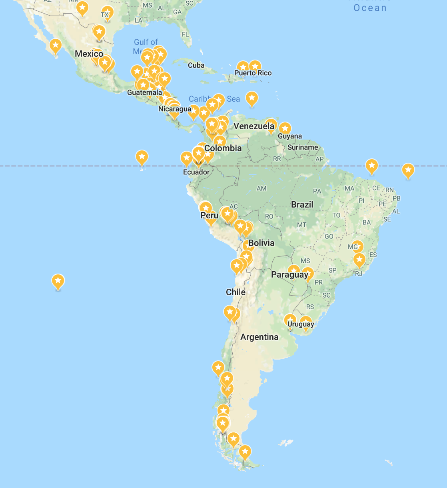
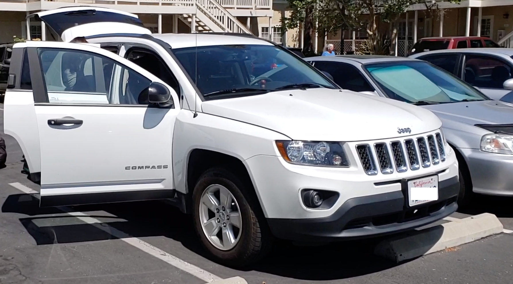

不知道多少年前，有句心灵鸡汤很火，叫“世界这么大，我想去看看”，还有种更诗意的表达，“生活不止眼前的苟且，还有诗与远方”。鸡汤有毒，我从来都是抗拒的，这一次还是被毒到了。既然在美国读书，美国后花园的南美洲就成了去看看的第一选择。在美国生活习惯了自驾出行，更自由更舒适更有安全感。条件允许的话，当然是最优先考虑的旅行方式了。

于是在某个懒散的下午，论文扔到一边，做起了南美旅行的可行性研究。最先搜到是一个华人小伙2008年开一辆1980年的破奔驰用时3个月就完成了整个行程，看起来也没有很难的样子。随着研究的加深，了解到北起阿拉斯加南到智利的泛美公路（Pan-American Highway），全长约30000公里，经过包括沙漠、热带雨林和高山的各种气候带和自然环境。知道了有一种人自称Overlander，热衷自驾横跨大陆旅行。后来上班了，摸鱼的时候就会搜搜世界上有哪些好地方最值得去，比如 [The 25 Places You Must Visit in South America](http://www.worldofwanderlust.com/25-places-must-visit-south-america/)。这样我的Google Map被标成了花。

转眼间就到了三十岁，有种有趣的说法是，治疗中年危机有三板斧： 环游世界，婚内出轨和辞职创业。婚内出轨有贼心没贼胆，辞职创业暂时本事欠缺，看起来只有环游世界更简单一点。环游不了整个世界，1/3个世界还是可以试一试的。路费攒的差不多了，正好也想换个工作，何不来场说走就走的旅行。

## 关于我们

80后老夫妻一对，就叫老牟和小盖吧。老牟理工男一枚，胆大爱冒险，有时候很虎。小盖建筑师一枚，心细有点胆小，但也愿意为了老公的想法做出牺牲。虽然在美国已经有很多次的自驾经历，但没有经过风浪，连换胎都没做过。这一路车一次也没坏过也算是走了狗屎运。非摄影大神，不爱自拍，美景之前，心情好了就用器材拍，懒的时候就眼睛咔嚓几张存在脑子里。总结来说，非常normal的两个人。

## 行前准备

### 行程计划

泛美公路自驾并不是什么新鲜事情，每年都有很多人准备上路或者已经在路上了。网络上可以查到各种详尽的资料。有专门的 [Wiki](http://wikioverland.org/Pan_American_Highway)，还有论坛 [Drive the Americas](https://www.drivetheamericas.com/)。Facebook上也有一个Overlanding the Americas小组。还有很多大神写了详尽的攻略心得，这2个就是目前仍能访问我觉得写的最好的博客。

- 一辆破旧甲壳虫完成行程的墨西哥情侣：[Nomadarte](https://www.nomadarte.com/)
- 驾驶皮卡的纽约夫妇：[Trans-Americas](https://trans-americas.com/)

不过最让我佩服的是这个开了3年多的英国旅行家 [KombiLife](https://www.youtube.com/@KombiLife)，精彩而疯狂的1000天。

我们计划用3-6个月完成14个国家，美国-墨西哥-伯利兹-危地马拉-萨尔瓦多-洪都拉斯-尼加拉瓜-哥斯达黎加-巴拿马-哥伦比亚-厄瓜多尔-秘鲁-智利-阿根廷。如果时间财力允许的话，再加上古巴和巴西。

出发前我们知道这趟行程会有三个大难题。不过想太多的话就永远不可能出发了，走一步看一步，实在解决不了最多半途而废。

**中国护照能否进尼加拉瓜？**

尼加拉瓜一直想要在中国和台湾间左右逢源，所以签证政策从来都不明确。看穷游上很多背包客的案例，有的人成功进了，有的人杯具了。2018年四月开始的持续性抗议活动，加上我们开的是美国车都让事情变的更复杂。尼加拉瓜又是开车穿越绕不过去的一个国家，所以只要还没有入境尼加拉瓜，能否完成整趟行程都充满着不确定性。幸运的是，虽然入境时被百般盘问，还是给我们发了入境签。

**巴拿马到哥伦比亚怎样运车？**

由于种种因素，泛美公路在巴拿马和哥伦比亚间并没有连通，存在一个160公里的Darién Gap。要想通过这个隘口，只能在巴拿马的Colon把车装上集装箱通过货船运到哥伦比亚的Cartagena。人再通过其他办法到Cartagena取车。运车最好能找到同伴共享一个集装箱，这样运费能控制在1100美金左右，否则会超过2000美金。整个运车过程要走过巴拿马海关，巴拿马警察，巴拿马港口，货运公司，哥伦比亚海关，哥伦比亚港口六道手续。而且由于行程的不确定性，如何运车只有大体思路，具体事宜只能路上再安排。

**智利或阿根廷如何卖车？**

等开到美洲最南端，我们大概也没有精力和财力把车再开会美国。车是乞丐车，运回美国也不划算，最佳方案就是在智利或者阿根廷就卖掉。至于卖给谁，怎么卖就只有等到最后再说了。

### 疫苗
黄热病疫苗是必备，怕死的可能还可以打其他的吧。不过黄热病疫苗在美国全国缺货。能打的一个替代品，加上咨询费什么的要接近400美金每人，简直是抢劫。最后我们在哥斯达黎加打的疫苗，每人只要100美金。

### 必装App
iOverlander：之前的Overlander们关于路线，露营，出入境等经验资料分享。

Maps.me: 没有网络时很好用的导航软件，有些路线比Google Map还准，还有非常准确的爬山路线。

Duolingo: 语言学习工具。除巴西外的所有国家都说西班牙语，对于两个西班牙语零基础的人，能学一点是一点吧。

### 签证
作为中国公民的大问题就是到哪里都需要办签证，在过去进入这一路的每一个国家前都需要先解决签证，而签证的处理时间的不确定性也会极大的增加旅行时间。幸运的是从2016年开始，中南美的国家逐渐发开了签证要求，现在大多数国家凭借美签就可以直接进入。

美签

十年旅游签证最好。我们持有美国绿卡，有些国家的官员开始不懂，不过也都在请示过上级后算美签放我们入境了。除了危地马拉，萨尔瓦多，尼加拉瓜，玻利维亚，阿根廷和巴西外，其他国家凭美签都可以畅通无阻的。

危地马拉

危地马拉入境需要同时有美签和危地马拉签证。我们提前在墨西哥城申请到的危地马拉签证。

萨尔瓦多

之前穷游上看到很多中国背包客只持有美签也成功入境了，不过都是做大巴。我们也就单纯的以为不用额外的签证。没想到入境时被怼了回来，要求同时有美签和萨尔瓦多签证。最后从一个没有immigration office的路口非法偷渡进去了，不过出境时就遇到了麻烦。结果我们出境不久，中萨就建交，不知道现在还需不需要额外的萨尔瓦多签证。

尼加拉瓜

需要美签，同时中国公民还需要办在口岸落地签。

玻利维亚

入境时需要100美金每人的落地签，据说如果提前在第三国的大使馆申请的话只需要30美金。

阿根廷

凭美签或申根签证可以网上申请阿根廷十年电子签证（AVE）。等我们到智利准备申请的时候，才发现它严格限制美签必须美国B2签证。我们只好在阿根廷驻智利大使馆申请纸质签证，没想到在第三国只拿到了严格限制起始日期的单次签证，导致我们最后我们的行程只能结束在距离乌斯怀亚三个小时车程的智阿边境。

巴西

出发前在洛杉矶申请的五年签证。

### 资金消费
自费。我们两个人都不喜欢穷穷穷游，给这趟旅程的定义是轻奢蜜月游，虽然已经结婚两年了。路上主要以性价比高的酒店，民宿和青旅为主。也准备迫不得已的情况下露营。穿越落后的中美时都没有露营过，于是进入南美后就主动丢弃了所有露营装备。预算是平均每天不超过200美金，包括吃穿住行玩等所有花费。

由于墨西哥和中美洲都不算太平，我们随身只带少量现金，另外取了1000美金现金分成5份藏在车上的不同的地方以备不时之需。在治安较好和热门旅游点基本以信用卡为主，Chase Sapphire Reserve是我们的主力信用卡，消费不收国际交易手续费（foreign transaction fee）。单独新开了一个Schwab Bank High Yield Investor Checking账户里，补充现金的话至少Charles Schwab一方会reimburse ATM手续费。最后算下来，这一路总共省了几百美金的手续费。

### 车
我们驾驶一辆2014年产美国加州牌照的Jeep Compass，前驱乞丐版。之所以称之为乞丐版，因为它不仅非四驱，没有定速巡航，刹车防抱死等功能，连车窗都是手摇的，装普通四季胎。不过鉴于以前的overlander有开28年老奔驰的，有开甲壳虫的，至少我们的车底盘高，车况新。当然如果有条件能开一辆四驱真SUV的，还是能大大增加遇到复杂路况时内心的安全感的。

