2018年7月1日-2018年7月7日

路线：洛杉矶 (A) - 凤凰城 (B) - El Paso (C) - Marfa (D) - 圣安东尼奥 (E) -休斯敦 (F) -Laredo (G)

行程：3509公里

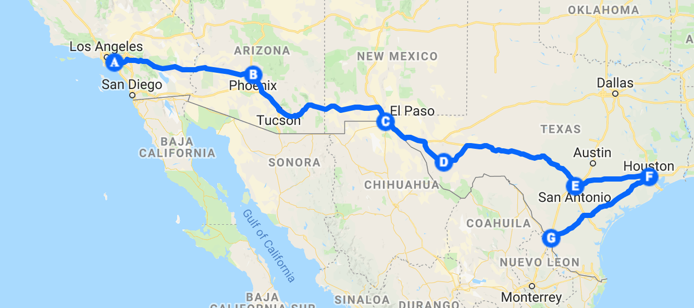

经过四天从早到晚的收拾，终于把住了两年的小家清理干净。家具早就被我们含泪赔本大甩卖了，剩下这么多年积攒的全部家当装了18个箱子搬到租的storage。

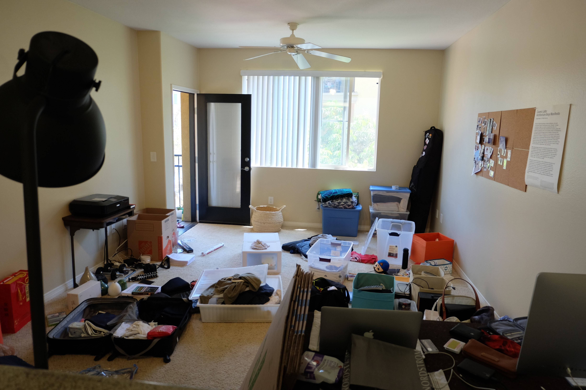

7月1日，一个阳光明媚的早晨，我们整装待发。

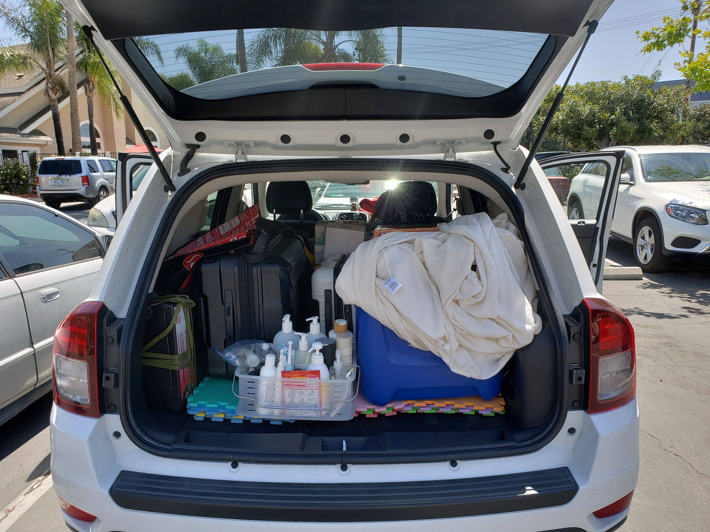

## 第一站 凤凰城
小盖作为一枚建筑师，每到一个城市，必先把当地的有特色的建筑搜出来，然后一一去探查。这样就开启了我们的凤凰城建筑之旅。这些景点都分布在凤凰城以北2个小时的车程内，每个点都很有特色，但不大，所有打算一天就全部参观完。

**Arcosanti**

建筑师保罗·索莱里建造，位于凤凰城以北的沙漠之中，是为了示范人类可以在尽量减低少破坏环境的前提下改善自己的居住环境。

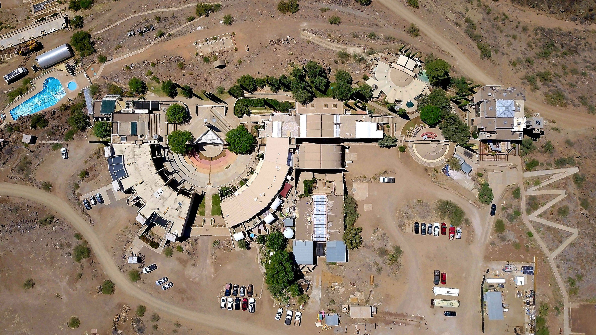

**Montezuma Castle National Monument**

一个保存了印第安人遗迹的国家公园，因为天气酷热，有没有太多可以看的，我们大概一个小时就走马观花的游览完。

**Chapel of the Holy Cross**

位于Sedona小镇的天主教堂，被选为亚利桑那州7大人造奇迹之一。

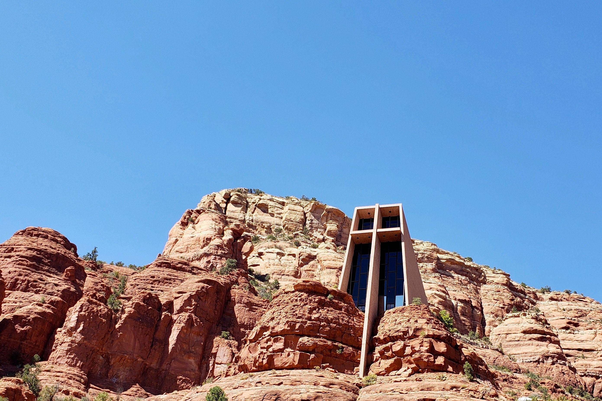

**Taliesin West**

大建筑师Frank Lloyd Wright的冬日住所，当然必须要来打一个卡。很可惜等我们下午5点回到凤凰城郊的时候，已经早早关门。我们只好在外侧远远观摩一下，希望以后能有机会进入一睹真容。

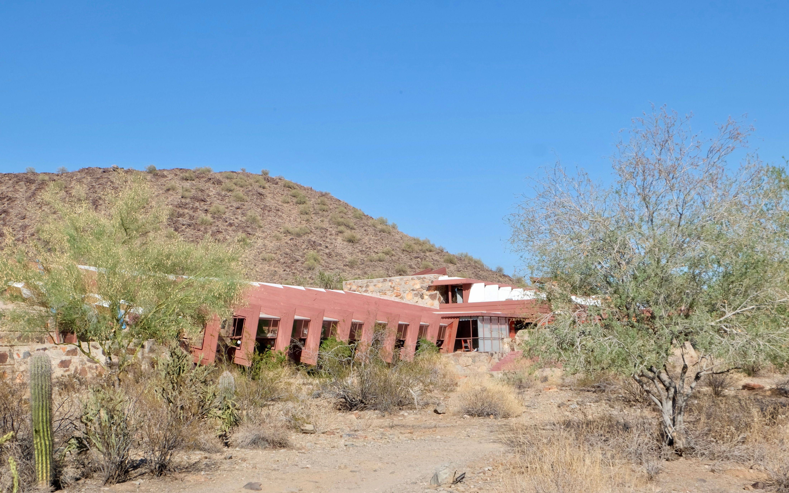

准备离开时已经下午六点多了，之前的计划对于行程过于自信了，这时才意识到距离晚上要入住的El Paso还有8个小时车程，只好开启疯狂赶路模式...

## 第二站 Marfa
早晨起来在El Paso吃完一顿正宗但非常油腻的墨西哥早餐，再开3个半小时就来到的德克萨斯州的Marfa。Marfa位于荒漠中，远离大城市和主要的交通路线，是一个以当代艺术出名的艺术小镇。因此虽然有点绕路，我还是要来探访一下，尤其要去Prada Marfa店照个网红照。

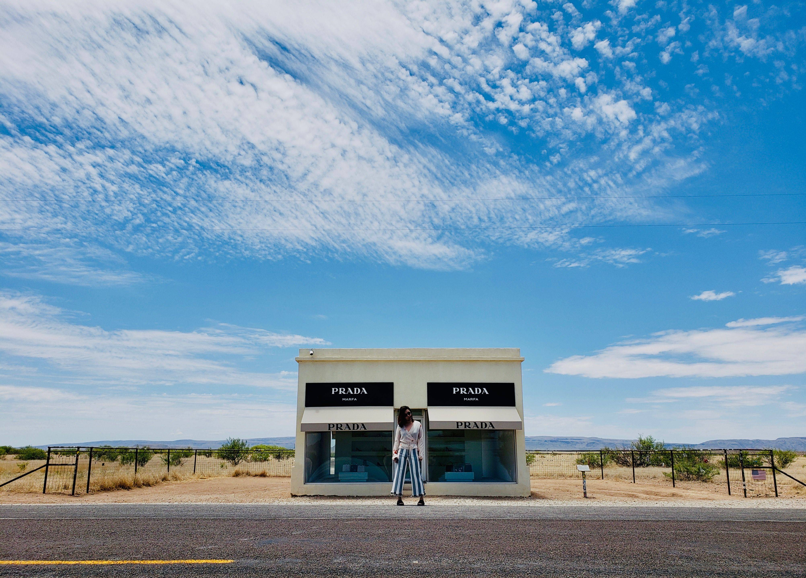

Marfa每年迎接着上万世界各地的艺术家和游客，但即便如此，听说过Marfa的人还是寥寥无几。如果不是著名艺术家Donald Judd，这座小镇早就在70年前死去了。Marfa是一个典型的美国西部小镇，就一条主路进出，总过只有2000居民。感觉除了酒店和饭店，剩下的全是Judd基金会的产业和展览馆了。不过既然以旅游和艺术为中心，这里的酒店和餐厅的素质还是可以的。

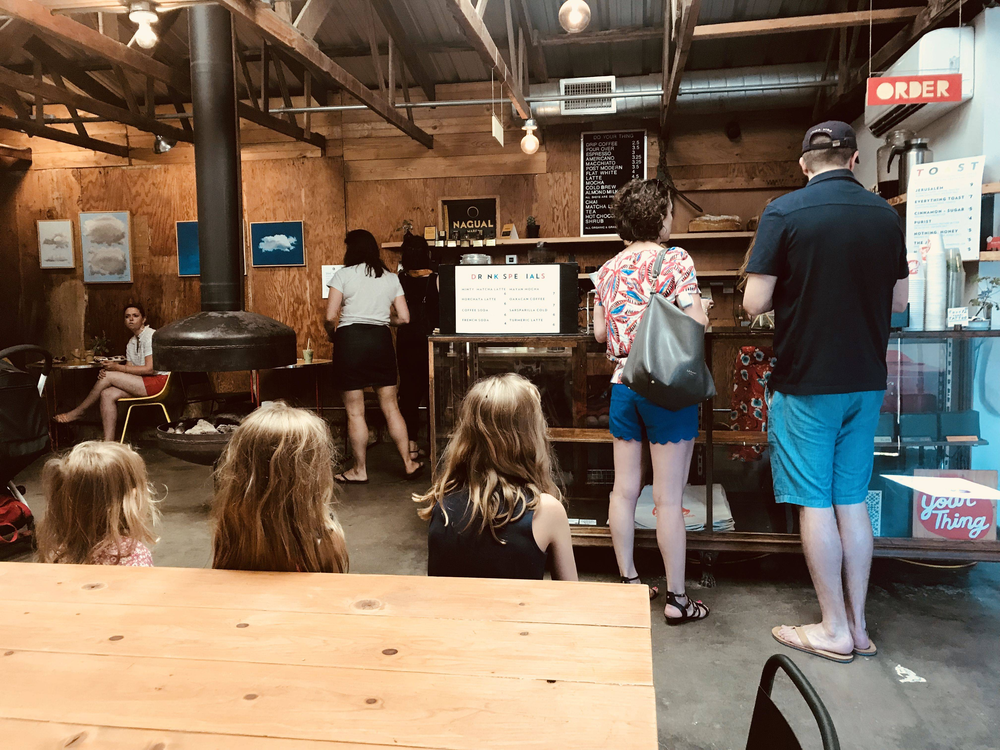

## 第三站 圣安东尼奥
过去这么多年一直都没机会来德州三角的三个著名城市走一走，这次去墨西哥就正好顺路领略一下南部城市的风采。没有什么特别的安排，只是简简单单去地标建筑打打卡，逛逛城市的博物馆。

**San Fernando Cathedral**

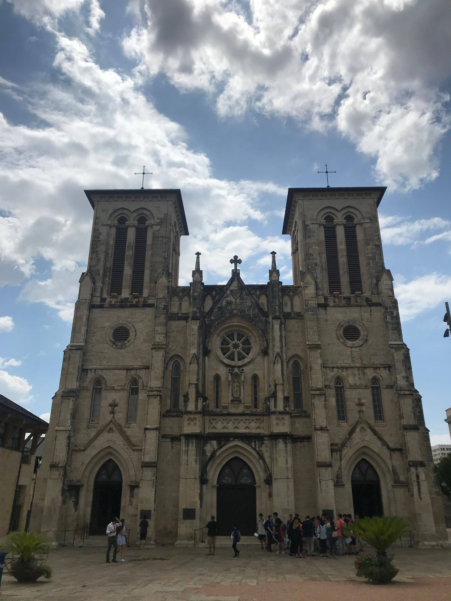

**San Antonio Missions National Historical Park**

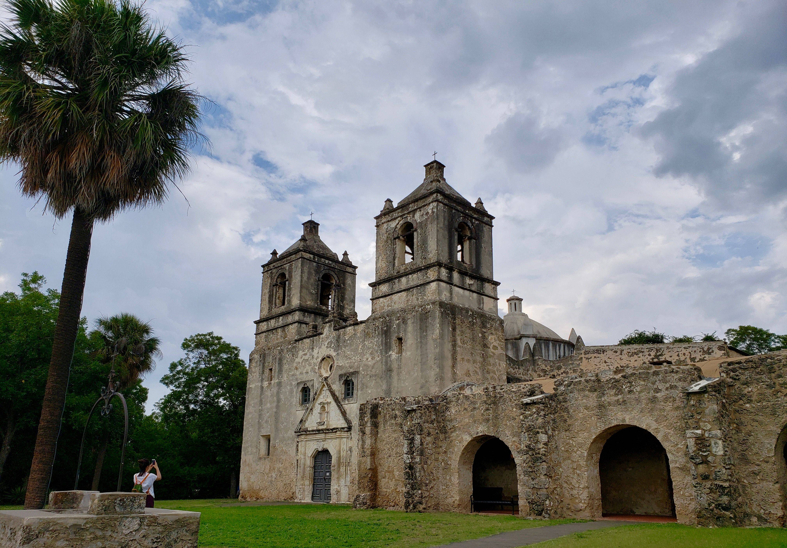

**The Alamo & San Antonio River Walk**

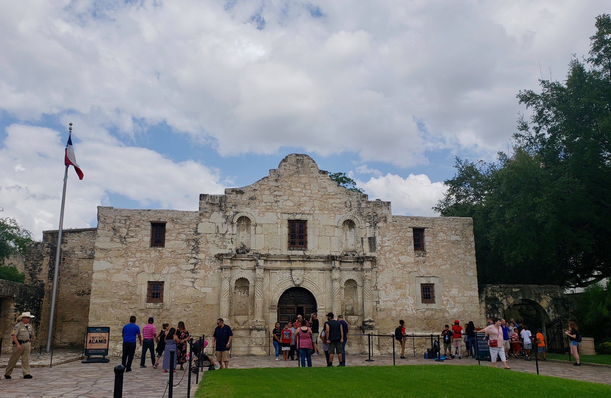

**Pearl Farmers Market & Camden Street Riverwalk Bridge**

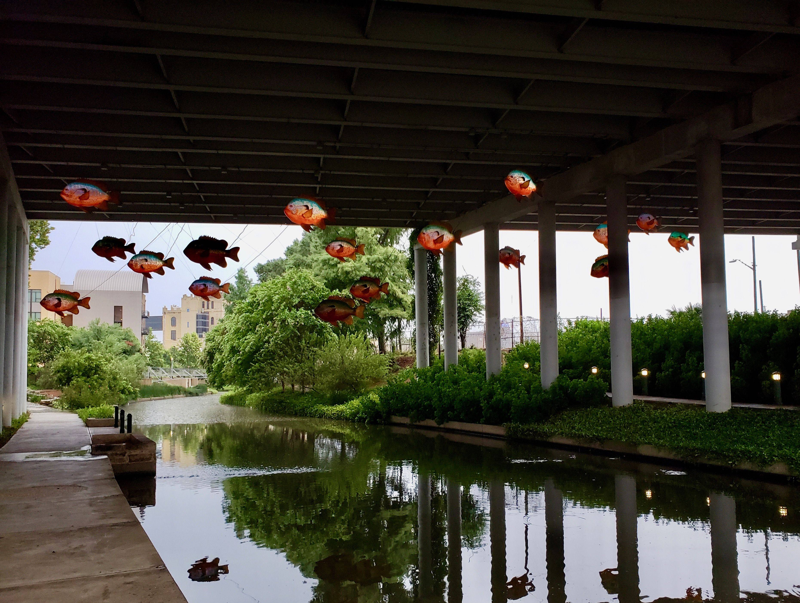

## 第四站 休斯敦
**The Museum of Fine Arts**

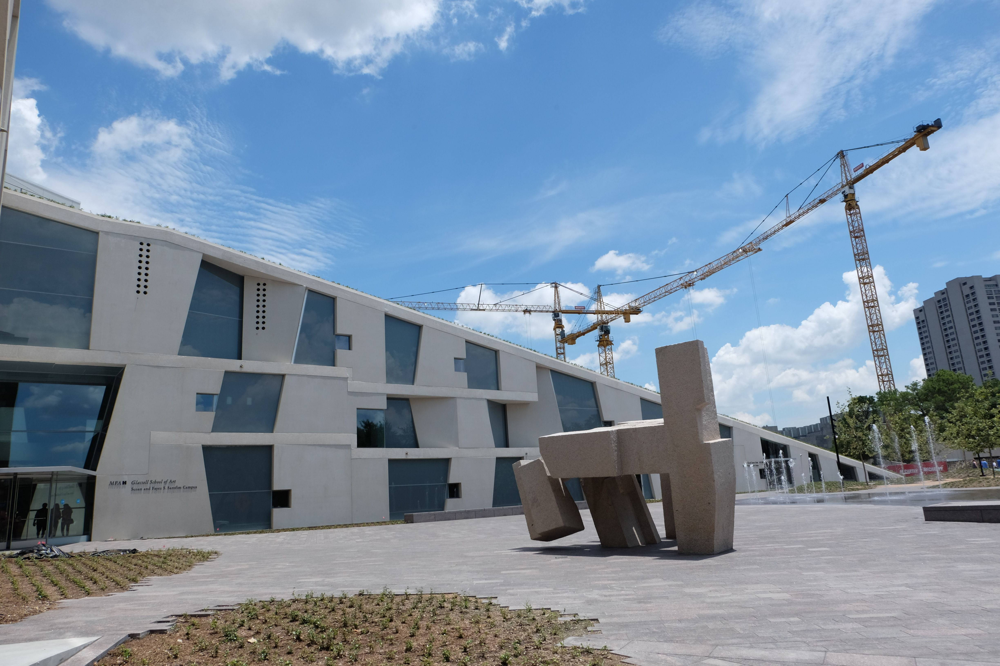

**Twilight Epiphany Shkyspace**

位于Rice University内。

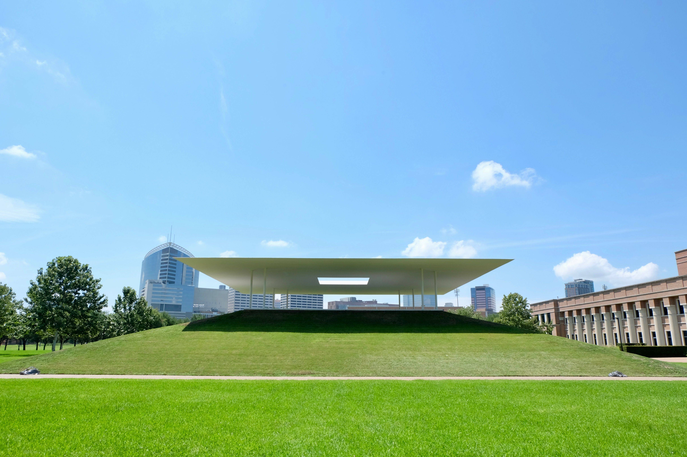

**Chapel of St.Basil**

位于University of St. Thomas内

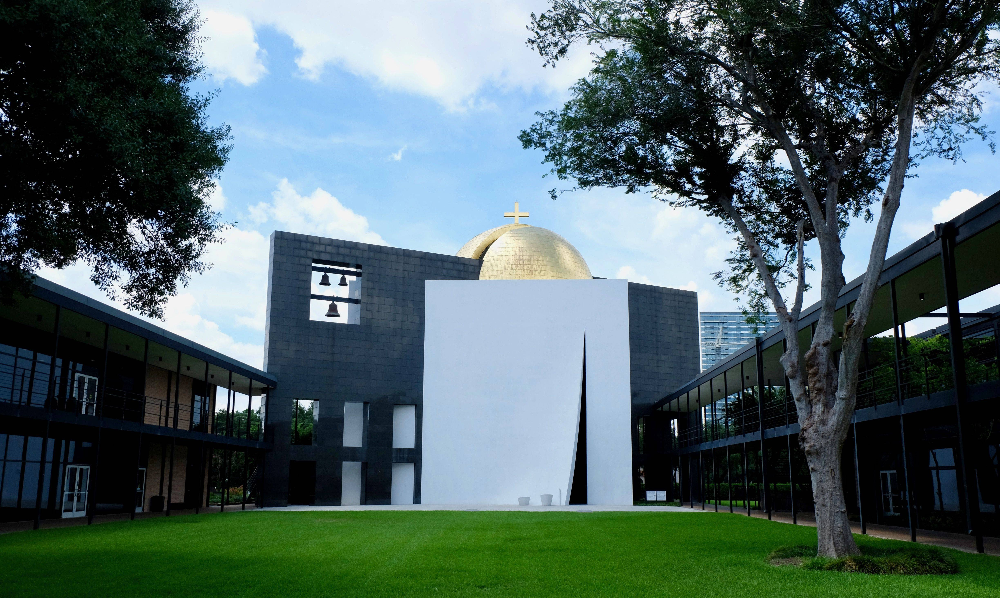

**The Menil Collection & Rothko Chapel**

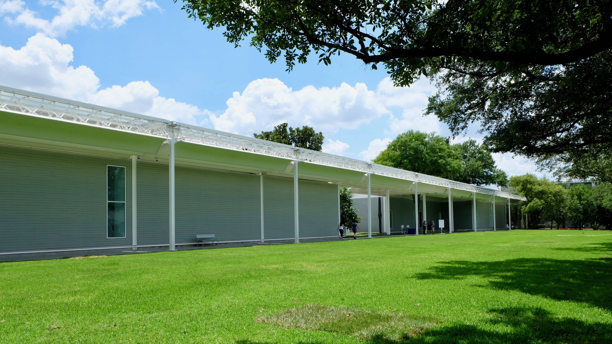

## 写在美国最后
在美国的一个星期波澜不惊，算是在冒险之前最后享受一下现代化的生活。我们也从失业的小慌乱中渐渐镇定下来，开始享受旅程。选择从德州的Laredo入境，主要是因为我们（小盖）畏惧于墨西哥恶劣的治安状况。从Laredo入境只用开两个半小时就可以到达墨西哥一个大城市Monterrey，大城市总是有相对安全的区域的。而大部分美洲overlander们都是从San Diego南部的Tijuana入境的，然后开到Baja California半岛的南部，再乘坐大概20小时的轮渡到墨西哥的大陆部分。听说那20个小时的轮渡可不好受，未来有想探索一下的同学最好提前做好心理建设。
