2018年7月8日-2018年7月26日

路线：Nuevo Laredo (A) - Monterrey (B) - Guanajuato (C) - San Miguel de Allende (D) - Mexico City (E) - Coatzacoalcos (F) - Zona Arqueológica Palenque (G) - Mérida (H) - Tulum/Cancun (I) - Chetumal (J)

行程：3912公里

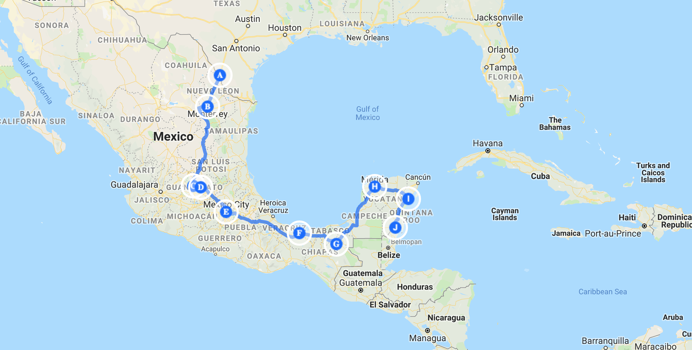

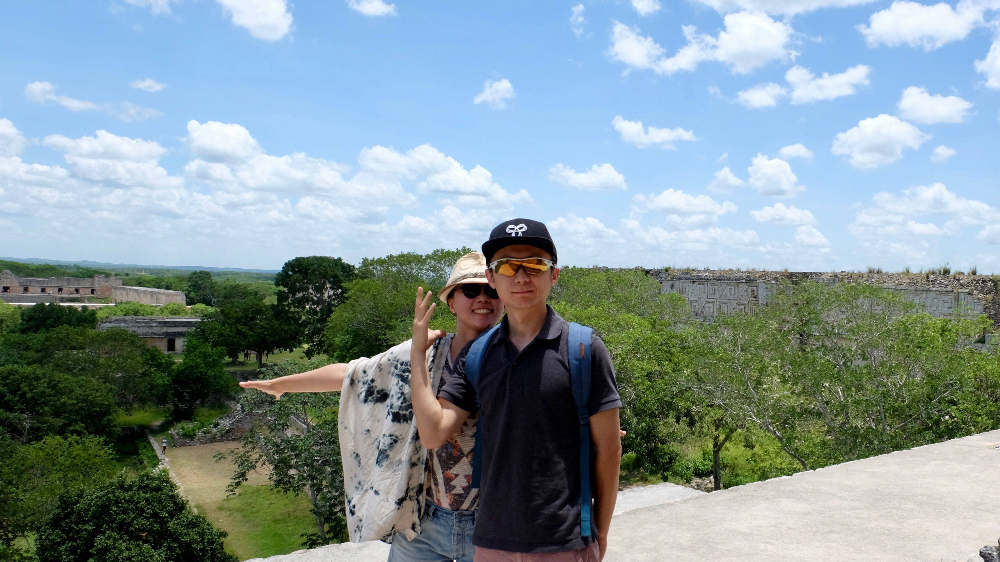

## 入关
进入墨西哥第一天的计划就是入关加上从圣安东尼奥到Monterrey 5个半小时的车程。为了减少墨西哥一侧边境停留的可能性，我们提前在美国一侧吃饱午饭，加满油，补充好水和零食。因为美国的边检只严查进入美国的车辆，所以我们美国牌照的车往墨西哥方向行驶时，美国边检完全没有任何检查。而对面返回美国的车则需要排着长长的队伍等待安检。

我们出发之前并没有对入关墨西哥做任何研究，猜想美墨边境应该有比较常规的流程，挨着美国一侧的墨西哥官员应该也会说英语。我们只需要看好指示牌或者跟着工作人员引导，就不会有什么大问题。

尤其我们前面正好是一辆美国牌照的车辆，我们就更安心了，只要跟着它办手续就可以了。哪里想到，前面的德州车完全没有停，直接就开了过去。我们猜想大概墨西哥这一侧的边境城市是什么free zone，方便美国人过来购物, 过了free zone就会有边检站了吧？我们也就没有停下来问一问，跟着前面的开了进去，整个过程中没有看到任何指示牌，也没有任何官员出现拦下我们。于是我们就高喊着Hola! Amigo！稀里糊涂的冲进了墨西哥。

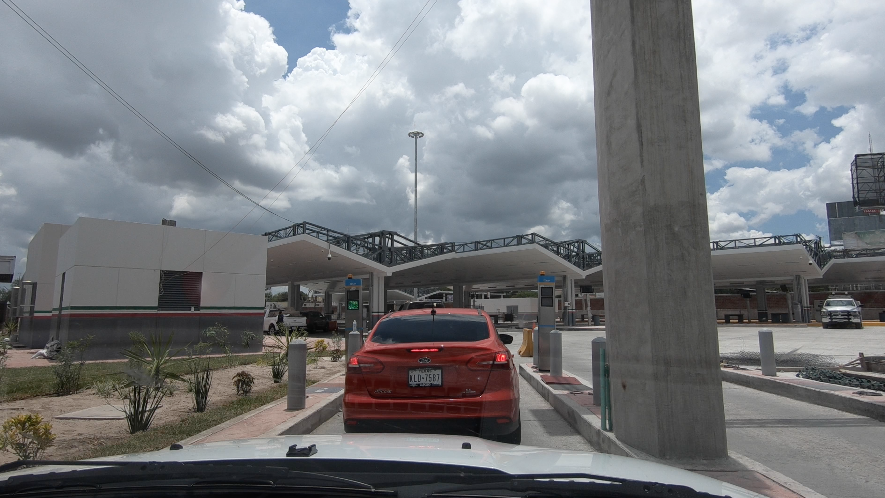

果然一进墨西哥，景观就完全发生变化，两边到处都是一幅破败的景象，道路的状况也不容乐观，到处都坑坑洼洼。好在手机导航没有问题，在边境小城残破的道路上开了20分钟后就上了直通Monterrey的高速公路。

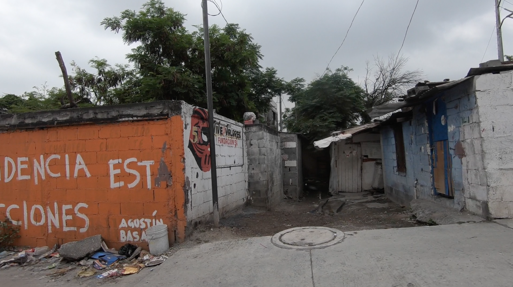

然而等到开了一个小时后遇到第一个收费站的时候，仍然还没有遇到任何边检站，我们才意识到大概错过了什么。等我们到了Monterrey上网一查，才知道需要自己停下来去旁边的一个小房子办签证以及车的Temporary Vehicle Importation Permit (https://www.mexpro.com/mexico/vehicle-import-permit.html)，还要交$400的押金。但又懒得再开两个半小时回边境办手续，索性继续我们的行程，看看能不能到墨西哥城再补办手续。所以理论上讲，我们属于非法入境墨西哥。

入境后一个小时左右会有一个收费站，这里就遇到了第一个麻烦。由于我们没有提前换一些墨西哥比索，无法交费。收费小妹虽然和我们完全无法交流，但是肯定是认得美金的。我们身上没剩其他小额美金，一张5美金不够，最后交了一张$20才放我们过去。好在到Monterrey之前就再没有遇到其他收费站了。

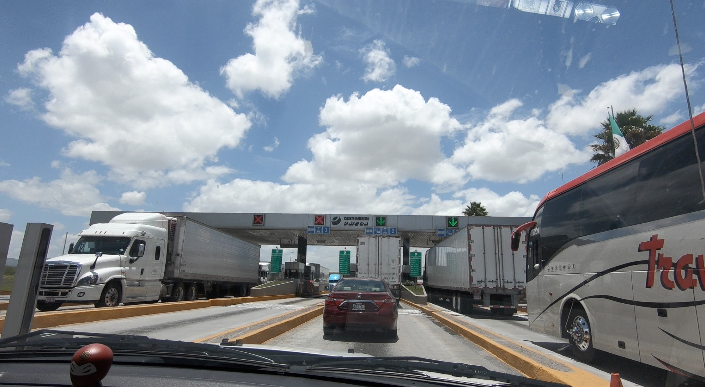

## 第一站 Monterrey
Monterrey是墨西哥较为富裕的并且非常美国化（Americanized）的一个城市。我们只安排了两个晚上。到的第二天起来吃上一份仙人掌早餐，然后花一天时间逛一下几个著名的景点。所有西班牙殖民城市都是以一个正方形或者长方形的广场为中心发展的，所以大部分景点如大教堂，博物馆，市政中心等都在中心广场Park Macroplaza附近。除此之外，还有Park Macroplaza附近的人造河Santa Lucía riverwalk和可以俯瞰整个城市的Palacio del Obispado。整体上感觉是个低配版的圣安东尼奥。

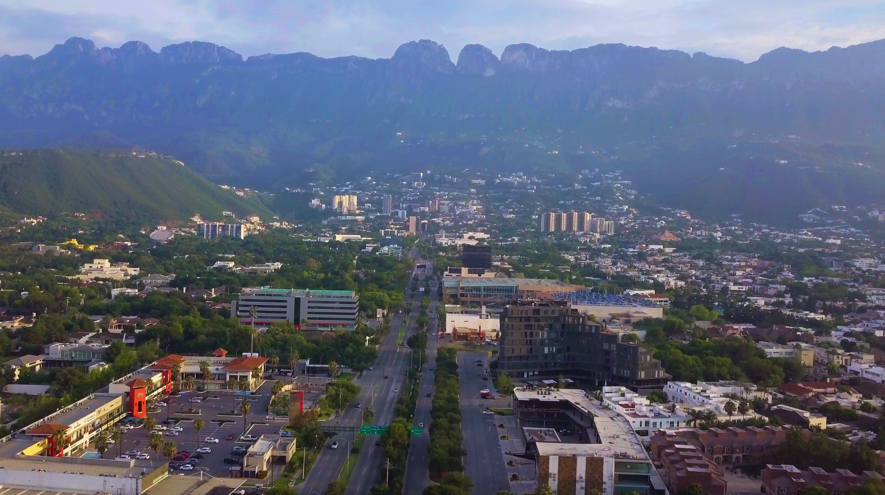

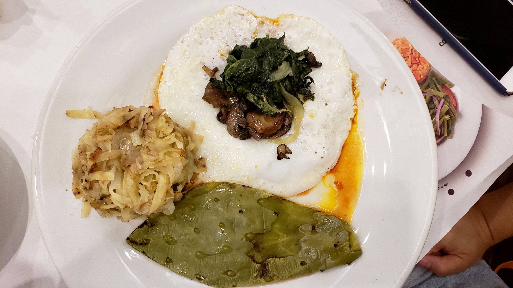

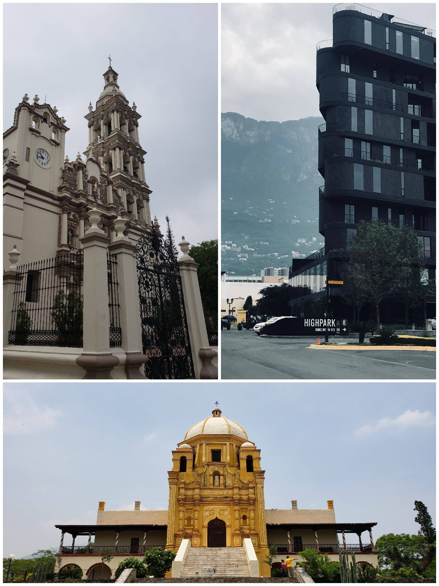

## 第二站 Guanajuato & San Miguel de Allende
从Monterrey到Guanajuato是大概8个小时的车程。我们在出发之前就听说过墨西哥警察腐败问题严重。传说他们的惯用伎俩之一就是给游客开高额罚单，然后以没收车或驾照的方式索要现金。今天是开一整天车，所以一路开车都很小心翼翼，任凭周围墨西哥人的车如何呼啸而过，我们都是压着限速开，生怕给警察找到借口。不过在一条州道上还是不能避免的被一个Federal警察给pull over了。Federal警察不像state police和municipal police，属于比较正直的，把我们pull over只是因为没有看到我们的Temporary Vehicle Importation Permit（理论上好像是一张大纸，贴在车窗上的）。在费劲的Google translate沟通后，友善的让我们到Mexico City去补手续，就放我们走了，也算是有惊无险。拜拜时我们又秀了一下Glacias, Amigo。

Guanajuato是位于墨西哥中部的一座小小山城。整个城市静静地卧在一个山谷里，放眼望去尽是七彩缤纷的民居延伸至山顶。虽然离墨西哥首都Mexico City只有三个小时的车程，这里丝毫没有现代城市的影子，房屋、道路、商铺还都带着原始和古朴的韵味。进入Guanajuato之前，车子在山路上攀缘了几个小时，最后在穿过一条隧道之后，正式抵达。隧道更像是时空转换机，眼前重见天日的一瞬间，仿佛时空穿越，老式汽车，石砖布道。没有玻璃幕墙，没有交通指示灯，却也不见车人抢路，所有人都配合着周围节奏，调整步伐，或走或停，井然有序。原来，在那个纷纷扰扰，步履匆匆的大都市外，真的还有这样的一个地方，遵循着生活本该有的节奏和秩序，悠然悠然。

按照导航寻找我们预定的Airbnb，车子七拐八拐的在小巷子里穿梭，却很久都找不到目的地，因为Guanajuato的道路系统一部分是蜿蜒在民居和山坡上的街道，还有一部分是忽而就探入地下的街道。这些地下街道错综复杂的布满小城中心，交织着与地上系统衔接，用于分散流量。比起城市里郑重其事的隧道入口，车子总是在不知不觉中开进这个“地下城”。这座“地下城”也没有因为不见天日而被敷衍，它的每一段都由石砖垒成，可以看见它的肉，更可以看见它的骨，完美又有韵律。顺着它的结构一路看过去，不知不觉又回到地上，支撑拱的柱延伸着成了一座桥的墩，链接两侧的行人。可见这一上一下两个系统咬合多么紧密。这样复杂的系统不知是该归功于当年设计师的巧思，还是世世代代居民的智慧。

我们Airbnb的房东Alex，是一位定居下来的法国年轻人，热情好客。即使在预定的时候已经看过了房子的照片，但在跟着他穿过涂着彩霞颜色的楼梯，种满了鲜花的小路，踏进房间的一刹那还是兴奋起来。油画一样的满山遍野的彩色房子就在眼前。拉开玻璃门，就等于完全置身于城市上空。更加能够体会，那些旅途中的人为何会那么笃定的留在一个地方，从游客变成这里的人。

待放下行李，夜色已经微微晕染了天边，小城中心却依旧热闹非凡。墨西哥人对于生活的热爱早有耳闻，似乎他们在世界的形象就是拿着吉他唱着歌儿。在小城最大的广场上，就有一群可爱的大叔，盛装唱歌跳舞。他们是真的开心，你能从歌声中感受到，更能从眼神里看到。说是广场，这里的视野其实并不开阔。广场由一圈树围绕，这些树都已成年，彼此枝桠交错，树叶侧面和底部离地7 feet的部分都被修剪整齐，顶部也一并修剪，好让更多的阳光渗透下来。远远看去就像是悬浮在广场上空的绿色hallow duct。它既为广场上的人提供了阴凉，也在树下提供了更加私人的空间，同时也将广场中央的音乐过滤掉。

在Guanajuato第二天，大概是这里大学Universidad de Guanajuato的毕业日，难怪前一天来的时候特别的堵。墨西哥的年轻人哈韩，又很少见到亚洲人。因此在我们围观他们的时候，也被围观了。好几波学生都拉着我们合照毕业照，也让我们享受了一下当明星的感觉。

Alex给我提供详细的用餐建议，我们停留的时间比较短暂，没办法一一尝试过去。在El delicamitsu吃了日式bento，并不惊艳，但让久别亚洲餐的我们吃的很舒服。晚餐的是Los Campos。算是墨西哥风味的豪餐了，以前还真没有吃过这样水准的墨西哥菜，价格虽然不低，但如果以美国的价格体系来算还是物超所值的。

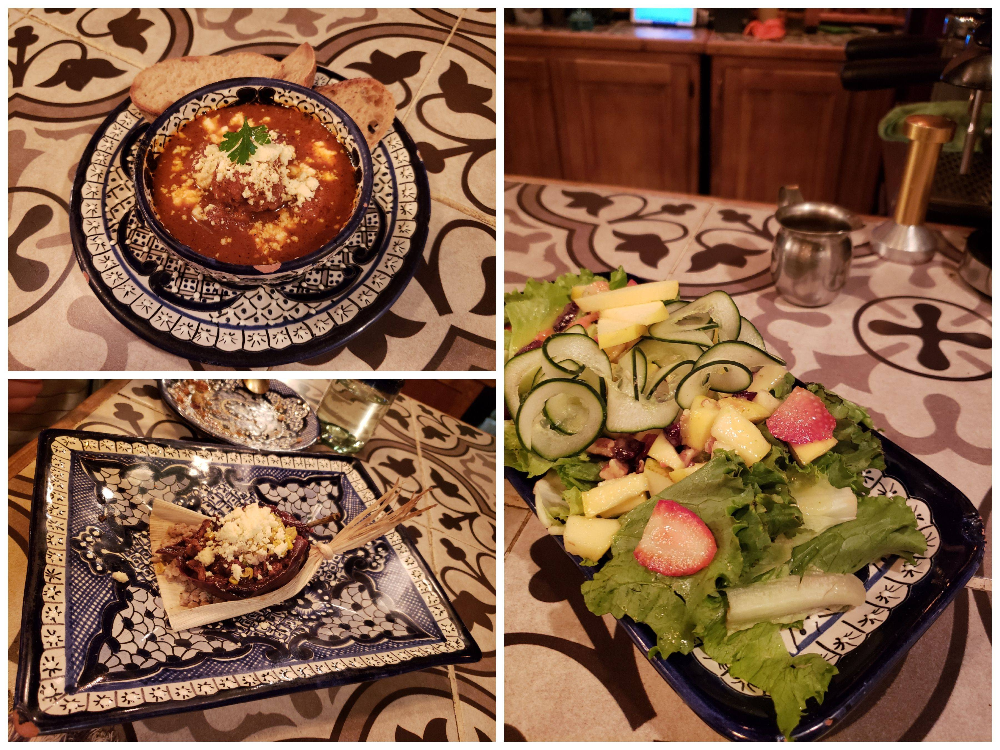

离开Guanajuato的下一站是San Miguel de Allende。距离Guanajuato仅1个半小时的车程，从这里再去往Mexico City也仅仅需要3个半小时，所以我们可以利用白天的时间游览一下。San Miguel又是一个漂亮的小城，有和Guanajuato一样的老街道，中心广场，和一些天主教堂。这里曾经差点成为ghost town，在艺术家Stirling Dickinson的努力下， 现在成为一个以艺术教育，旅游和养老为主的城镇。据说很多欧美人退休了会来这里买房子住，所以不论商店还是餐馆，对英文的支持都比Guanajuato要强的多。

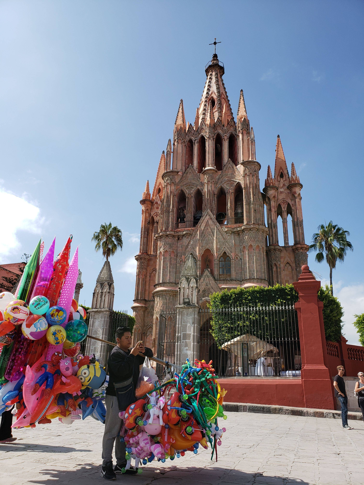

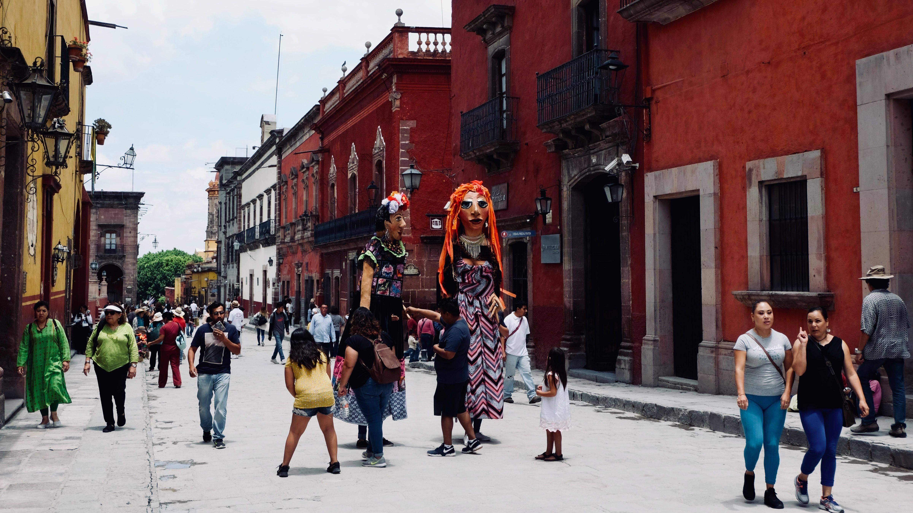

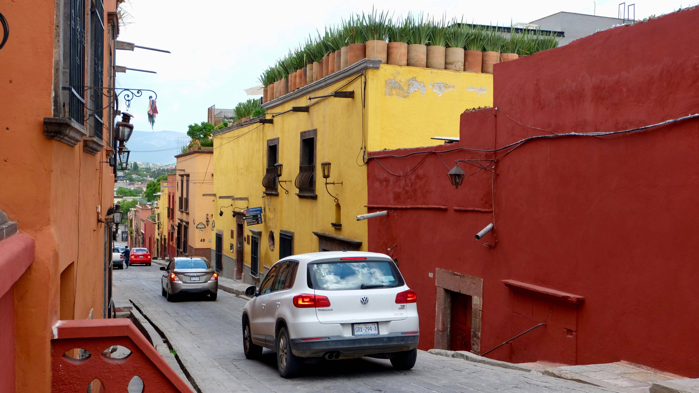

## 第三站 Mexico City & Puebla City
当天晚上，我们开进Mexico city后直奔机场，尝试解决一下我们非法入境的问题。我们想的是第一步需要先补办tourist card，然后拿着证明我们合法身份的旅行卡去城里的税务部门Servicio de Administración Tributaria（SAT）办理车的TIP。最终事实证明我们还是太naive了。机场一侧的尽头有一个immigration office，可以补办tourist card，人还不少。移民官先让我们填个表，然后把我们在墨西哥的行程用email发到他们的邮箱。但真开始处理的时候，才注意到我们是陆路进入，当天并不飞走，所以没法办理。因为只有离境的当天才能补，让我们等离开墨西哥时在相应的boarder处理。好吧，那我们就只能安心当我们的非法移民吧。

虽然我们的Airbnb定在了墨西哥城较为富裕的区域，但毕竟后备箱装着全部家当，对车的安全问题还是比较担心的。我们租的Airbnb房间没有停车场，车只能停在了公寓楼下的街边。在来之前，公司一位墨西哥通就提醒我：如果停车的时候有人可以帮忙看车问你要钱，一定要满足，“because they might be the one who take care of the car, or the one carjackes”。 于是我们当即决定，“收买”隔壁饭店的看车大叔为我们照看四天。我们先给了大叔 50比索，相当于2.5美金，作为见面礼。从此以后，无论我们出门还是回家，大叔都会跑上来热情的跟我们打招呼，有一次还送了我们面包。每天会发信息提醒我们出门小心行李，有事儿找他。当然我们中间又补了一次小费。

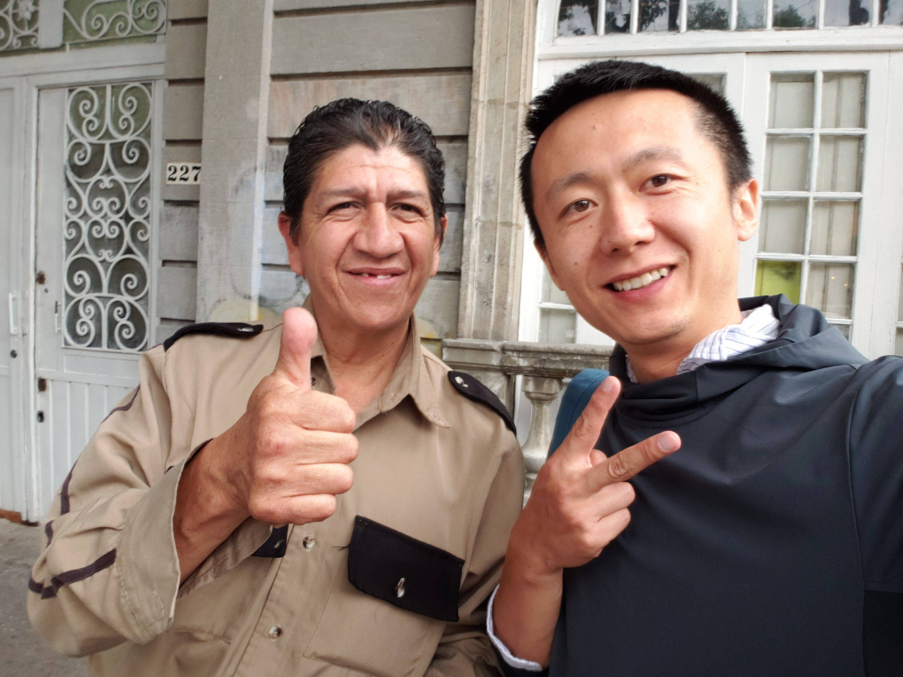

在墨西哥城的第二个任务是危地马拉签证。材料很简单，就是护照及复印件，绿卡及复印件，银行visa卡及复印件一份，墨西哥tourist card及复印件，2寸照片，25美金，行程单以及相关机票酒店预定单。虽然我们是打算陆路进入，但是免去必要的麻烦，还是网上定了可取消的机票酒店。但问题是，我们没有墨西哥的tourist card，所以不知道能不能办成。危地马拉使馆办公室里总共就3个人，工作人员检查了一下材料说办不了，于是找来大使解释。我们心理其实已经准备好飞回美国再飞回来拿一张tourist card了。大使人很好，但刚开始也是不肯通融，最终在我们的连番恳求下，网开一面，给了30天的单次签证，不过下不为例。所以在西语世界任何事情都是可以商量的。心头一块大石头落地，终于可以轻松的探索一下墨西哥城了。

墨西哥城是墨西哥首都、人口密度最大的城市、千年历史。一看这些要素就知道这是一个社会结构极其复杂的城市。大大小小的社区，不同背景的人群，就像是一幅清明上河图一样在几天内高密度的在眼前铺开。大树下皮肤粗糙的买手工艺品老婆婆，地铁里手臂纹着一朵玫瑰穿着时髦的妇女，在她怀里熟睡的可爱男孩儿，衬衣熨烫平整袖扣精美坐在西餐厅里的中年男人，还有一群群韩范儿打扮听着kpop跳舞的少男少女。很难从形形色色的人群中分辨出哪些是当地最典型的居民，因为在这个城市里似乎一切存在都合理。

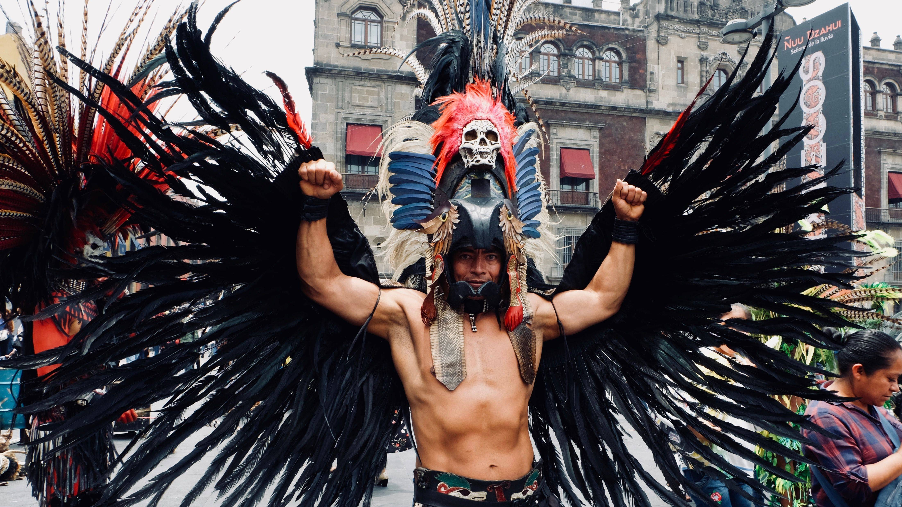

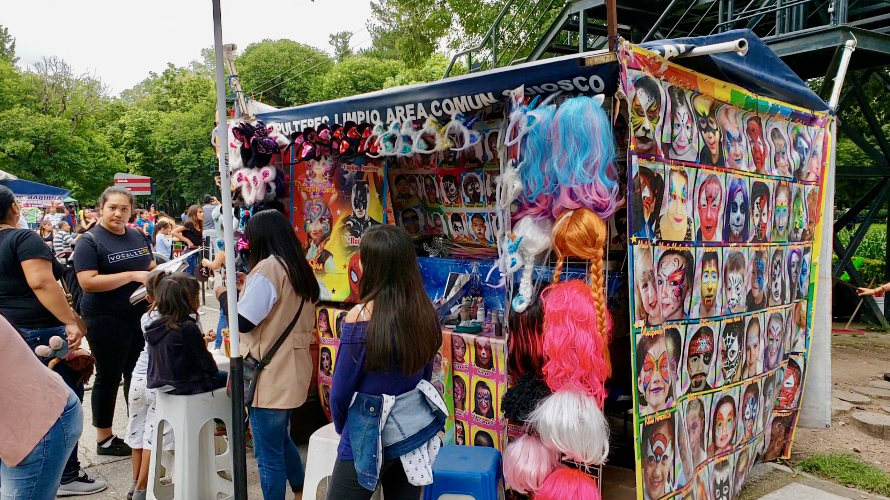

游览这样一个城市少不了从各种古迹，教堂，广场，历史及文化博物馆开始，所有的景点基本上围绕着一个广场Historic center of Mexico City和一个公园Bosque de Chapultepec，也算是西班牙殖民城市的典型特征吧。

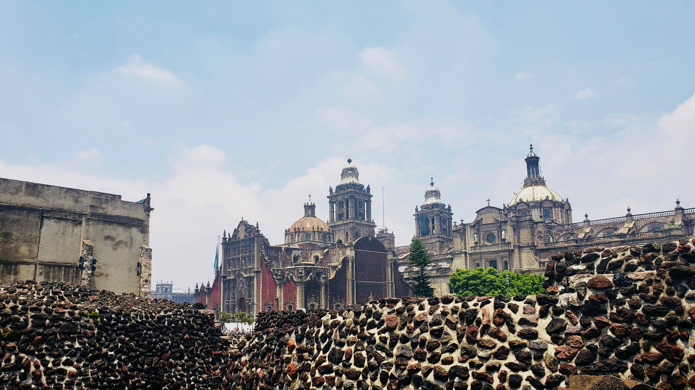

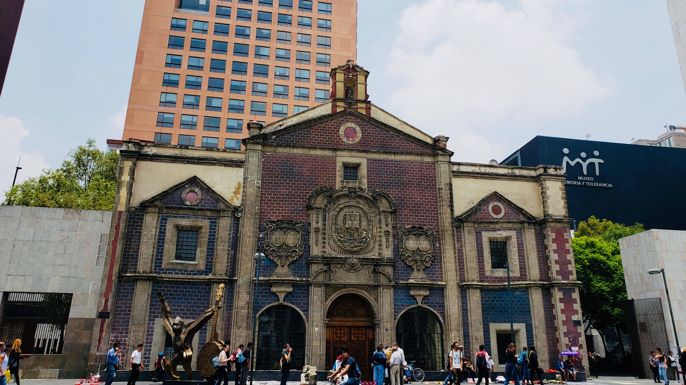

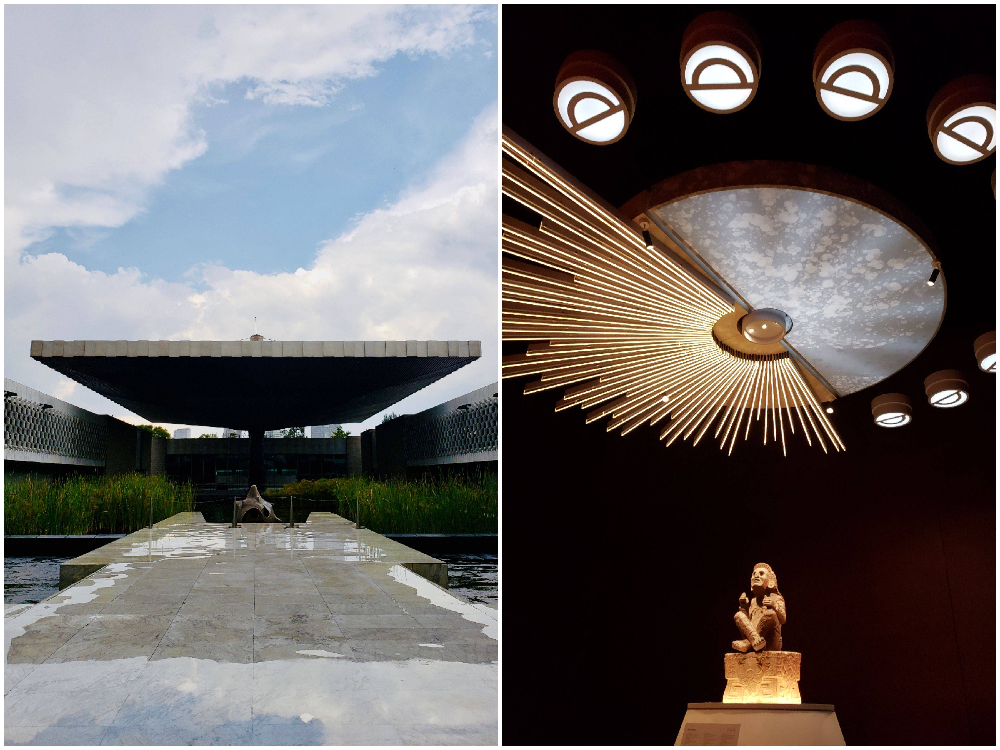

除了这些典型景点，作为建筑狗的小盖还有特别的游览名单，那就是墨西哥建筑大师Luis Barragán的家及一系列作品，比如Luis Barragán House and Studio，Casa Gilardi和Torres de Satélite。其中Casa Gilardi是Luis Barragán给一个朋友设计的家。没想到现在这个朋友把自己的家也开放给游客参观，自己当导游。300-400比索一个人，只收现金。想要照相？再交500比索。算一算一个月能赚不少钱呢。

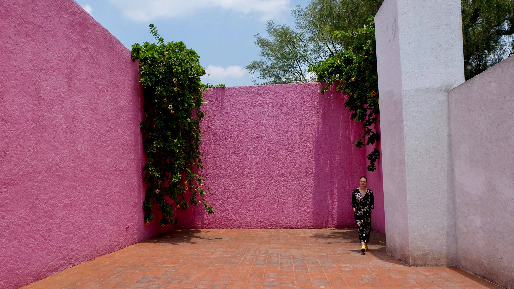

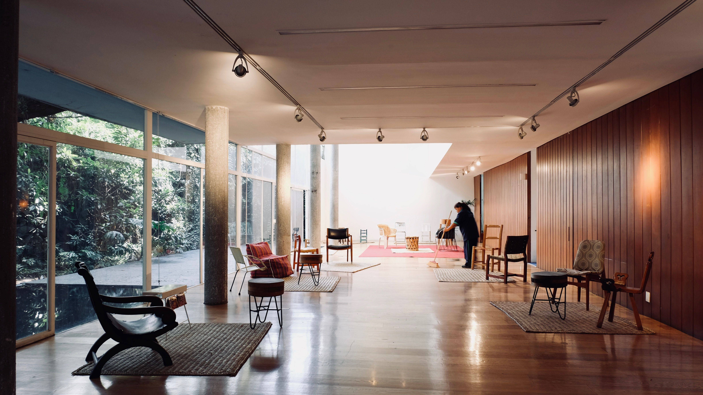

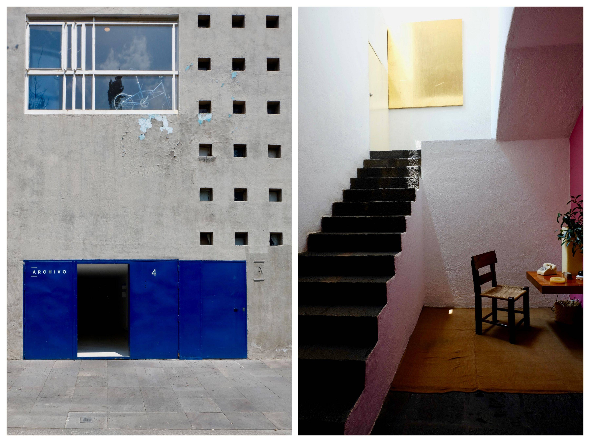

在墨西哥人所有的特质中，最让人喜欢的是他们热爱生活的天性，这一点并没有淹没在拔地而起的摩天大楼里。走过任何一家门口，都会看到生机勃勃的盆栽。周五下午的公园里，已经积满了带着孩子休闲娱乐的年轻父母。似乎大家的生活就是简单的上班回家，欲望不高，负担也就不重。能有时间带着老婆孩子在公园里嬉闹，能为家人买得起一餐晚餐就足以让他们满足和幸福。这一特点极大的影响了这里的建筑形式。墨西哥的建筑体量小，造型简单，但是却一定是用色大胆，不是在外墙，就一定是在内部。且用色大多明亮鲜艳，就连美术老师一直告诫慎用的紫色，在这里的建筑也随处可见。难怪当地人总是一脸今天有好事发生的表情，看着这些五颜六色的房子，怎么能够不开心？

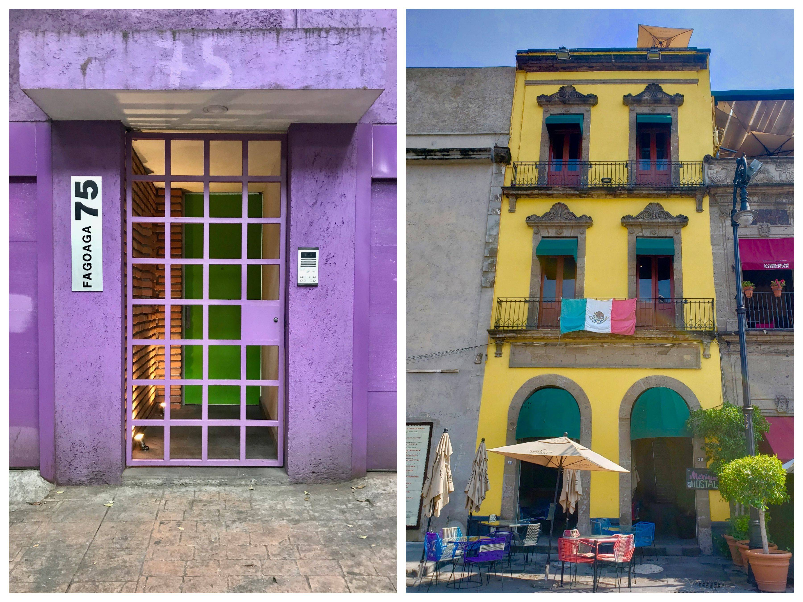

小盖建筑师的职业习惯，每到一个地方，第一个先看的是设计是否符合规范。多年的工作经验已经练就了近乎生理反应式的提问：Is it ADA compliant? Is it up to code? 而大多数情况下的答案都是“不”。显然，墨西哥建筑规范比美国要宽松的多，这就为大量新鲜的设计提供了自由的土壤。许多美观但是容易造成隐患的细节都得以在这里生根发芽。原因，大概是墨西哥人民觉得，比起三天两头的诉讼，他们更愿意自己在使用中稍加注意，进而享受设计带给他们的愉悦感吧。

**Biblioteca Vasconcelos图书馆**

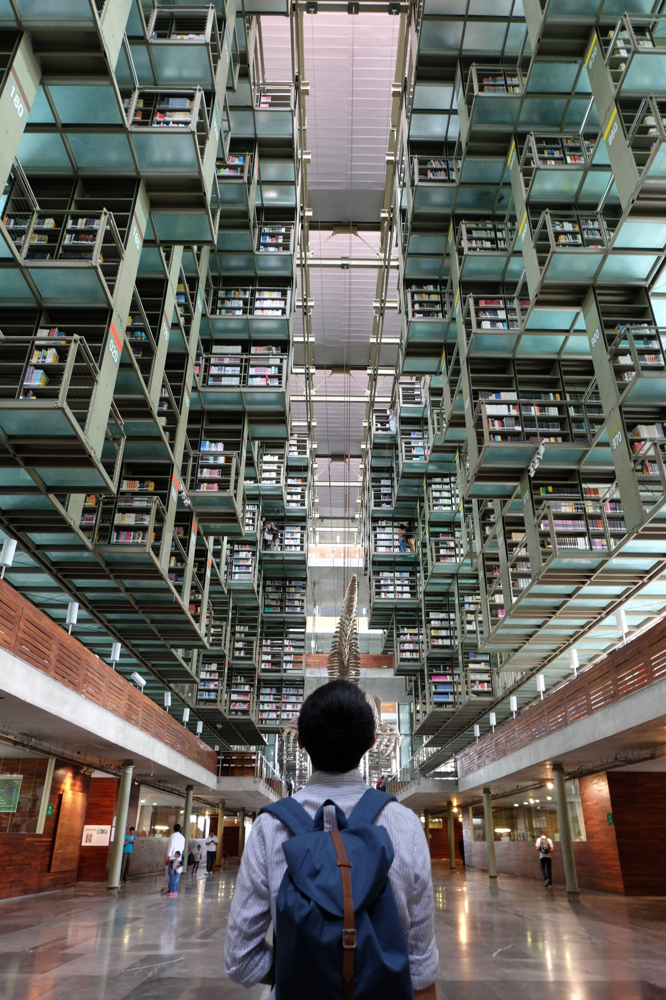

**墨西哥城补遗**

墨西哥城的道路非常狭窄，道路设计有时候脑洞清奇，让在中国和美国道路体系训练下的我们有时候摸不着北。可能由于发音问题，GPS报的路名和看到的路名经常对不上号。发展中国家的司机开车又自由奔放，所以进城后出门就不开自己的车了，以打Uber为主。反正Uber很便宜，去的地方5美元以内都能搞定。在打不到Uber的时候也尝试了地铁，价格表看不懂，以为5比索一站地，没想到是5比索随便坐。地铁没有空调，完全靠开窗通风，看来便宜有便宜的道理。人多加上墨西哥胖子也多，每次都被挤扁在地铁里......

离开洛杉矶后就再没吃过中餐，这时候我们对家乡的味道已经如饥似渴了。而墨西哥城也许是接下来很长一段的日子里唯一可能吃到较正宗中餐的城市。所以离开之前我们一定要吃一顿好的中餐，不计代价！网上搜到的很多一看就不靠谱，还是靠在墨西哥华为工作过的同学推荐才找到一家叫一品居的（Londres 114, Juárez, 06600 Juárez, CDMX, Mexico）。据说是华为前食堂大厨出来开的，现在号称华为二食堂，味道正宗，大大缓解了我们的中餐焦虑。

**Puebla City**

墨西哥城附近还有一个历史名城叫Puebla City，处于墨西哥城东南2个半小时的车程的位置，正好在我们去往下一站的路上。我们打算花半天的时间的游览一下，毕竟天主大教堂已经看的有点审美疲劳了，然后会辛苦点开六个小时到晚上的落脚地Coatzacoalcos。没想到在快要进Puebla City的收费站时，由于只有我们一辆车非常显眼，被一对城市警察(Municipal police)盯上了，也就遇到了预期的腐败警察。他们也不着急，慢慢悠悠追上来，我担心他们说我超速，没敢开太快。就这样在只有两条道的城市高速上被pull over了。应急车道窄到约等于没有，因此负责扮红脸的年轻胖警察上来找我说话，马上会负责扮白脸的白胡子老警察先负责指挥后续车辆避让。估计猜测我们美国来的车不会有保险，先是问我们有没有车保险，没想到我们还真买了。于是直接编造法条说由于我们后备箱用布遮盖行李，妨碍检查，要开罚单。这样想要钱的意图就很明显了。套路都是先要驾照，这样可以以此为要挟。网上看到的经验是坚决不能给原件，我就先给了复印件，混不过去只好给了原件（后来发现欧洲来的overlander都是制作了几十张假驾照以防万一）。老警察拿着我的驾照佯装要开罚单，年轻警察当然提出会帮我们，不用去警察局，当场付100的罚金就行。我还想他们还真不贪心，100比索不算贵，我们不那么讲原则，给就给了。因为没有零钱，就拿了200比索。没想到他们狮子大开口要的是100美金，那就逼我们只剩玩赖一条路了。“我们没钱，出门都用信用卡，只有这200比索”。唱白脸的老警察威胁要扣驾照扣车，带我们去警察局处理。随便！年轻警察提出可以降价到500比索。还真是一个唱红脸一个唱白脸的老把戏。因为对这个事情早有预期，我们开车出行的时候，大额现金都是藏起来的。我就从车里又拿了50比索加一把硬币，声称只有这些钱，要不只能去警察局了。两个警察很无奈的把钱全收了，连硬币都不放过，才放我们离开。据说只要你足够耐心，完全不露财，一直耗下去一分不给也是可能的。

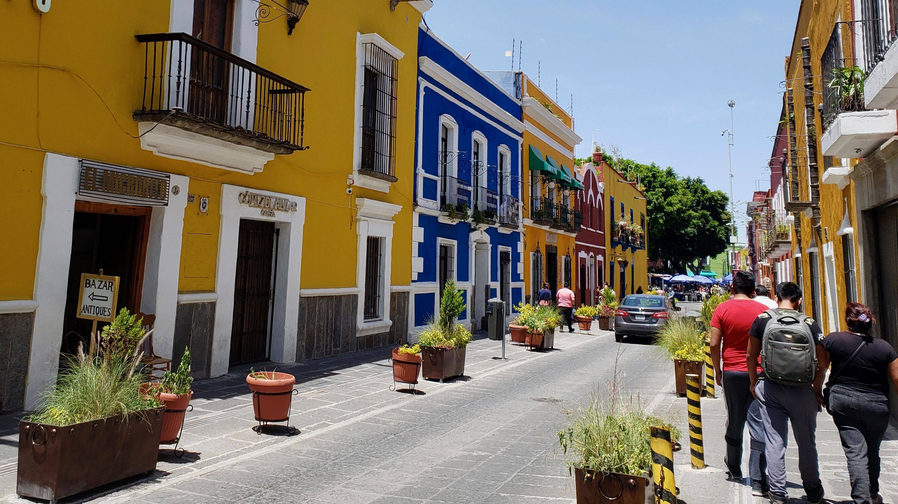

## 第四站 Zona Arqueológica Palenque
Palenque位于墨西哥南部，在任何一个玛雅金字塔must see名单上都是名列前五的。不过远离主要的旅游城市，无论到墨西哥城还是坎昆都要10-11个小时的车程，非墨西哥的游客相对较少。金字塔旁的小镇以旅游业为主，所以不管住宿还是吃饭都质量好价格实惠，晚餐一条烤鱼一盘虾两杯果汁400比索。

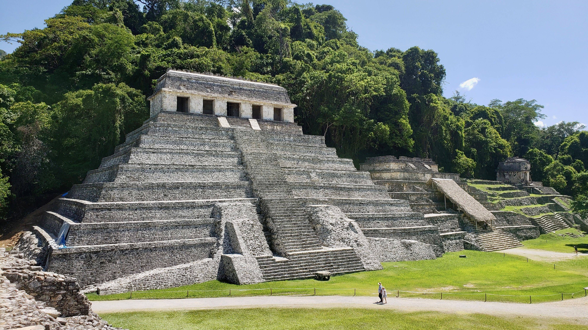

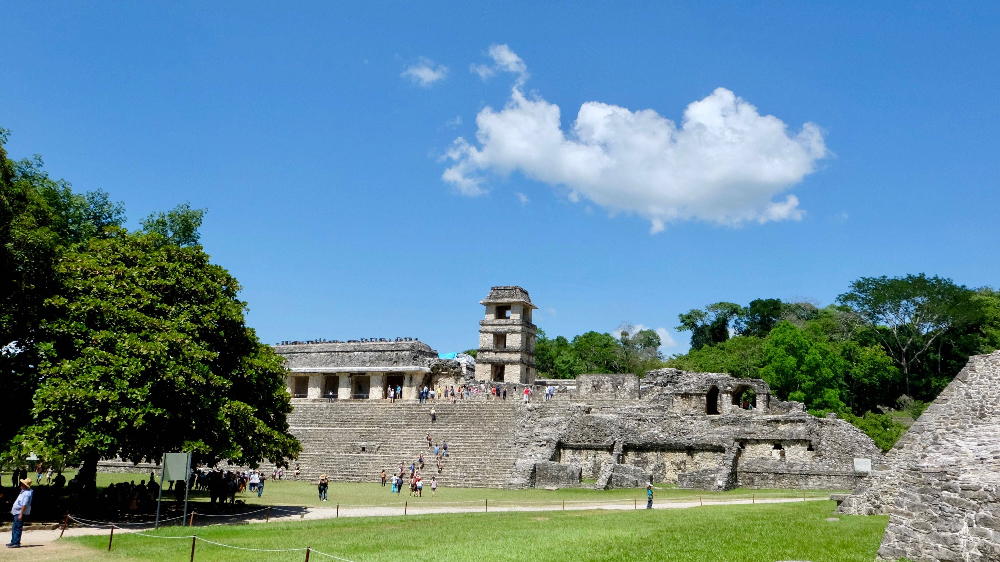

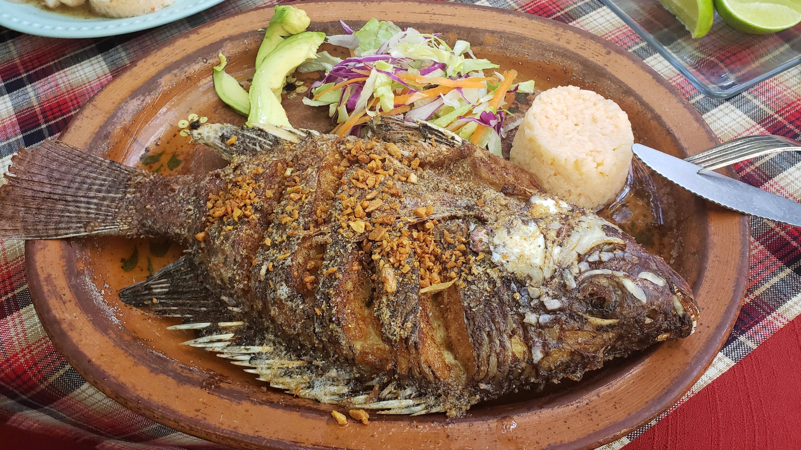

## 第五站 Península de Yucatán
Península de Yucatán是我们在墨西哥行程的最后一站。这里的几个主要城镇Merida，Cancún，Tulum都属于发展极其成熟的旅游区了，伙食，住宿和消费水准都达到发达国家的水平。虽然自驾还要小心腐败警察，打车要小心出租车司机，但治安基本不用太担心。我们也就从冒险模式切换为旅游放松模式了。  

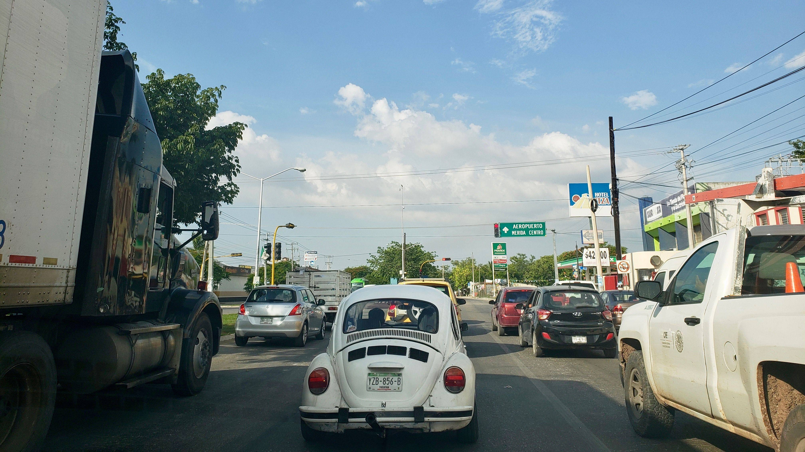

从Palenque到到Merida是7个半小时。途中加油的时候遇到了第二种经典的墨西哥事件了。进入墨西哥之前，听墨西哥通同事说，加油付钱的时候要一张一张数好，否则会被换钱。在我们的前移动支付时代，国内这种事情也不少见的。我们这一路过来加油都很顺利，也就逐渐放松了警惕。巧的是，之前加油从来都没有录过像，这次想起剪辑视频需要录了一下，就留下了珍贵的视频资料。加油前只剩1格半油，预计要加600多比索的，没想到加到440多就停了。我以为只是加油口卡了一下，没加满而已。也懒得用翻译软件继续沟通，算算油够开到目的地，就准备付钱走人。从包里抽了一张500的付钱，付的时候很随意。加油的人回头了看一下油表，然后给我一张50比索的钱，指着油表说着西班牙语。我听了半天终于听懂是cincuenta（50），再看到他还给我的钱，第一反应是给错钱了，于是又拿了一张500付给他。小盖说她拿的是500啊，而且包里也只有500的，让我看看有没有掉在座位上。这时候我们突然意识到不对了。就说算了吧，语言也不通，就当花$25美元买个经历和教训。等我们在旁边停车上厕所时突然想起正好录像了，骗都被骗了，就研究下被骗的过程。虽然录的角度不是很好，当把视频从GoPro下载到手机上放大并慢放时，正好有一个很短暂镜头清清楚楚捕捉到了500。虽然钱肯定要不回来了，但很不爽，一定要找他的领导说道说道，给骗我们钱的老墨找点不痛快。我就在加油站里挨个房间找人。这是个新建的加油站，既没商店也没办公室。在我就要放弃的时候，换钱的老墨也许看到我们逗留这么久还不走自己心虚了，迎了上来。既然找不到manager，那就先和他说到说到。也不知道他有没有听懂，但意识到被录了现行，大概不想为了这点钱惹不必要的麻烦，勉强抵赖了一下，就把多收的钱退给我了。

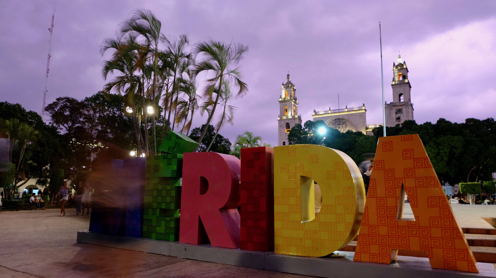

**玛雅遗址**

Península de Yucatán 保存有众多重要的玛雅遗址。Uxmal位于Merida南部一小时车程的地方，是我们打卡的第一个遗址。其中的Pyramid of the Magician 尤其著名。遗址不大，一个上午就能逛完，要小心踩到满地的大蜥蜴...…

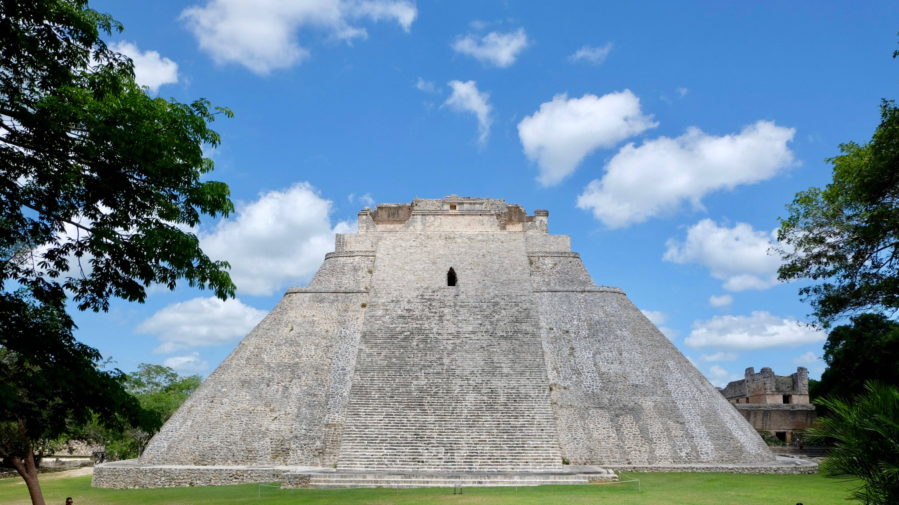

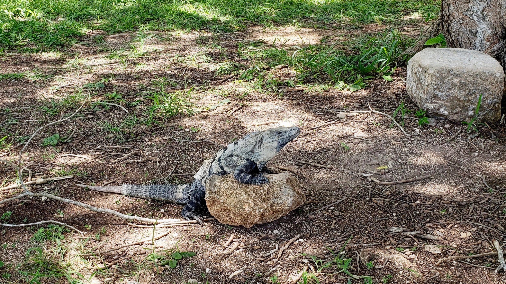

Chichén Itzá是墨西哥最赫赫有名的玛雅金字塔，是一定要去的景点。在Merida东面一个半小时车程的位置，我们开往Tulum的路上就可以顺便探访一下

没错下图左下角就是我们的中国旅行团了，亲切ing。团里一个妹子格外引人注目，因为肤白高挑头上还带着花环。走进一看，脸上的妆服服帖帖，假睫毛稳如泰山！这真的不是黑她！要知道这时候40度+，站着不动汗可以从鼻尖滴下去浇花，别说粉底，防晒都融掉了。所以说那些旅游还可以发美照的妹子，为了她们的毅力也要点赞啊！

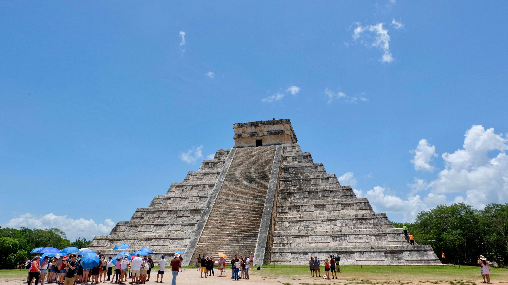

这个区域参观的第三个金字塔群就是Cobá了。他的主金字塔是为数不多在这个级别仍然可以攀爬的金字塔，当然金字塔的保存状态不容乐观了。

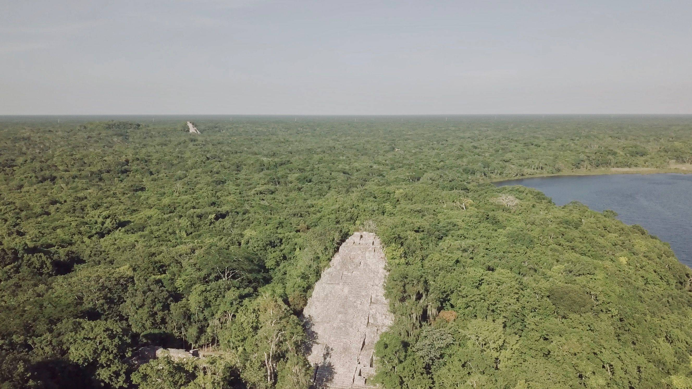

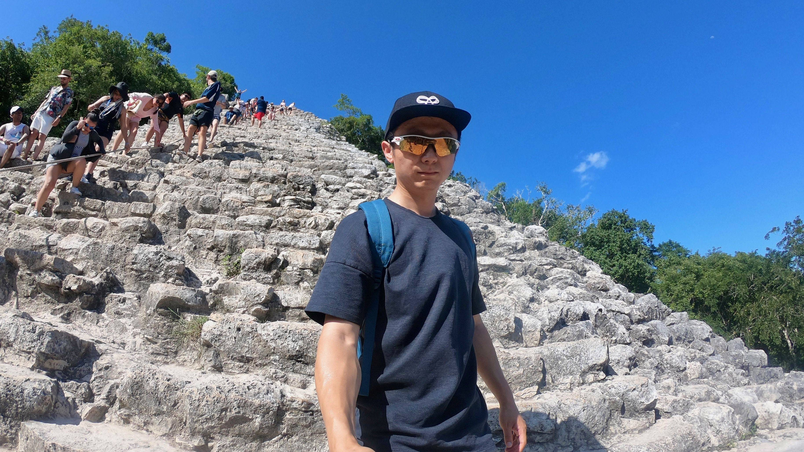

Tulum玛雅古建筑群壮观地矗立在尤卡坦半岛东海岸的悬崖上，是玛雅人建造和居住的最后几座城市之一。

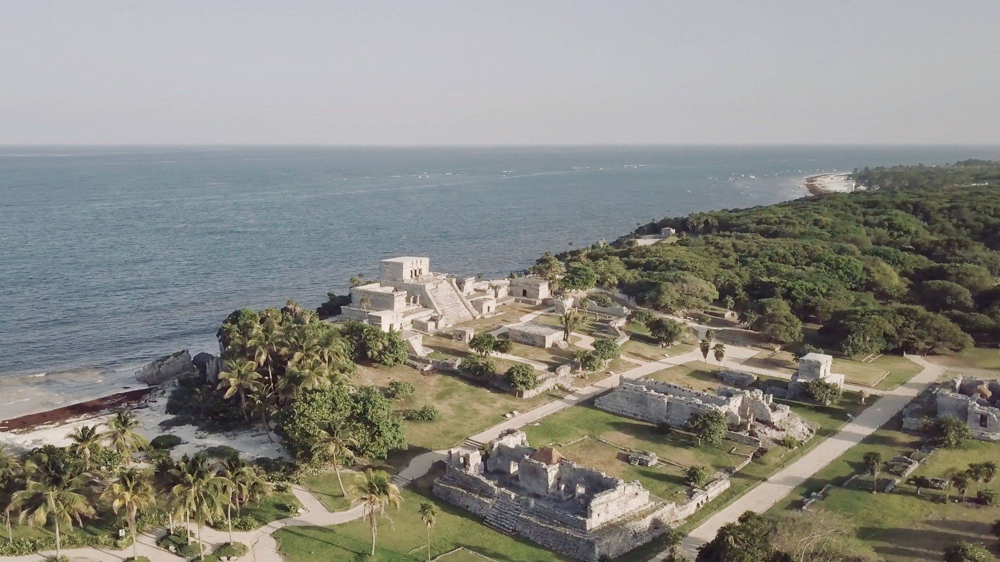

Tulum是我们在墨西哥最后的基地。我们计划休整一个星期，除了要去那些有名的旅游景点打卡，还要把拖了很多年的潜水证学成。提前几天在网上五星好评的Agua Clara Diving Tulum报的课程。7月份高温，可能是这里的旅游淡季。因此虽然报的是普通课程，只有我们两个学员，就给上成了私教课。PADI的基础潜水认证一般包括课堂学习，两天的confined water和一天的open water。和美国相比，在这里学能省很多事情。毕竟第一宗旨是让游客开心，写好评，所以无聊的东西能跳则跳，能省则省。比如完全没有了课堂学习，第一天早晨到了把书一发，连个教学视频都不用看，直接出发准备下水。潜水完全不懂？没关系，下水再说，边潜边学。两天的confined water部分也不是无聊的游泳池，而是私人cenote。Cenote是石灰岩形成的天然溶洞，是来坎昆附近游玩一定要造访的自然景观。我觉得cenote严格意义上不能算confined water，水下不仅有鱼，乌龟和水生植物，还有四通八达的水道。同一个cenote不仅能学习基础课程，高手还能练习洞穴潜水。不过还是那句话，要让游客开心😄。我们潜水课程每次去的是相对小众的cenote，抵达的时间也会早于开放时间，再加上是“私教课”时间充裕，所以在两天的confined water课程中，潜水之余还有机会独享空无一人的cenote。这样的课程简直是超值！

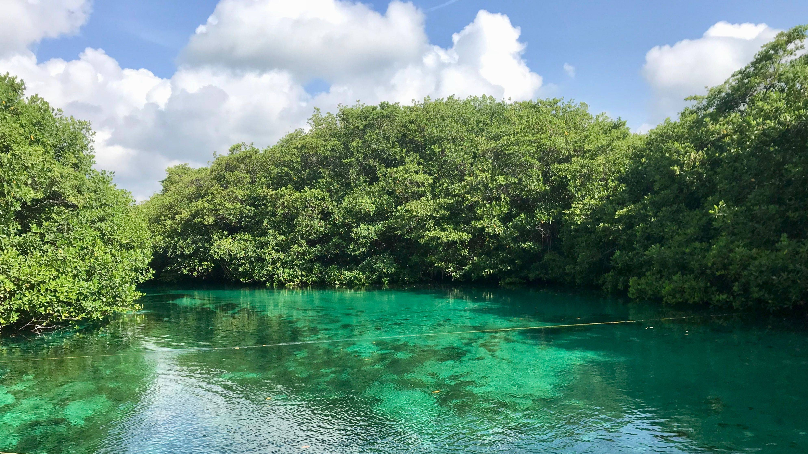

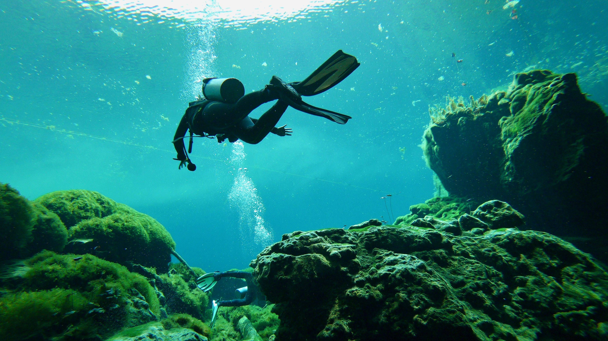

等后来我们自己去名气大的cenote打卡，看到的就是下饺子的cenote了。

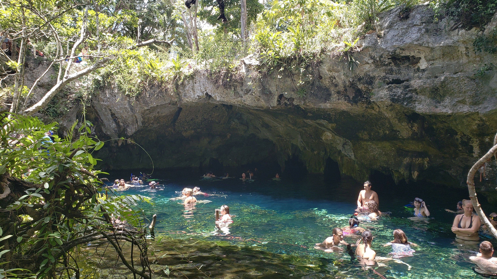

不论是Tulum沙滩还是整个加勒比的沙滩，最近几年都遭受着海草的困扰, 被称为Sargassum。就是沙滩上褐色的那一条，有点臭有点恶心。尽管每周会清理掉以顿记的海草，但要不了几天又会堆满海滩。甚至浮潜时经常会发现头顶一把海草。哎，海滩远观依然很美，近处不忍下水啊......

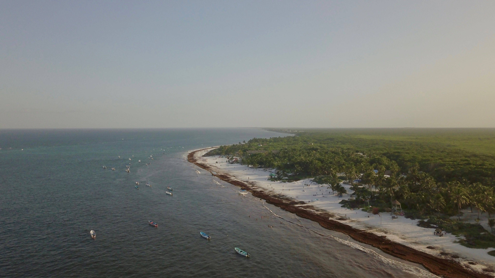

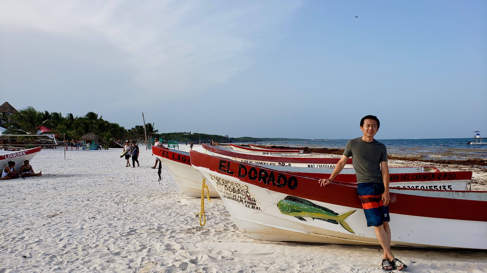

Tulum附近的**Xcaret主题公园算**是一个结合了自然生态和娱乐项目的大型主题公园。不过其中的景观以人造为主，游乐项目对于我们来说叶意思不大，可能个更适合家庭旅行。里面动物园和植物园能近距离看到很多墨西哥独有的动物，晚上的墨西哥风情表演非常盛大，都是非常不错的体验。

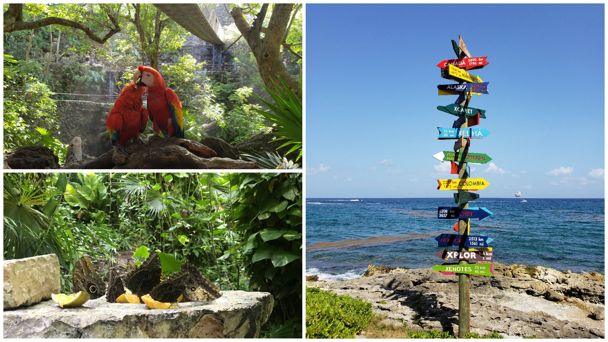

至于大名鼎鼎的坎昆，我们只花一天的时间开车转了一圈，总感觉亮点不多，商业氛围太浓，连照片都没顾上照一张。总之，来这边玩的话，更推荐Tulum。

最后给大家感受一下更多墨西哥普通食物的风情。

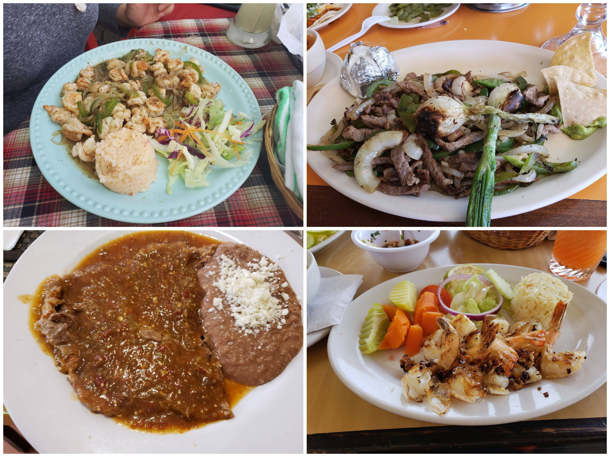

---

附录

Breakfast:

- Tacos Baez, down on the Embajadoras square from 8am to 11am, good for a quick breakfast! They do take away as well, that's a classic for us ... it takes 1min to get there from home. The chicken one are our favorite.
- El truco 7, mexican, for breakfast and lunch (calle el truco, close from the Jardin de la union)

Our 2 favorite place for Lunch:

- Las Cruces, Calle Sangre de Cristo. Authentic Mexican lunch, single menu. 60pesos!
- el Delicamitsu, japanese, be sure to be there before 3pm, they serve excellent Bento, just pick the food from the counter (calle el campanero, climb up the stairs on your left before passing under the bridge, coming from home), a must.

Dinner & lunch

- Los Campos, you can not leave Guanajuato without having dinner there. Excellent modern Mexican cuisine. I especially recommend the “lomo de cerdo en huitlacoche”, but all tapas are amazing, so are the cocktails Paloma and Margaritas. (Tips: 2 tapas/person is plenty)
- El Metate, calle Pósitos, same owner as Los Campos. They serve amazing tacos.
- El Mestizo, excellent Mexican
- La Virgen de la cueva, Marfil, expensive but excellent
- la Trattoria, Marfil, expensive but excellent
- El Rivera, Mexican food, Calle Alonso. Great aguachiles.
- Casa valadez, Jardin de la Union, in front of the Teatro Juárez. It is a touristic place but food is great.
- La Santurrona, big and rich burgers (Just in front of La Taula)

Others:

- Limon sorbet of the guy who sells ice cream at the beginning of the street "el campanero"
- aguas de fruta de la tienda "Michoacana" at the beginning of the street "el campanero"
- el Golem, Mexican bar (Calle cantarranas)
- you can also walk up the road to the "Presa de la olla" and eat some "gorditas" it is like a taco but different ...
- la inundación, mexican bar, good range of Mezcales

(Plaza San Fernando)

- la inundación (second of the name) mexican bar, excellent cocktails and live music. (Calle de la constancia)
- la Dama de las camelias, salsa club, go after 2am ... (calle sopeña)
