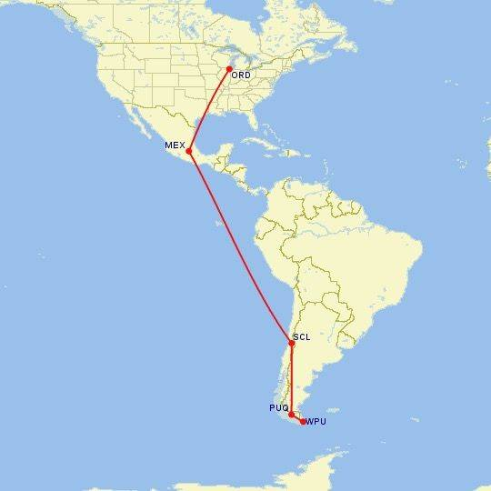
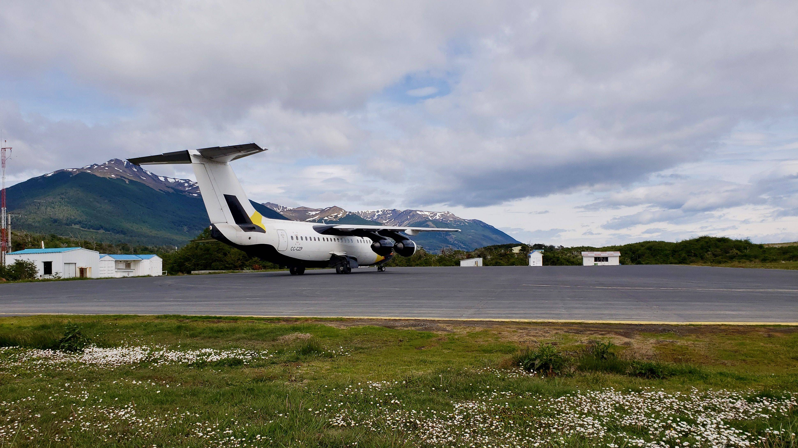
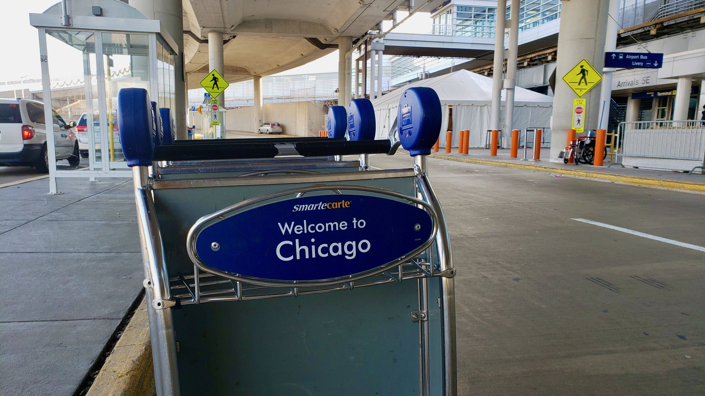
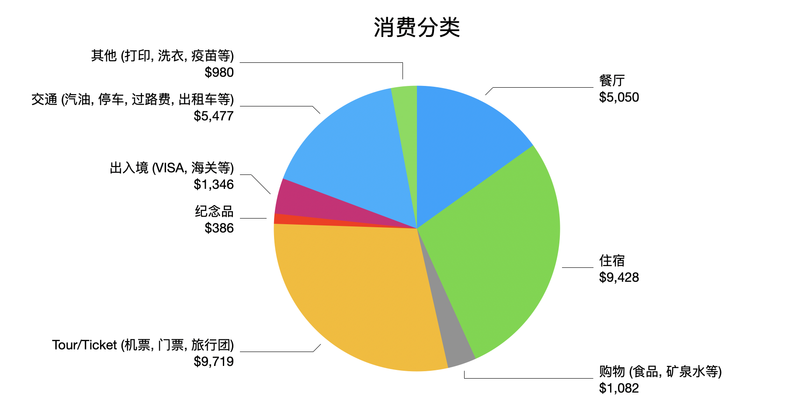
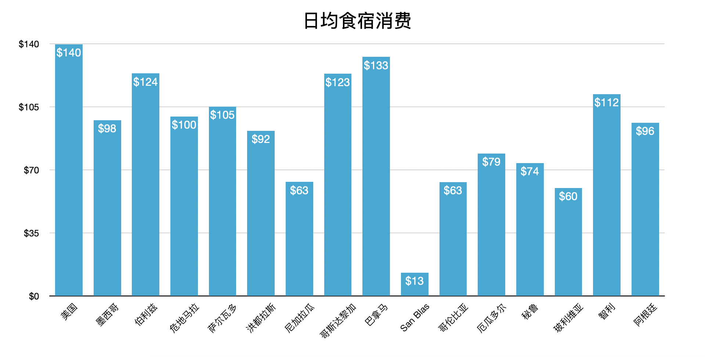

## 返程

我们的行程在Puerto Williams就正式宣告结束了。卖掉车后，行李该丢弃的丢弃，剩下的衣物打包了2个大箱子，2个小箱子，2个背包。拖着这么多行李，再去任何地方旅行都非常不便。所以伊瓜苏瀑布，布宜诺斯艾利斯和里约热内卢就只能继续待在我们的旅行清单上了。同样的原因，我们的返程也是4趟飞机连续接力，一天之内中转3个机场，一口气直接杀回美国。从Puerto Williams登机，经过25个小时后降落芝加哥O'Hare机场，回到老牟和小盖真正故事开始的地方。

## 消费总结

我们的整个行程总共消费$33437美金，平均到每天约202美金，也算是符合我们的预期。旅行团和机票占了大头，其中比较贵的项目有$1000美金的潜水课，$550美金的大蓝湖机票，$1050美金的San Blas船票，$1041美金的彩虹河Caño Cristales Tour，$795美金的复活节岛机票和$1495美金的返程机票。我们对住宿的要求是舒适，很少选择便宜的青旅，所以住宿就成了另一个大头，平均每天要65美金。不过这和去发达国家旅行相比，已经是便宜太多了。很多50-60美金一晚的酒店条件其实很好，和美国200美金一晚的酒店档次差不多。

只看食宿上的费用的话，平均每天约100美金，基本和各国的发达程度成正比。

## 写在最后

2018年，我们送给自己30大寿一个生日礼物，完成一个悬在心中很久的心愿。驾车从洛杉矶出发，途经14个国家，165天，28852公里到达地球的最南端Puerto Williams。航海一次，学习一门语言，每天与自己对话。这一年没有辜负，希望未来还会有更精彩的旅程。

