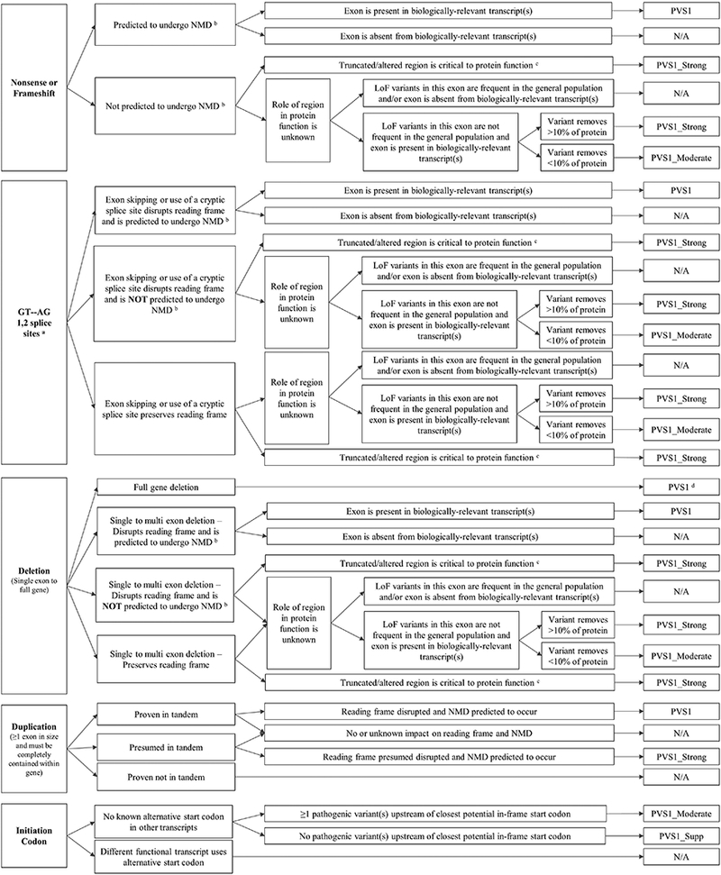
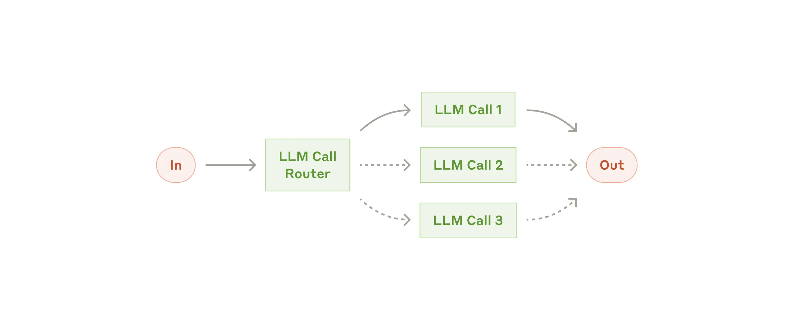
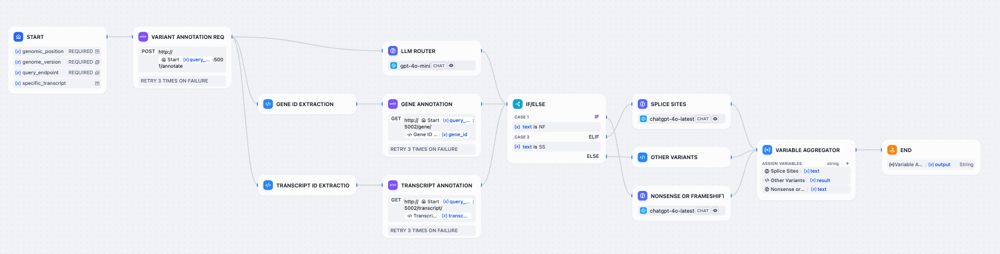
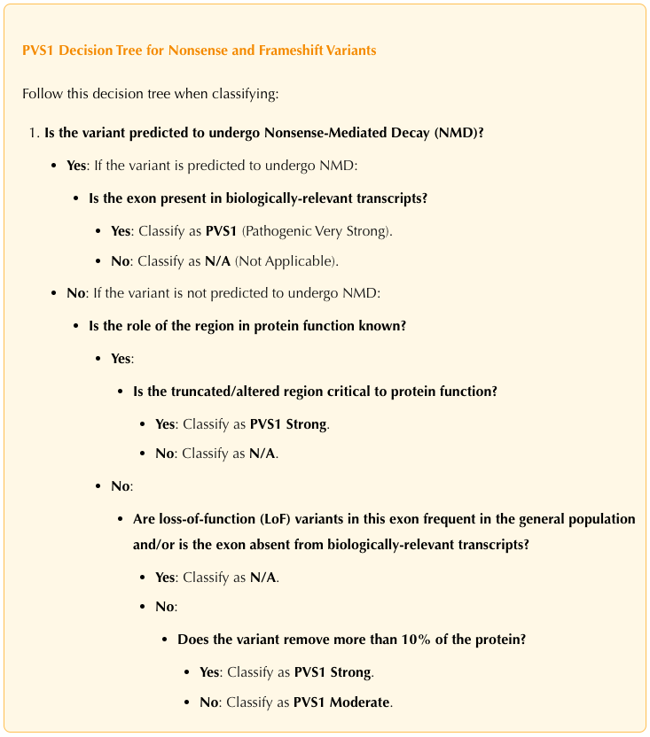
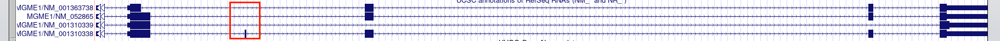

## 引言

通过上一篇的实验我们发现，想用一个 AI workflow 一步到位地实现“专家级”变异评级，恐怕没那么简单。还是得老老实实地回到 ACMG 指南，把每一个评级标准（criteria）拆开来，逐一攻克。

**今天我们来“开刀”的是 —— PVS1**

PVS1 是 ACMG 指南中评估基因变异致病性的一个重要标准证据类型，它主要用于判断可能导致致病变异的“框架移位”变异（如插入、缺失或替换，导致蛋白质功能丧失的变异）。PVS1 通常用于评估影响 **关键外显子 (exon)** 的变异，尤其是如果这种变异会导致蛋白质的合成提前终止，或者导致蛋白质的完全缺失。这种类型的变异通常被认为非常强烈的致病证据，因为它们可能直接影响基因的正常功能。例如，如果某个基因的变异导致蛋白质合成的终止，或者在一个关键的外显子上发生突变，这可能会导致该蛋白质丧失功能，从而引发相关疾病。

PVS1 的一些使用须知和背景如下：
1. 它属于 ACMG 评估系统中“非常强”的致病证据（Very Strong），因此使用上门槛也高，不能随便“乱扣帽子”。
2. 为了规范使用，行业专家们还专门发了一篇操作手册式的论文[1]，把 PVS1 的评估流程做成了一个“决策树”（Decision Tree）。不过，这棵树不像问答题一样简单——很多判断并不是“是”或“不是”那么二元，而是需要深度的专业判断。比如哪里是“关键区域”（critical region）？是否会发生 NMD（nonsense-mediated decay）？
3. 为此，也有一些工具来辅助分析，我也会应用以下这 2 个工具来对比和判断我们 AI 方法的表现：
    * **AutoPVS1**：完全基于专家论文中的决策树，结合数据库，力求明确各项判断的具体指标和定义，并且提供得到最终结果的完整决策树路径；
    * **Varsome**：它的遗传变异分析台中提供PVS1的评定，虽然不严格遵循决策树，但凭借其用户社区的力量和变异数据积累，形成了一套自己的评估体系。

*PVS1 决策树*

## AI workflow
在上一篇中，我们已经有了变异注释、基因注释和转录本注释的基础。这次，我们以“Workflow Routing”（工作流分流）的思路继续——也就是先把不同的变异类型送到各自专属的分析路线。这么做的好处是：让每一类的评级更聚焦、提示词更专业。如果一锅端处理所有变异类型，那调优某一类时可能会“伤及无辜”，影响其他输入的表现。

*LLM Workflow Routing*

整个流程是这样的：
* 首先，由一个轻量级模型判断变异类型（ gpt-4o-mini），看看是“无义/移码（Nonsense and frameshift）”变异，还是“经典剪接位点（Canonical ±1,2 splice）”变异；
* 接着，进入各自分支，我们为不同变异类型设计专属提示词；
* 最后，再由一个更强但不带推理能力（deep thinking）的模型（这里用了 chat-4o）根据提示词来推理评级。

*PVS1 AI Workflow v1*

## PVS1 提示词工程（Nonsense + Frameshift）
本篇先聚焦第1类 Nonsense + Frameshift，我们来一步步构建提示词。

我们先按照提示词工程的四个基本要素构建第一版本的提示词：
* **角色（Role）**：让 AI 以什么身份来工作？（比如“遗传变异专家”）
* **任务指令（Instruction）**：你到底想让它干嘛？
* **上下文背景（Context）**：AI 做这件事需要知道什么？
* **输出格式（Output Format）**：你想让它怎么呈现结果？

> You are a genetic variant curation expert specializing in the classification of PVS1 (null variant) evidence according to ACMG/AMP guidelines. Your task is to evaluate whether a variant on given transcript qualifies for PVS1 evidence and at what strength level (very strong, strong, moderate, or supporting).
> 
> #### Input:
> <variant_annotation>
> {variant_annotation}
> </variant_annotation>
> 
> <gene_annotation>
> {gene_annotation}
> </gene_annotation>
> 
> <transcript_annotation>
> {transcript_annotation}
> </transcript_annotation>
> 
> #### Output Format
> 
> For each variant analysis, structure your response as follows:
> - Variant Summary: Basic information about the variant
> - Gene-Disease Mechanism: Assessment of LoF as disease mechanism
> - NMD Prediction: Analysis of NMD likelihood
> - Transcript Relevance: Assessment of exon's presence in relevant transcripts
> - Critical Domain Analysis: Evaluation of region's importance
> - Protein Impact: Calculation of protein truncation percentage
> 
> PVS1 Classification: Final determination with strength level
> 
> Evidence Summary: Concise summary of key evidence supporting your classification
> 
> #### Example Response Format
> 
> Based on systematic evaluation of [variant] in [gene]:
> - PVS1 Classification: [strength level]
> - Evidence Summary: [detailed reasoning]
> 
> #### Analysis
> Start your analysis by thoroughly understanding the variant information provided, and then systematically work through each of the criteria above, explaining your reasoning at each step.

这次我们希望 AI 遵循“行业内的流程”来做判断，而不是自己天马行空地搞“思维链”。所以我们直接把决策树翻译成自然语言，内嵌进提示词中，让模型照着“规则”走。

## 怎么判断 AI 的表现？
接下来，我们准备了一系列问题，来测试模型是否真的理解了决策流程。当然，目前还只是基于 PVS1 的通用规则（general rule），暂不考虑 ClinGen 各个专家小组的细化指南。

下面这七大问题，就是我们验证时的核心关注点：
1. 能不能正确判断这个基因的**致病机制**是不是 LoF（功能丧失）？
2. 能不能判断这个变异是否会经历 **NMD（nonsense-mediated decay）**？
3. 能不能判断变异所在外显子是否出现在**生物学上有意义的转录本中（biologically relevant transcripts）**？
4. 能不能识别变异是否位于**关键功能区域（critical to protein function）**？
5. 能不能判断变异所在的外显子中，是否存在在人群中**高频 LoF 变异**？
6. 能否计算变异影响了**多大比例的蛋白质序列**？
7. 当基因的 LoF 致病机制的**临床有效性**较低时，AI 能不能识别并自动调低 PVS1 的强度评级？

这些问题也会直接写进提示词中，起到“正向引导”（hint）的作用。有研究表明，“提示-再解题”（Hint-before-Solving）能显著提升大模型的判断质量，所以我们就给它铺好路，让它少走弯路。

> #### Analysis Framework
> For each variant, follow this systematic approach:
> 
> **Gene-Disease Mechanism Analysis**
> 
> - Use given gene-disease mechanism results for PVS1 analysis
> 
> - Unless specifically analyzing a variant for a rare alternative phenotype, apply the classification based on the primary disease mechanism associated with the gene's most common phenotype.
> 
> **Nonsense-Mediated Decay (NMD) Prediction**
> 
> - Determine if the variant is expected to undergo NMD
> 
> - Consider exceptions to NMD prediction based on:
> 
>   - Position relative to the final exon-exon junction
> 
>   - Presence of downstream in-frame start codons
> 
>   - Evidence of escape from NMD for similar variants
> 
> **Transcript Analysis**
> 
> - Determine if the affected exon is present in biologically relevant transcripts using given biologically relevant transcription determination results.
> 
> **Critical Domain Assessment**
> 
> - Evaluate if the variant affects a region critical to protein function
> 
> - Consider:
> 
>   - Functional domains identified in databases (UniProt, InterPro, etc.)
> 
>   - Conserved regions across species
> 
>   - Known binding sites or catalytic regions
> 
> - Previous functional studies demonstrating the importance of this region
> 
> - Provide evidence supporting your critical domain assessment
> 
> **Population Data Analysis**
> 
> - Determine if the frequency of LoF variants  in this exon exceeds what would be expected given the disease prevalence
> 
> **Protein Impact Quantification**
> 
> - Calculate the percentage of protein removed by the variant
> 
> - Consider:
> 
>   - Total protein length
> 
>   - Position of the variant
> 
>   - Functional importance of the removed portion
> 
> **Final PVS1 Strength Assessment**
> 
> - Use PVS1 Decision Tree as your only framework for classification
> 
> - The strength level should be further adjusted based on the robustness of evidence supporting the gene's LoF disease mechanism
> 
>   - Keep current PVS1 strength for genes with definitive/strong clinical validity
> 
>   - Downgrade one level for moderate clinical validity with at least two associated LoF variants and supporting mouse models
> 
>   - Downgrade two levels with only moderate validity and either limited LoF variants associated with the phenotype or only mouse model evidence

## 验证样本设计
为了“对症下药”地测试 AI 的判断力，我们需要挑选可以尽量覆盖决策树的每一个分支的测试用例，即变异。变异来源优先选择 ClinGen 和 ClinVar 中有专家评级的记录。如果找不到，比如某些非生物学相关转录本上的变异，则自己设计。

### 1. NM_000142.5(*FGFR3*):c.1632_1633del (p.Cys545HisfsTer17)

FGFR3主要的致病机制是 gain-of-function（功能获得），因此PVS1不适用。测试 AI 是否能够辨别该变异所在基因的致病机制，即问题 1 的 negative 情况，标注为 1-。

### 2. NM_000314.8(*PTEN*):c.1003C>T (p.Arg335Ter)

PTEN 基因的主要致病机制是 LoF（功能丧失）。根据 NMD 50 nt 规则，PTEN 的 NMD 阈值位于 c.976 位置，而该变异发生在 C2 结构域，属于关键外显子，该变异可能会发生 NMD，因此根据决策树，应该被评为 PVS1_Strong。而ClinGen专家依据实验证据将NMD 阈值定在 c.1121。因此这个变异会发生 NMD，按照决策树的另一个分支应该评为PVS1。验证 1+，2，4+。我们也可以很好的了解存在这种矛盾时，大模型是自行计算、使用我们给定的阈值、还是采用自有知识。同时 NMD 的正确判断是 PVS1 评级的一个核心，如果不能解决好这个问题，整个 workflow 都没有意义。

### 3. NM_000203.5(*IDUA*):c.1799del (p.Pro599_Ser600insTer)

该变异发生在倒数第二个外显子，导致提前终止密码子的产生，可能会逃脱 NMD。同时，只有不到 10% 的蛋白质被去除，因此最终的证据评级应当是 PVS1_Moderate。这个变异可以测试到 AI 能否识别变异逃脱 NMD 的可能性，并计算蛋白质丧失的比例，即 1+，2-，4-，6-。

### 4. NM_001369369.1(*FOXN1*):c.1315del (p.Leu439CysfsTer111)

这个移码变异发生在8号外显子，导致在最终外显子（外显子9）的549位密码子处产生提前的终止密码子。变异预测不会引起 NMD，但将导致 15% 的蛋白质被截短，包括大部分对蛋白功能至关重要的转活化域。根据决策树，最终应评为 PVS1_Strong。可以验证 1+，2-，4+，6+。

### 5. NM_001310338.2(*MGME1*):c.525_526del (p.Cys175Ter)

MGME1的经典转录本和 Mane select 都是NM_052865.4，NM_001310338.2 比经典转录本及有表达的其他转录本都多出来一个外显子，我在这个外显子上设计了一个无义变异来测试 AI 对非生物学相关转录本变异的判断能力。专门用来测试 3-。

*MGME1 基因结构*

### 6. NM_001503.4(*GPLD1*):c.2440C>T(p.Gln814Ter)

在 LoF 致病机制基因中，找一个人群中 高频 LoF 变异 的外显子相对困难。且LoF变异被认为具有较高频率的阈值还是取决于特定基因和/或疾病的属性，如患病率(prevalence)、基因贡献(gene contribution)、等位基因异质性(allelic heterogeneity)、遗传方式(mode of inheritance)和渗透性(penetrance)。这方面信息并没有一个数据库可以提供直接的数据。所以这里我参考 AutoPVS1 的实现方式，采用一个 0.1% 这个非常保守的阈值。也就是说当外显子中的LoF变异在至少一种 gnomAD 族群中的等位基因频率大 于0.1% 时，认为其重要性较低。我们设计了这样一个无义变异，专门用来验证 5-。

### 7. NM_020686.6(*ABAT*):c.1306C>T (p.Arg436Ter)

ABAT 在 ClinGen 定义中为 Moderate 的基因-疾病有效性（Gene-Disease Validity），因此无论 PVS1 的强度如何，都需要降级处理。可以测试 AI 是否能识别到基因本身的 Moderate 强度，并调整 PVS1 的评分。验证 7-。

### 8. NM_000284.4(*PDHA1*):c.1142_1145dup (p.Trp383SerfsTer6)

该变异来自 ClinVar，存在多个机构提交评级。其中 ClinGen 专家给出的评级为 PVS1_Moderate，而另外2个机构则没有考虑降级，直接给出PVS1。这是一个论证 AI 是否能超越传统专家的好例子。

通过这些用例，我们能够详细测试 AI 在面对不同类型变异时的判断力和灵活性。每个用例不仅能帮助我们理解 AI 在 PVS1 判定上的优劣，也能为改进模型提供关键数据。

## 未完待续

这篇内容到此已经很多内容了，完整的验证结果我们放在下篇再讨论！我也把这些挑选的变异当作“作业”留给各位关注我的同行专家——欢迎大家带着你们的“答案”来阅读下篇，看你和AI的观点是否一致。如果你发现我对某个变异的预期评级有误，也欢迎留言帮我“纠错”，省得我带着错误去优化模型，那就事倍功半了。

## 参考资料

1. Abou Tayoun AN, Pesaran T, DiStefano MT, Oza A, Rehm HL, Biesecker LG, Harrison SM; ClinGen Sequence Variant Interpretation Working Group (ClinGen SVI). Recommendations for interpreting the loss of function PVS1 ACMG/AMP variant criterion. Hum Mutat. 2018 Nov;39(11):1517-1524. doi: 10.1002/humu.23626. Epub 2018 Sep 7. PMID: 30192042; PMCID: PMC6185798.
2. Anthropic. Building effective agents. *Anthropic Engineering Blog.* April 14, 2023. Available from: [https://www.anthropic.com/engineering/building-effective-agents](https://www.anthropic.com/engineering/building-effective-agents)

