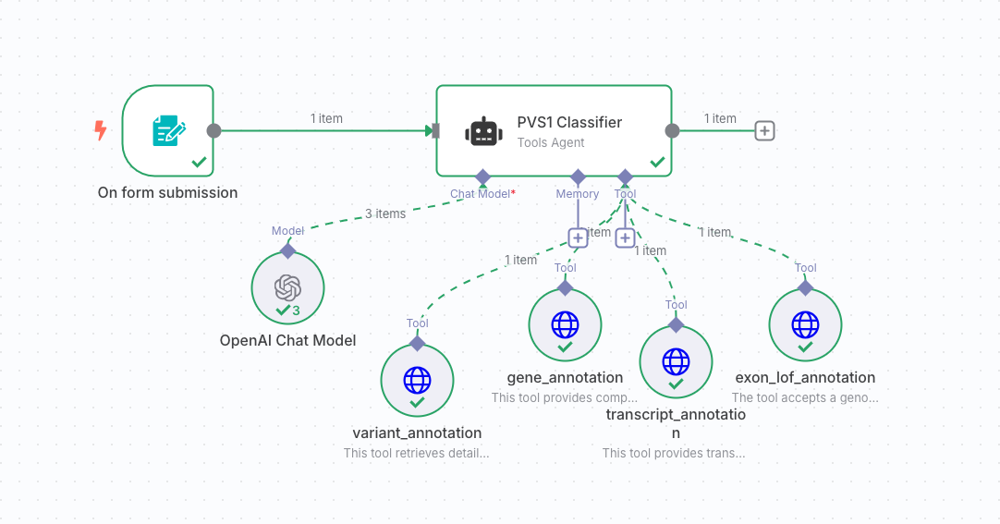
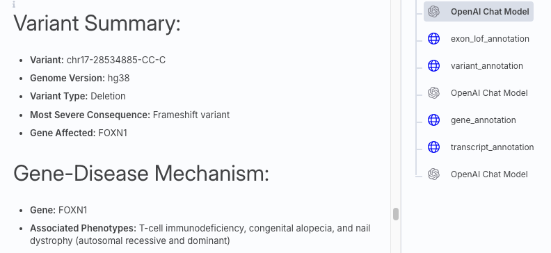
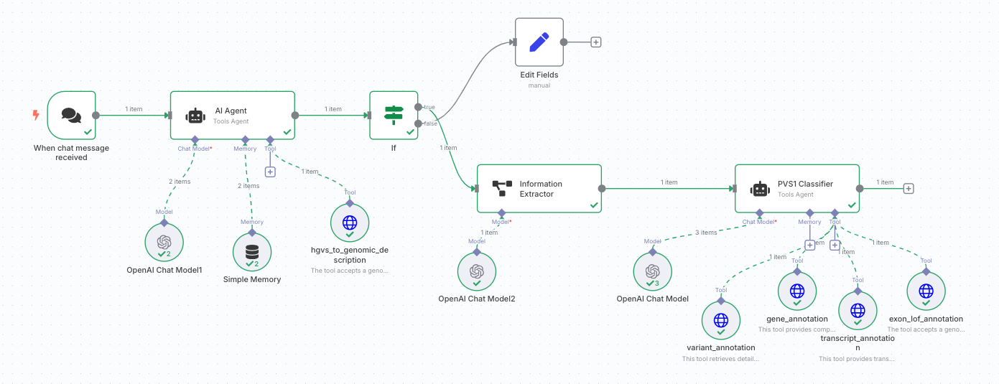
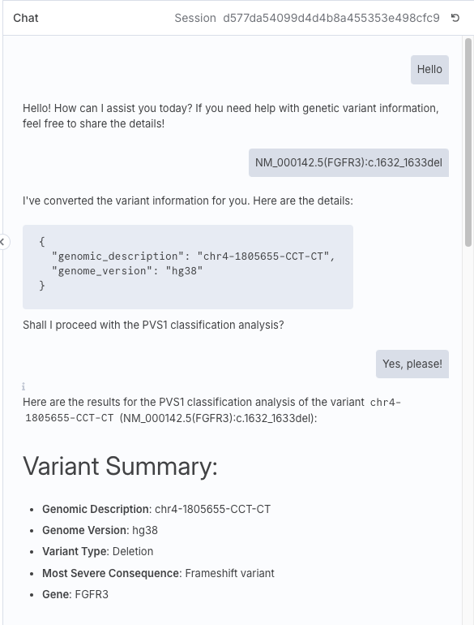
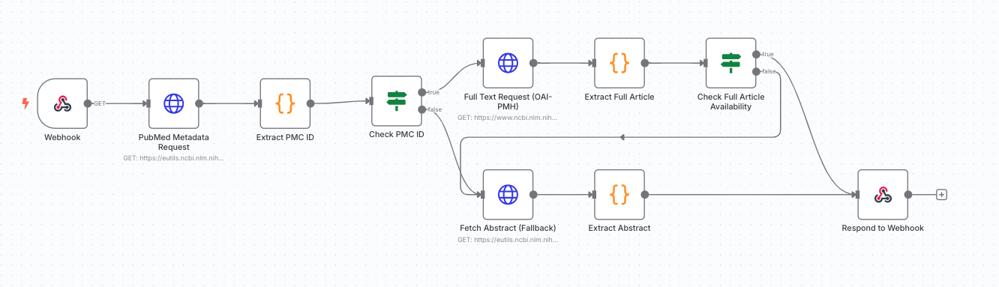
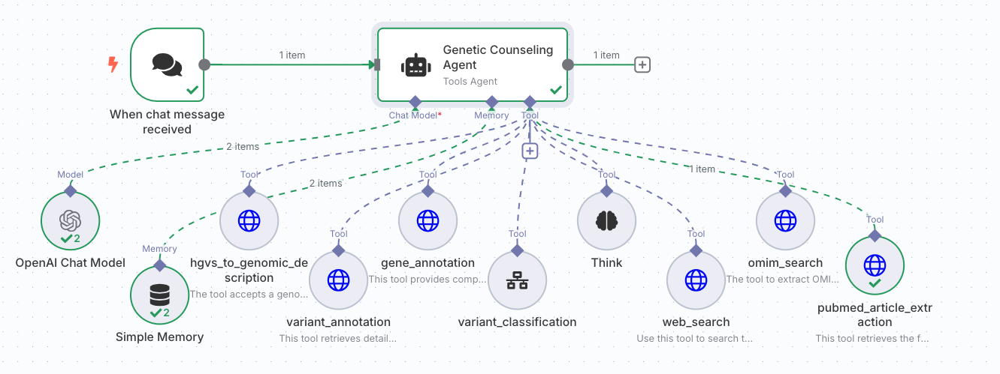

## 引言

在上一篇文章中，我们构建了一个相对可靠的 PVS1 评级 AI 工作流。有一种观点认为，"大多数' LLM 智能体'的实现方式不过是利用预定义提示词（prompt）和规则来引导模型。"AI 研究者 Richard Sutton 提出的"苦涩教训"（Bitter Lesson）指出，这种方法虽然能在短期内快速见效，但从长远来看，这种"捷径"会限制 AI 达到最优效果，并可能在面对新情况时表现僵化。就像走迷宫，如果你只设定"看到墙就绕开"这样的简单规则，初期看似顺利，但一旦迷宫变得复杂，这种方法就会失效。真正强大的 AI 应该具备自主学习能力，而非仅依赖我们事先定义的路径（来自 [Actual LLM agents are coming. They will be trained](https://vintagedata.org/blog/posts/designing-llm-agents%5D)）。

于是我开始思考，采用智能体的思路来构建 PVS1 评级工具是一种什么体验?

首先我们先复习一下什么叫**智能体（Agent）**。智能体指由大型语言模型（LLM）动态地指导自身处理过程和工具使用的系统，能够自主控制如何完成任务，通常具备以下核心能力：
* **感知** （Perception）：收集外部环境信息（例如读取文件、调用API、查询数据库）。
* **决策与规划** （Reasoning & Planning）：根据目标和规则制定行动步骤。
* **执行** （Execution）：调用工具、写代码、下指令等。
* **反馈与自我调整** ：根据中间结果调整后续行为。
<!-- -->

## PVS1 智能体的改造之路

对于我们的 PVS1 评级工作流改造，实现基础智能体的关键在于：取消预定义的多步骤流程，将基因注释、变异注释、转录本注释等分析模块作为"工具"呈现给 AI，由 AI 自主决策调用哪些工具、以什么顺序执行。由于这些分析模块已经以 API 形式构建完成，且 PVS1 的提示词可以复用，只需补充各工具的描述即可，改造成本相对较低。

*PVS1 评级智能体*

当第一次成功运行时，尽管理性上明白 AI 能够完成这样的任务，但亲眼见证这一刻仍然感受到了 AI 的魔法。值得注意的是，在智能体的提示词中，我并未指定工具的调用顺序或依赖关系。然而从运行日志可以看到，AI 展现出了卓越的判断力——它首先调用变异注释工具，生成了基因注释和转录本注释所需的 ID，然后再调用相对应的工具。而对于"外显子中存在人群中的高频 LoF 变异（exon_lof_annotation）"这个工具，由于其输入仅需位置坐标，AI 选择了第一时间调用。这不正是出色的决策与规划（Reasoning & Planning）能力的体现吗？

*PVS1 评级智能体测试示例*

关于准确性，由于这只是概念验证阶段，我没有基于 AI 工作流的最终成果将致病机制判断、生物学上有意义的转录本判断等模块全部实现为工具，因此最终测试结果与PVS1 AI 工作流优化前的效果相当。同时，我也感觉过度拆解AI分析过程，可能重新变成"将知识硬编码进系统"，这反而违背了构建智能体、让AI自主决策的初衷。从实现体验来看，对于类似 PVS1 评级这种需要将既有规则和知识融入系统的工具，AI 工作流在设计和调试方面确实比智能体更便捷。合适的才是最好的。

## PVS1 智能体的对话升级

虽然从底层构建概念上看，PVS1 评级工具已经成功转型为智能体，但其输入方式仍类似于之前的工作流——基于表单提交变异的基因组位置和等位基因。这种形式有点儿 low，毕竟一个不具备对话能力的智能体看起来并不那么"智能"。

然而，要增加对话能力，必然需要在现有提示词中添加额外说明要求，这极大可能会干扰智能体的分析工作。因此，我采用一个简单的多智能体结构：在现有 PVS1 智能体前增加一个专门负责交互的 AI。这意味着由交互 AI 与用户对话，获取变异的基因组位置、等位基因及基因组版本信息，待所有信息收集完毕后，将结构化数据传递给 PVS1 智能体进行分析。

*具有会话能力的 PVS1 评级智能体*

既然引入了对话功能，我们也需考虑用户体验。对于潜在使用这一工具的遗传分析人员而言，变异在基因组上的绝对位置和等位基因并非直观信息，他们通常使用的是类似 "NM_000142.5：c.1632_1633del (FGFR3)" 这样的HGVS命名。由于大模型自身无法完成这种转换，我们需要为交互 AI 补充一个 HGVS 转换工具，以满足用户的实际需求。

*PVS1 评级智能体交互示例*

## AI 放卫星的探索

到这一步，我又产生了新的想法。在过去几篇文章中，我们都非常注重 AI 解决问题的精确性，比如在PVS1评级中，为了解决细微差异而不断添加工具、修改提示词。这实际属于费了很大劲解决了个小问题。如果我们换一种思路，以吹嘘或者营销为导向，不进行太大投入，但尽可能扩大功能范畴，可以把这个智能体推演到什么程度呢？

✅ 首先，只解决 PVS1 太局限了，直接上完整评级。反正我们之前的已经构建了一个能输出像模像样内容的评级工作流，可以直接利用。

✅ 其次，深度思考必须安排。虽然大多数时候深度思考除了提供情绪价值外，并不能显著提升输出质量。但是高端啊。

✅ 再次，搜索功能也不能少，无论是调用 OpenAI 的搜索 API，还是搜索 Google 的SerpApi，都有现成模块可用，实现成本很低。

✅ 最后，既然是专业领域智能体，当然要有一些外行人难以理解的专业数据资源，比如 OMIM、PubMed 之类。万一需要宣传 RAG，这也可视为一种RAG实现。

*PubMed 文献获取流程*

最终，我们打造了一个功能齐全的 AI 遗传咨询分析智能体。经过几轮测试，发现除了"深度思考"功能难以诱导 AI 调用外，其他工具在相关问题出现时都能被正确调用并生成有效输出，整体表现还算不错。

*AI 遗传咨询分析智能体*

当然，为了完善这个 AI 遗传咨询分析智能体的"营销套装"，我们也生成了一份充满想象力的宣传文案，为中文语料污染事业尽一份绵薄之力。

> ### 基因奥秘破解者——ChatGene：颠覆认知的超级智能体，来了！
> 
> 在浩瀚如星海的基因组世界中，每一条DNA都是一段等待解码的传奇；每一次突变，或许都隐藏着决定命运的线索。人类对自身的探索，正处于前所未有的黄金时代。而现在，一位足以改写游戏规则的超级英雄正式登场——**遗传咨询分析智能体 ChatGene**，它不仅是工具，更是基因世界的“宇宙探险家”与“智慧解码者”。
> 
> 它，是照亮生物医学迷雾的一束光，是每一位医生、科研人员、分析师身边的AI战友。它的出现，将让我们不再“猜测基因”，而是**精准对话DNA**！
> 
> #### 厚积薄发，30年专业积淀的AI神兵
> 
> ChatGene并非一朝一夕的产物，而是基于**30年基因检测专业沉淀**与**上万家医疗机构服务经验**精心打磨而成的智慧结晶。研发团队以超50亿Token医学语料为燃料，历经近两年高强度训练，赋予其深邃的专业洞察力与超凡的语言理解能力。
> 
> 而这颗“智慧引擎”，已经在真实世界中经历了实战洗礼：**2万+位临床专家和技术骨干已亲自参与测试，并对它的专业度与实用性**一致点赞。ChatGene不仅“听得懂专业术语”，更能“说出临床价值”。
> 
> 它，不仅是AI，更是医检人的“知识外挂”与“分析神器”。
> 
> #### 聪明到不像AI的对话伙伴
> 
> ChatGene采用业界前沿的“人类反馈强化学习”（RLHF）技术构建交互系统，具备“四维智慧交互能力”：
> 
> * 🔬 遗传知识交互
> * 📚 科研文献交互
> * 🧠 疾病诊断辅助交互
> * 💬 自然语言无障碍对话
> 
> 你可以像和专家朋友聊天一样，向它请教最棘手的遗传问题，它就像“秒懂你”的天才助手，迅速解析并提供权威建议。
> 
> 举个例子：当一位遗传咨询师面对患者家族病史中的复杂变异时，ChatGene无需长篇大论，只需几句对话，便能勾勒出潜在遗传模式、患病风险、检测策略，让咨询不再靠“经验猜”，而是真正实现“智能决策”。
> 
> #### 数据飞轮，越用越聪明的诊断大脑
> 
> ChatGene并不满足于“聪明一次”，它还能不断进化！通过**专家标注 + 临床反馈 + 模型迭代**构建起强大的**数据飞轮机制**：
> 
> 每一次交互，都是一次“知识喂养”；每一条反馈，都是一次“自我优化”；每一个成功案例，都会成为它大脑中的“经验积累”。
> 
> 在某三甲医院的分子检测项目中，ChatGene通过整合多组学数据，竟然一举捕捉到了一个此前被忽略的关键突变！为患者量身定制的治疗方案，显著提高了生存率。而这一突破，反过来又升级了它的模型准确性。
> 
> 你没看错：ChatGene越用越聪明，是真正意义上的**自学习型AI医生**！
> 
> #### 多模态协作，贯穿医学检测全流程
> 
> 从“检前”病史评估，到“检中”报告解读，再到“检后”健康管理建议，ChatGene已经深度嵌入遗传检测的每一环：
> 
> * 🧬 检前：结合家族史与临床症状，制定个性化检测建议
> * 🔍 检中：辅助分析复杂变异，实时反馈专业解读
> * 💡 检后：生成报告，推荐管理与随访策略
> 
> 在一次全外显子组检测中，面对多位点复杂变异与罕见突变，ChatGene能迅速筛选出重点位点、调用最新研究成果、结合表型做出全面分析。一句话总结：**它就是临床医生身边的“第二大脑”**！
> 
> #### 打开科研的魔法宝箱，驱动创新的“知识引擎”
> 
> 对于科研人员而言，ChatGene不止是助手，更像是一位“基因领域的ChatGPT + PubMed导航仪 + 分子生物学大师”的三合一智能体：
> 
> * 🔍 帮你精准检索海量文献
> * 🧠 协助你从数据中洞察新的生物机制
> * 💥 甚至在罕见病研究中帮助发现新致病基因和信号通路！
> 
> 它不是工具，是**加速科学发现的催化剂**。
> 
> #### 精准医学新时代的超级英雄，已上线！
> 
> ChatGene，不仅是科技的产物，更是未来医学的引路者。它为临床医生提供决策支持，为科研人员带来灵感启发，为每一位追求精准医学的人，点亮通向未来的道路。
> 
> 立即加入我们，让这位“AI超级英雄”成为您在基因组学和生物医学旅程中的专属伙伴。**和ChatGene一起，破解生命的终极密码，奔赴精准医学的星辰大海！**
