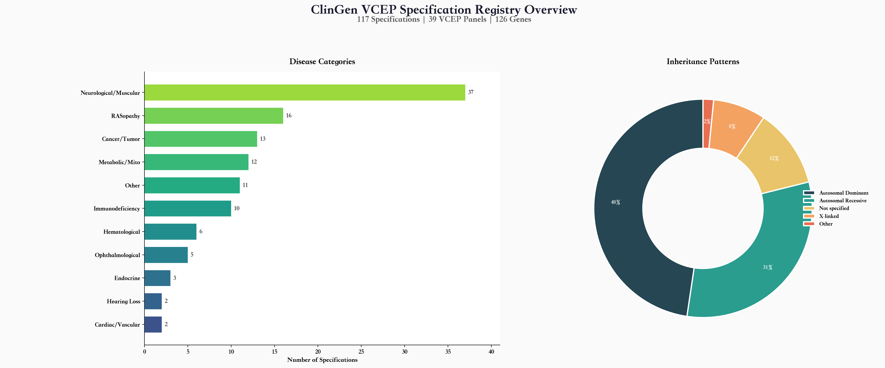
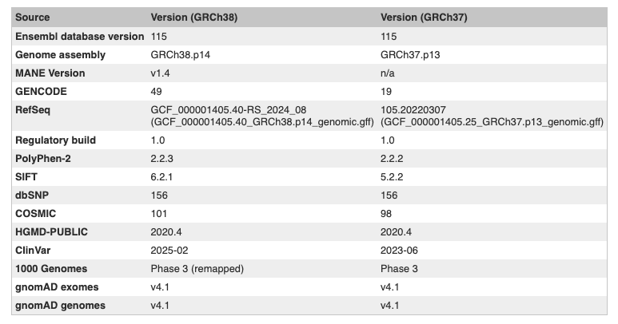
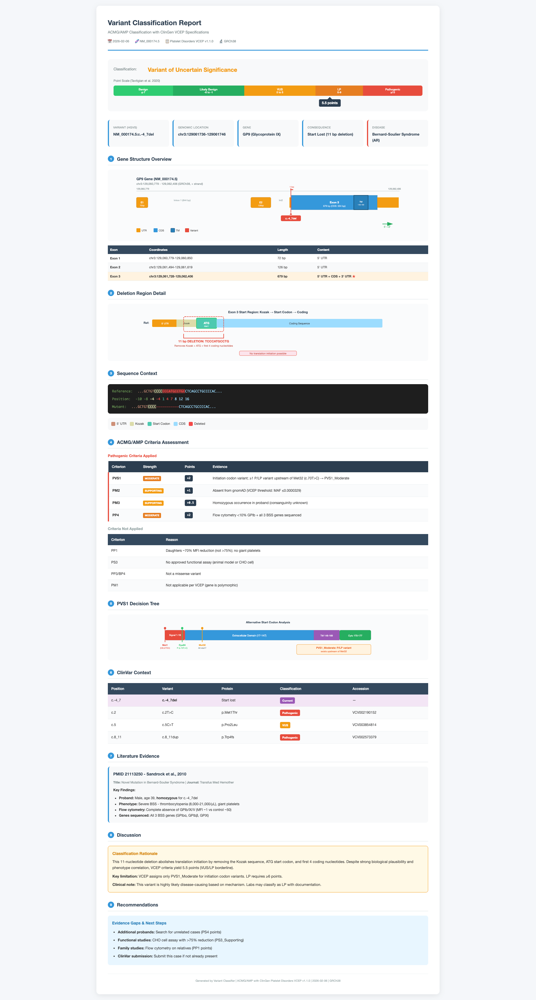

## TL;DR

我基于 Claude Code 的 Skill 机制，实现了一套 **VCEP-Aware Variant Classification Skill**，配合 Claude Code、Codex 等 AI 编程工具，可以做到精确、有据可依、符合 ClinGen VCEP 规范的变异评级。

项目地址：https://github.com/muwenbo/vcep-classification-skills

---

## 为什么要做这件事

基于 AI 的变异评级（variant classification），是我一直想做但始终不知道如何下手的一块硬骨头。

其实市面上已经有不少自动化评级工具，我自己也开发过类似的东西。但这类工具有一个共同的痛点：**即便只看能基于数据库注释进行判定的证据**（比如 PP3、PS1、BA1 等），它们给出的结果与专家判断之间依然存在不小的偏差——更不要说那些需要从文献中提取的功能研究证据（PS3/BS3）、家系共分离证据（PP1/BS4）了，这些目前几乎没有工具能自动处理。

偏差的根源在于：**ACMG/AMP 指南本质上是一套通用性的框架指导，并没有为每条证据给出明确的判定阈值**。于是各家自动化工具各自解读、各自定义，结果自然千差万别。

ClinGen 各 VCEP 专家组正是为了解决这个问题而存在的——他们针对特定疾病和基因，制定了更加细化的评级规则。然而这些规则以描述性语言写成，附录流程散落在 PPT、Word、Excel 等各种格式中，非常不结构化。要把某一套规则完整地程序化实现出来，需要大量的人工梳理。所以即便是 VarSome 这样的商业平台，也很难提供完全符合 ClinGen 规范的证据匹配。

**直到去年 10 月 Claude 发布了 Skill 机制，我看到了破局的可能。**

---

## 什么是 Skill？为什么它适合变异评级？

如果你还不了解 Skill，一句话概括：**Skill 是一种让 AI 掌握特定领域知识和工作流程的机制。**

它的核心公式是：

> **通用大模型 + Skill（领域知识）+ Tools（工具调用） = 领域专家级 Agent**

借助 Claude Code、Codex 这类 AI 编程工具，我们不需要操心什么规划器、执行器、工具协议，它们会替你处理这些底层逻辑。我们只需要操心如何构建 Skill（领域知识）。

以前我总琢磨怎么搭工作流、怎么构建多级智能体。但这些机制面对变异评级的复杂性时，灵活性远远不够。而 Skill 的思路完全不同：**它更像是给 AI 一本"变异评级操作手册"**，AI 能快速消化领域知识，同时保留自主调用工具、搜索网络、灵活决策的能力。不需要把所有分析路径提前设计好，AI 可以根据实际情况动态应对。

---

## Skill 的设计：四大核心上下文

和所有 AI 处理专业任务的场景一样，关键在于提供充分的上下文，或者说**降低 AI 自己准备上下文的成本**。对于变异评级，我将所需上下文拆解为以下四块。

### 一、VCEP 评级指南

既然目标是符合 ClinGen 规范的评级，那第一步当然是把规范"喂"给 AI。

我把每个 VCEP 散落在各种格式中的文件（PPT、Word、Excel……）整合成 AI 更容易解析的 Markdown 格式。这样 AI 在分析时就不需要再跑到 ClinGen 网站上自行查阅和学习，同时我们也方便根据实际分析中遇到的问题随时调整和补充。

> 顺带一提，价值 500 美金 Token 整理出来的 ClinGen 规范文档，已经一并打包在这套 Skill 中了。

不过坦率地说，我对这些文档的完整性还是一些疑虑的——各个 VCEP 规范的原始文档质量参差不齐，有些图片分辨率很低可能导致 AI 难以准确识别，有些规范的描述又极其简略。目前已整理的规范超过 100 个，数量庞大，利用 AI 整理完后，我也没有逐一审阅。如果你在使用中发现某个规范存在遗漏或偏差，随时反馈给自己的 AI。



### 二、变异注释

AI 需要完整的变异注释信息——人群频率、有害性生信预测、变异类型等——来支撑数据库类证据的判定。

这些证据主要包括：

| 证据类别 | 涉及证据项 |
|---------|-----------|
| Population frequency (gnomAD 等) | BA1, BS1, BS2, PM2 |
| Variant databases (ClinVar, HGMD 等) | PS1, PM5 |
| Computational/predictive tools | PP3, BP4, BP7 |
| Sequence analysis (变异类型/位置) | PVS1, PM1, PM4, BP1, BP3 |

考虑到用户是遗传分析师，输入自然以 **HGVS 命名**为主。因此变异注释这一步需要能够基于 HGVS 获取完整的变异信息。

在工具选择上，Skill 尽量要做到：
- **不依赖本地安装的注释软件**（VEP、ANNOVAR 等安装门槛高，且需要庞大的参考数据）
- **不依赖付费平台**（如 VarSome），优先使用公共可用的途径

最终发现 **Ensembl REST API** 已经足够强大，能满足绝大部分注释需求。当然，Ensembl 的部分参考数据版本可能略滞后于最新版，这是一个需要注意的地方。



### 三、变异所在区域的信息

变异注释通常只能获取单个变异位点的信息，但有些证据需要**区域层面的上下文**。例如：
- **PM1**：判断变异是否位于 mutational hotspot 或 well-established functional domain without benign variation
- **PS1**：判断该位点是否有 previously established pathogenic variant（不论 nucleotide change）

为此，我利用公共 API 实现了三类区域信息的获取：
1. 变异所在区域的所有 **ClinVar 变异**信息
2. 变异所在基因的 **UniProt domain** 信息
3. 变异所在区域的所有 **gnomAD 变异**信息

当然这里能够发挥的空间还很大。

### 四、文献的获取与分析

以下这些基于文献的证据，一直是变异评级中最难啃的骨头，也是各种自动化方法几乎无法触及的领域：

| 类别 | 涉及证据项 |
|-----|-----------|
| De novo / 家系证据 | PS2, PM6, PP1, BS4 |
| 病例对照数据 | PS4 |
| Trans / Cis 观察 | PM3, BP2 |
| 表型匹配 | PP4, BP5 |
| 功能研究 | PS3, BS3 |

要让 AI 处理这些证据，需要解决两个核心问题：

#### 问题 1：如何找到相关文献？

我做了3种尝试。首先利用 AI 编程工具本身强大的网络搜索能力。比如让它搜索 ClinGen 收录的变异 `NM_000545.8(HNF1A):c.745T>C (p.Ser249Pro)` 的相关文献，它会自动构建一系列关键词反复尝试：

```
- NM_000545.8 HNF1A c.745T>C p.Ser249Pro variant
- HNF1A Ser249Pro pathogenic variant MODY diabetes
- "c.745T>C" HNF1A ClinVar
- HNF1A "745T>C" OR "Ser249Pro" diabetes publication
```

其次主动引导 AI 用模糊搜索策略，基于 `HNF1A + ("745T>C" | "745T->C" | "Ser249Pro" | "S249P")` 这样的关键词进行检索。最后调用 LitVar2 数据库的接口。

**遗憾的是，不论哪种方式，文献检索效果都不太稳定。** 有时候能找到，但在上面这个例子中没有找到 ClinGen 专家实际引用的那些文献。文献检索这块还是有很大的优化空间。（如果有读者在用 Mastermind 的订阅，欢迎分享下它在定位变异相关文献方面的真实表现。）

#### 问题 2：AI 能从文献中准确提取证据吗？

即便自动检索不够理想，我们假设在实际工作中，厉害的分析人员仍然通过其他途径获取到相关文献，再让 AI 辅助阅读并匹配评级证据。那么关键问题就变成了：**AI 能否准确理解文献内容，并按照 ClinGen 规范正确匹配证据？**

还是以 `HNF1A p.Ser249Pro` 为例，ClinGen 专家的评级涉及两篇文献，恰好代表了评级中的文献阅读的两种经典困境：

**文献一** | PMID:16249556
*Renal malformations may be linked to mutations in the hepatocyte nuclear factor-1alpha (MODY3) gene*

这是一篇 2005 年的文章，有被 HGMD 数据库收录，但它的全文在付费墙后面。除非分析人员自行准备 PDF，否则 AI 没有公共途径获取正文。

**文献二** | PMID:23771925
*Prevalence, characteristics and clinical diagnosis of maturity onset diabetes of the young due to mutations in HNF1A, HNF4A, and glucokinase: results from the SEARCH for Diabetes in Youth*

这篇文章发表于 2013 年，确实包含该变异，但仅出现在**补充材料的表格**中。也许正因如此，该变异在 HGMD 中也未收录这篇文献——不得不感叹 ClinGen 专家的细致程度。

当我提前下载好第一篇文章的 PDF，并提供第二篇文章的 PMID 后：

1. **AI 可以准确理解文献一的内容**，并将案例正确匹配到 PS4 的计数中。
2. 但对于文献二，由于 AI 自带的 WebSearch 会对网页内容进行摘要式处理，容易遗漏变异这种细节信息。即便给 Skill 补充了文章下载能力来获取完整正文，**NIH/PMC 的反爬机制**也阻止了 AI 自动下载补充材料——而变异信息恰恰在补充材料里。

#### 小结

**文献的精准检索仍然依赖更专业的工具**，但如果分析师能人工准备好可能相关的文章，AI 已经可以非常精确地实现 ClinGen 专家级别的变异评级。

至于具体的评级分析流程，我们完全可以信赖 AI 的自主决策能力，不需要像我们之前设计 PVS1 工作流那样精细控制每一步。这套 Skill 的实战表现，我会在后续文章中通过具体案例展开分析。

---

## 意外收获的可视化报告

AI 协作中常有的惊喜——**你永远不知道它会给你带来什么额外的灵感。** 我本想借助 AI 为另一个任务生成可视化报告，却误操作在了一个变异评级的窗口中。没想到 AI 就此"大展身手"，在没有任何设计指引的情况下，生成的 HTML 报告效果竟然超乎预期。这种网页报告远比传统 CLI 输出对普通用户更友善。经过轻微调整，我就把这个意外之喜打磨成了一个通用的报告模板。这也是 



---

## 如何使用

使用非常简单。安装好 Skill 后，只需输入：

```
/variant-classifier 任何格式的变异命名
```

AI 会自动执行以下步骤：获取变异注释 → 收集区域信息 → 逐条匹配 VCEP 评级规则 → 生成评级结果。过程中如果遇到需要确认的情况（比如基因对应的 VCEP 选择、是否需要补充文献），AI 会主动与你确认。

---

## 一些延伸思考

做这件事情的时候，产生了一个有趣的思考：如果说过去网站需要做 SEO（搜索引擎优化），那么现在我们已经进入了需要 GEO（生成式引擎优化）的时代。我相信当下科研文章已经开始由 AI 撰写、由 AI 阅读了，所以我们需要重新思考内容的呈现方式。例如

- 结构化表格、避免复杂的单元格合并
- 关键数据尽量放在正文而非仅在补充材料中
- 优先选择 Open Access 期刊

这些看似微小的调整，实际上都在优化 AI 对信息的理解和引用，也许还能让你的文章在 AI 时代的引用数上占据先机。

最后，特别要赞叹一下 Ensembl、NCBI 和 UCSC 等机构的长期投入。在处理遗传学数据时，我原本预期需要为 AI 开发工具接口，结果发现完全是多虑了。完全不需要重复造轮子，他们搭建的 API 体系已经足够完善，数据获取无需从零开始，一切都能直接调用。
