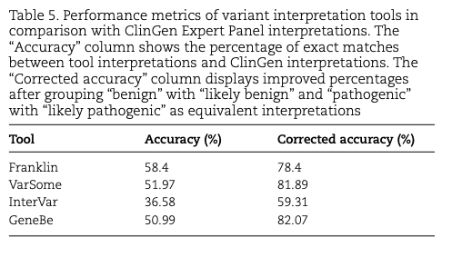
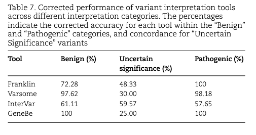

## 引言

AI 能把代码写好，现在已经不让人惊奇了。但它能把你专业领域的事情做好，甚至比领域专家做得还好，才是真正让人有点"后背发凉"的时刻。到目前为止，我们还没用 AI 做过科研，那不如挑一个方向浅试一下。

前面我们证明了 **AI + Skill + 文献资料** 可以做到专家水平的变异评级，但代价是巨大的 token 消耗和推理时间，更适合对**个别变异**的深度研究或精细评级。可现实中，临床基因分析往往需要前置性地对**成千上万条变异**做预评级，提前筛掉没有分析价值的变异。对于这种规模化场景，基于规则的评级方法仍然是更合适的手段。

之前的文章里提到过，我也通过"蒸馏"身边遗传专家同事的知识开发过这类工具，但始终卡在一件事上：**不知道该如何设计实验来系统性地验证性能**。尤其一想到要对每条证据逐一精细评估的工作量，就一个头两个大，所以这套规则体系迟迟没有被完整评测过。

而且说到底，这类方法的阈值和规则本质上都是领域专家"拍脑袋"定出来的，你也很难说哪个阈值就一定比另一个更正确。尤其面对 2 万个基因，很容易顾此失彼。按照 VCEP 的原则，不同的基因、不同的疾病应该有各自独特的判定标准。所以一套通用规则在部分变异上准确性差一些，也是完全可以接受的。

不知道是不是因为类似的原因，商用平台 Varsome、Franklin 也都只是公布了自家的评级规则，从没正式发表过系统性的评估结果。去年的一篇 *[The promises and pitfalls of automated variant interpretation: a comprehensive review](https://doi.org/10.1038/s41525-024-00464-2)*，是我第一次看到**相对公允、且说清楚了问题**的一篇评测文章。

于是我就冒出一个想法：**要不让 AI 来帮我评测一下我这套规则的真实性能到底如何？**

*promises and pitfalls* 已经搭好了一个可比较的 benchmark，我只需要专注于自己这套方法的结果。原文作者仅选择了 5 个领域共 256 个变异。而我们用的是 AI，不用考虑"工作量"，索性直接放开手脚，把 ClinGen 专家评审过的所有变异都拉来做评估。实验设计也干脆交给 AI 自己定——反正大概率比我设计得好。具体过程如下。

---

## AI 主导的实验过程

我提供给 AI 的输入非常简单：一份我已有的规则引擎代码、上次构建 Skill 时整理的 ClinGen VCEP、我们的变异注释工具，以及 ClinGen 的变异数据。剩下的设计和执行，全部由 AI 自主完成。

### 基准测试设计

ClinGen 专家评审过变异数据共收录了 41 个 VCEP 的 12,396 条变异评估记录。每一条记录都包含：

- 被判定为 **met** 的 ACMG 判据及其强度修饰
- 被明确评估但判定为 **not met** 的判据
- 最终分类（P / LP / VUS / LB / B）

在过滤掉已撤回的记录并与 ClinVar VCF 坐标匹配后，AI 得到了 **11,656 条** 既有专家评估、又有 VEP 注释的变异。

评估方法：**对每项判据，只纳入 ClinGen 专家明确评估过该判据的变异**。如果某条变异在某项判据上专家既没说"符合"也没说"不符合"，那它就不进入这项判据的混淆矩阵。这样可以避免把"注释缺失"当成"分歧"来算。

指标也是老几样：敏感性、特异性、准确率。同时 AI 还主动提醒了**局限性**：

> 各 VCEP 会对通用 ACMG/AMP 框架做基因特异的定制——自定义等位基因频率阈值、特定功能域定义、强度调整、疾病特定判据等。通用规则分类器与这些定制规则之间必然存在系统性差异。因此，基准测试中的部分不一致反映的是 VCEP 的规则定制，而非分类器本身的缺陷。

### 基线表现

第一次跑完基线时，我有种 **too good to be true** 的感觉。

| 判据 | N | 敏感性 | 特异性 | 准确率 |
|-----------|------|-------------|-------------|----------|
| PVS1 | 4,866 | 89.9% | 97.4% | 93.7% |
| PS1 | 3,746 | 41.9% | 85.6% | 84.0% |
| PM1 | 4,483 | 66.9% | 70.4% | 69.4% |
| PM2 | 10,075 | 94.2% | 54.6% | 86.1% |
| PM4 | 3,258 | 36.2% | 99.2% | 95.1% |
| PM5 | 5,062 | 4.7% | 98.5% | 76.3% |
| PP3 | 7,576 | 84.3% | 86.2% | 85.3% |
| BA1 | 4,961 | 28.6% | 99.8% | 84.6% |
| BS2 | 3,549 | 61.7% | 84.7% | 80.0% |
| BP3 | 2,598 | 47.8% | 99.7% | 99.3% |
| BP4 | 5,389 | 19.6% | 97.1% | 64.9% |
| BP7 | 3,631 | 0.0% | 100% | 73.7% |

按照 *promises and pitfalls* 的方法统计：
- **评级五分类精确一致率：59.9%**，甚至高于文章中评测的所有软件。
- **评级三分类（P/LP vs VUS vs B/LB）：约 79%**，与业内方案旗鼓相当。

但很明显，一些"看起来应该很简单"的证据——比如 **BP4** 这种纯粹基于生信工具的证据——灵敏度低得离谱（19.6%）。**BP7** 更是不合理，完全没触发过。**BA1** 作为一个"看频率超不超过阈值"的简单判据，居然也漏掉了 71% 的案例。

那就让 AI 看着解决一下吧。

### AI 自主的优化循环

接下来的过程完全超出了我的预期。AI 自己按"问题最严重 → 最不严重"的顺序逐条处理，每解决完一条，就问我：**"要不要看一下下一个有问题的证据？"**

我基本就是一路 Yes，假装自己 human in the loop。

#### BP7：从 0% 到 99.4%

BP7 的定义是"不影响剪接、保守性不高的沉默变异"。敏感性 0%，意味着这条判据根本就是"死代码"。

AI 拆出两个根因：

1. **适用范围太窄。** 代码里只接受 `synonymous_variant`，但 ClinGen 专家在内含子变异（162 例）、剪接区域（67 例）、多聚嘧啶区（49 例）、UTR（30 例）上都在用 BP7。ACMG 定义的核心是"沉默"，实践中涵盖了所有"不太可能改变蛋白序列或剪接"的变异类型。
2. **硬依赖缺失分数。** 评估器要求 dbscSNV 剪接分（ADA/RF）和 phyloP 保守性分数同时存在，而 VEP 注释对非编码变异根本不返回这些分数。结果就是全局阻断——**所有本该符合的变异都因为数据缺失被立刻拒绝**。

修复思路很优雅：不再把剪接和保守性分数当成**必要前提**，而是当成**排除门控**。分数存在且指示破坏剪接时，BP7 被阻断；分数不可用时（非编码变异的常态），仅凭变异后果类型就足以作为证据。

| 指标 | 修复前 | 修复后 |
|------|--------|--------|
| 敏感性 | 0.0% | 99.4% |
| 特异性 | 100% | 81.3% |
| 准确率 | 73.7% | 86.1% |

#### BP4：从 19.6% 到 95.0%

BP4 的错误根因同样是两个，一是 REVEL 阈值（0.2）过于保守，二是根本不支持非编码变异。

AI 做了一件我原本绝对懒得做的事情：**它自己枚举了 0.2 / 0.3 / 0.4 / 0.5 / 0.644 五个阈值，对每个阈值重新跑了一遍基准测试**，最后选定 0.5 作为 Supporting 阈值——能保持 95.5% 的敏感性、同时让整体准确率达到最高的 84.1%。

对非编码变异，AI 直接复用了刚修好的 BP7 逻辑，同时注意到 BP4 和 BP7 之间有互斥规则会自动防止双重计数。它在报告里专门写了一段解释这个"副作用"：

> 修改后，BP4 会在所有 BP7 目标的非编码变异上触发。根据互斥规则 `BP4 触发 → 禁用 BP7`，BP7 在基准测试中的指标降为 0%。这是正确行为——BP4 吸收了 BP7 在这类变异上的作用，组合器最终只计一条 Supporting 良性证据。

| 指标 | 修复前 | 修复后 |
|------|--------|--------|
| 敏感性 | 19.6% | 95.0% |
| 特异性 | 97.1% | 75.4% |
| 准确率 | 64.9% | 83.6% |

#### BA1：字段名的陷阱

BA1 的敏感性只有 28.6%。AI 查出来的根因是——**字段名对不上**。评估器只读 `gnomad_popmax`，但注释流程在这个字段上是空的；真正有数据的字段叫 `gnomad_af`，1,042 条里都能取到值。

顺带还发现两个问题：5% 阈值偏严（VCEP 普遍使用更低阈值），以及强度等级返回错了（应是 `VeryStrong` 而不是 `Supporting`）。一次修三处毛病。

| 指标 | 修复前 | 修复后 |
|------|--------|--------|
| 敏感性 | 28.6% | 51.7% |
| 特异性 | 99.8% | 99.6% |
| 准确率 | 84.6% | 89.4% |

#### PM5：AI 也会"一本正经地走偏"

PM5 的敏感性 4.7%，问题是 PS1 把它吸收掉了——只要在 ClinVar 里能找到相同氨基酸改变的致病记录，PS1 就会把 PM5 挡在门外。

AI 给出的修复方向是——**加入 ClinVar 评审星级门槛**：只有 ≥ 2 星记录才允许 PS1 阻断 PM5，1 星（单一提交者）的记录不算。它还列出了数据：655 条被挡的变异中，有 644 条被 ClinGen 专家标注为"PM5 符合、PS1 不符合"，解释得条理清晰、逻辑自洽。

唯一的问题是——**这不是真正的根因**。

我的实现里确实限定了 ClinVar 致病变异的最低星级标准，但 AI 自行脑补了一个"星级门槛"的故事。这也提醒我们：AI 能写出**极具说服力的错误推理**，而且结构上和正确推理几乎一模一样。如果纯 Vibe Research 会非常容易被带跑。

#### PM1：适用范围的隐性越界

PM1 的准确率只有 69.4%，AI 发现 43.6% 的假阳性来自 **不应该触发 PM1 的变异类型**——同义、移码、内含子、无义、剪接变异。PM1 本来就是"错义变异在突变热点"的证据，功能丧失变异（PVS1 管）或非编码变异根本不该进来。

把适用范围显式限制为错义和框内插入/缺失后，准确率从 69.4% 提升到 78.0%。

### AI 也会说"这条不改"

不过 AI 也不是逢问题必改——在 PS1 上它反而给出了相反的建议。

PS1 的假阳性 521 条里，有 517 条是"变异本身在 ClinVar 里就已经是致病"。专家认为对这类变异再贴一条 PS1 是冗余的，所以标了 not met。AI 尝试加一条排除规则——"变异本身已在 ClinVar 为致病时排除 PS1"——结果 PS1 假阳性从 521 掉到 4，但**整体五分类一致率从 60.5% 跌到 55.2%**。

因为这些 PS1 虽然"多余"但是正确的，去掉之后组合器就不够证据把变异推过致病阈值，约 960 条变异从 P/LP 掉回 VUS。

报告的结论是：

> PS1 的当前实现是正确的——它为氨基酸改变的致病性提供了有效证据。基准测试中的分歧是**方法论差异**（ClinGen 认为多余，而非错误）。我们保留了现有实现。

### 最终结果

| 指标 | 基线 | 优化后 |
|------|------|--------|
| **五分类精确一致率** | 59.9% | 60.5% |
| **三分类一致率（P/LP vs VUS vs B/LB）** | 约 79% | **81.4%** |

三分类混淆矩阵：

| 专家 \ 我们 | P/LP | VUS | B/LB |
|---|---|---|---|
| **P/LP** | **4,318**（79.9%）| 1,069 | 18 |
| **VUS** | 81 | **2,703**（73.7%）| 884 |
| **B/LB** | 1 | 118 | **2,464**（95.4%）|

几个值得注意的点：

- **严重性错误极少**：P/LP 与 B/LB 之间跨类仅 19 条（0.16%）。
- **B/LB 方向表现最强**（95.4%）——这对"预筛掉没有分析价值的变异"这个实际应用场景尤其重要。
- **主要的错误是 P/LP 欠判**（1,069 条被误归 VUS），也就是说系统偏保守而非激进。

---

## 写在最后
虽然最终的优化结果中整体评级五分类和三分类准确性并没有大的变化，但每条单项证据的灵敏度都有不错的提升，并且一路捎带修掉了代码里的 bug 和无效代码。 虽然远没到大神 Andrej Karpathy 的 AutoResearch 理论那么厉害，但也有点儿那么回事儿了。大部分时候我的参与基本等于没参与——繁复的实验迭代循环由 AI Agent 自主完成，**人类只需设定方向和评判标准，从执行者转变为监督者**。而且 AI 这种工工整整的科研报告，真的能为后续工作打下一个非常扎实的基础。

---

## 番外

> 凌晨时分在社交媒体上最兴奋地晒出自己用 AI 做出的小产品的人，往往不是 00 后的年轻程序员，而是三四十岁的中年人。他们分享的并非自己的技术有多高深，而是一种失而复得的感动——"我居然还能做出点什么来"。年轻时，这种从零到一的成就感随处可见，所以你不觉得珍贵。直到被日复一日的琐碎生活消磨了激情，才会在某个平凡的深夜，突然被 AI 赋予的创造快感所击中，激动到无法自已。
>
> 归根到底，钓鱼也好，Vibe Coding 也罢，本质上都是中年男人给自己找的一个巧妙借口：我并非逃避责任或回避生活，只是短暂地需要一点空间，重回那个内心有好奇心、有创造欲望的自己。唯一不同的，是一个挥动着鱼竿，一个挥动着 prompt。但鱼是否上钩，代码能否上线，都已不再重要。
>
> 重要的是，那根鱼竿在手，那行光标在屏幕上不停地闪烁——
>
> 这一刻，是真正属于我的。
>
> —— 宝玉

