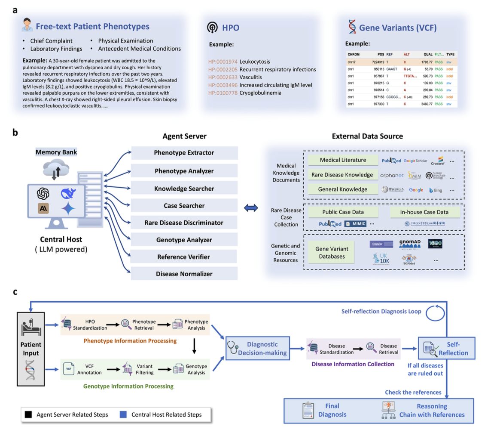
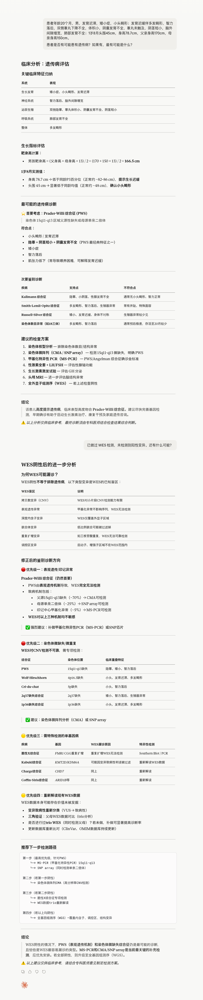
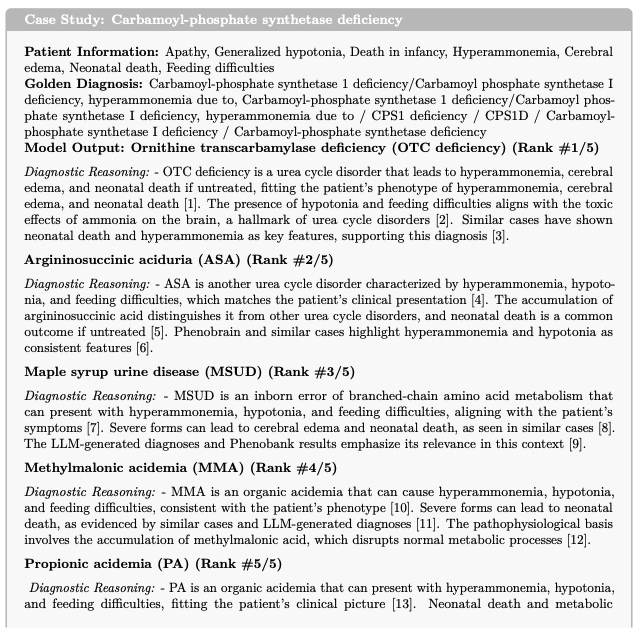
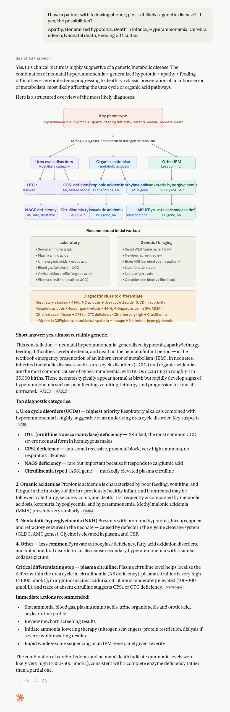
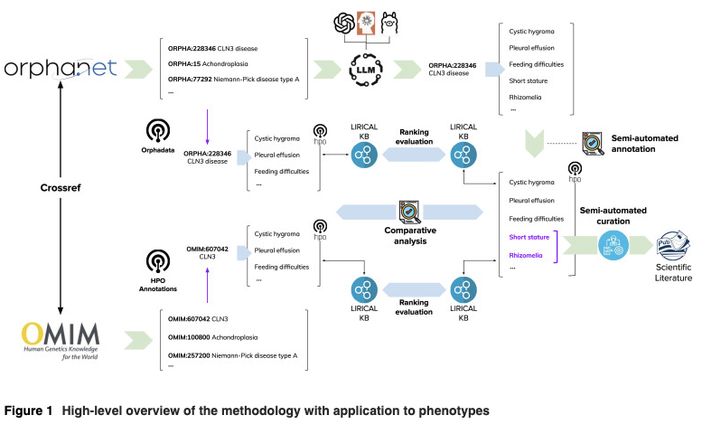

## 引言

前一段时间 OpenAI 发布了 GPT-5.5，顺手把官方提示词指南也更新了。比较有趣的几条结论：

- **Shorter, outcome-first prompts** 通常比堆砌过程的"保姆式"提示词表现更好
- 推理能力提升后，应该重新评估 `low` / `medium` reasoning effort，不要默认拉到 `high`
- 在重度依赖工具调用的 Responses workflow 里，前置说明（preamble，让模型先简述意图再调工具）、阶段切换处理（phase handling）、assistant 消息原样回放（assistant-item replay）仍然是有效的做法
- 明确的人格设定（personality）、检索调用预算（retrieval budget）、输出校验规则（validation rules）有助于塑造面向用户和 agentic 类应用的交互体验

其实这也是 AI 大神们在社交媒体上的共识：以前的模型比较"笨"，需要你手把手地教它每一步怎么走；但对最新一代大模型来说，那些啰嗦的指令反而成了干扰，会缩小它的搜索空间，让输出变得死板。提示词优化本质上是在信息充分性与 token 成本之间找平衡。

这让我想起去年罕见病领域的明星工作——DeepRare（*Zhao et al. 2026*）。

DeepRare 把临床描述文本、HPO 术语、基因检测结果做了融合，整合 40+ 专业工具和最新医学知识库，最终给出带可追溯推理链的排序诊断假设。整个系统分两个阶段：information collection 阶段主动调取相关临床支持信息；self-reflection diagnosis 阶段对诊断结果做自我反思校验。每一步推断都可追溯到可验证的医学证据。

在 2024–2025 年的 AI 能力下，这样的设计是先进的，甚至是必须的。但 AI 领域的发展实在太快，基于最新的官方提示词指南，我产生了这样的疑问——**对最新的大模型来说，DeepRare 这套精巧的提示词链 / 工具调用 / 自我反思机制，是不是还有必要？**

## 两个递进的对照方案

我不想搞太复杂的验证，打算手选几个真实案例试试看。设想的测试方法如下：

1. **直接把病例文本扔给最新的大模型**——不接任何外部数据，完全依赖大模型自身的知识与推理
2. **如果方案 1 失败**，再上 LLM + HPO / disease 知识库工具 + 极简提示词，看看"大模型 + 可靠数据"能不能补齐缺口

为了更好和 DeepRare 比对，案例就从 DeepRare 发布的数据里找。

### 案例一：DeepRare 排到 Top 2 的小胖威利综合征（B 站 DeepRare 官方宣传视频）

> 这是一个真实世界漏诊的案例，医生在看到全外报告后未能找到结论。经 DeepRare 系统提示，想到了印记异常的可能性，经过甲基化检测，明确诊断为小胖威利综合征。
>
> 患者年龄 20 个月，男，发育迟滞，矮小症，小头畸形；发育迟缓伴多发畸形，智力落后，双侧睾丸下降不全，体积小，阴囊发育不全，睾丸未触及，阴茎短小，脑外间隙增宽，肺部发育不全；1 岁 8 月头围 45 cm，身高 78.7 cm，父亲身高 170 cm，母亲身高 150 cm。

DeepRare 把正确答案小胖威利综合征排在了第二位。我把同一段文字喂给 Claude Sonnet 4.6，小胖威利综合征直接落在第一位，同样附带了还不错的推理链。

这下尴尬了，方案 1 已经赢了，方案 2 直接没法在这个案例上测试。不过也不让人意外，DeepRare 论文结果里就已经有体现，**即便用 2024 年的模型直接通过表型推理疾病，正确答案的 Top 1 也有 ~30%、Top 5 ~50%**。到了 2026 年的 Claude Sonnet 4.6，再上一台阶不算稀奇。

> 注：Top 1 / Top 5（也叫 Recall@1 / Recall@5）是变异 / 基因排序领域的常规评估指标，可以简单理解为"正确答案排在算法输出前 N 名内的比例"。

### 案例二：到 DeepRare 翻车的案例里挑（论文补充材料）

简单的赢不了，那就去 DeepRare 自己列出来的失败案例里翻。我们想挑到的"理想案例"得同时满足三个条件：一个单纯依赖表型有可能被诊断出来的遗传病、方案 1 必须先失败（否则方案 2 没机会验证）、而接上知识库工具后又能被证据推理出来（方案 2 的价值才说得清楚）。DeepRare 团队在补充材料里给出了若干未能在 Top 5 命中的真实病例并进行了复盘。这些大概率会是不错的挑战性案例。

我挑了一例 CPS1 缺乏症（氨基甲酰磷酸合成酶 I 缺乏症）的案例。DeepRare 团队的解释是：

> The truth and DeepRare's top 5 showed high phenotypic overlap. The key to distinguishing CPS1 deficiency from OTC deficiency is often a urine orotic acid test, which is not in the input information.

也就是说，单凭输入的表型，CPS1 和 OTC 几乎长得一样，靠尿乳清酸（urine orotic acid）才能区分，而这个数据并不在输入里。**这是一个结构上就困难的案例**：纯表型驱动确实存在歧义。

我把同样的输入丢给 Claude Sonnet 4.6，DeepRare 没排进 Top 5 的这条案例，Claude 直接推到了第二位。

这个案例方案 2 也跑不下去了。一个 DeepRare 无法解决的案例，新一代大模型直接拿下。**看来仅靠手选的几个案例，是探不到当前大模型的底的**。要做出有意义的对照，可能需要把 DeepRare 的完整测试集重跑一遍。

## 大模型不是专家治理的专业知识库，但它能补专业知识库的缺失

这次测试跑不下去，但有篇研究的结论倒是能很好的解释原因——*Groza et al. 2026* 的 *A systematic assessment of large language models' knowledge of rare diseases: How much do large language models know about rare disease?*。

他们系统性地拿大模型给出的“表型-疾病 / 基因–疾病”关联，去比对 HPO / OMIM / Orphanet 这些专家治理的专业知识库资源。我摘几条有趣的结论：

- **大模型的知识不是专业知识库的镜像**。同一个疾病，大模型给出的表型可能和专业知识库不完全重合，**准确性不足以替代专家治理的罕见病知识库**
- **但缺失并不一定等于"幻觉"**。罕见病文献本身就稀疏、数据库更新滞后真实存在、很多正确关联散落在案例报告里没被入库。把"凡是库里没有的就是幻觉"当成默认假设，在罕见病领域并不合适

**大模型本身也是一个同时包含噪音和真实信号的知识源**。模型输出的推测性新关联里，至少一部分大概率是真的，只是专家治理的资源还来不及把它们收进去。

这条结论刚好回应了我前面两个测试。这些关联本身就埋在模型"读过的医学文本"里，只是以一种隐式、概率化的形式存在，并非模型临时查到了专业知识库的数据。

## 写在最后

实事求是地讲，测试的这 2 个孤例什么也证明不了：

- 既不能说明在所有极端案例上最新大模型一定比 DeepRare 这种精巧的 agent 系统强，也许 DeepRare + 最新大模型可以更优秀
- 也不能说明各种纯表型驱动的分析工具和方法已经被大模型拍死在沙滩上

不过可以确定，**遗传病 / 罕见病没法纯靠表型诊断，分子检测仍然是关键**。DeepRare 在论文里给了具体数字——同一份数据集上，加入基因型证据后 Top 5 从 59.5% → 82.1%（新华医院，N = 168），从 45.7% → 81.5%（湖南医院）。**这条质变线，不是更强的大模型能直接补上的**。DeepRare 团队自己也在论文里很克制地把定位写成"给非专科医生用的决策辅助工具"——尤其在医疗资源不足的地区，用来降低罕见病诊断门槛。

这个定位我觉得没有问题，但它也让我又产生了 3 个疑问。专科医生该用什么 AI 决策辅助工具呢？如果是面向专科医生的决策辅助工具的话，agent 设计有没有必要？如果 agent 有必要，那"领域专属 agent"这条路是不是仍然成立？

毕竟目前真正领先的 agent 系统是 Claude Code、Codex、Kimi Code、Trae 等等等等。这些公司雇着这个星球上最聪明、也最懂大模型的一批大脑，手握最大的用户群，拿得到海量真实反馈来快速迭代他们的工具。在这个起跑线上，一个垂直领域的团队真的能凭手搓的 agent 体系，跑得赢通用 agent + 一份合适的提示词 / 工具集吗？

按现在的趋势，我觉得通用 agent 工具大概率会演化成继 Excel / Word / PowerPoint 之后的下一代"牛马工具"。怎么用，取决于每个使用者自己往上面装的"插件"和"配置"——同一个 Excel，有人拿来算小学加减乘除，有人用它给集团 CFO 搭现金流模型，还有人把它当 BI dashboard。agent 工具可能也会演化成为这种形态——基座是通用的，生态是分化的。

对我这种垂直领域的玩家来说，发力点也许在于把领域内的工具、数据接口、知识库做成能被通用 agent 直接调用的"装备"——MCP server、领域专属 skill、可验证的数据 pipeline。

---

**参考资料：**

1. OpenAI. *GPT-5.5 prompting guide.* https://developers.openai.com/api/docs/guides/prompt-guidance
2. Zhao W. et al. *An agentic system for rare disease diagnosis with traceable reasoning.* Nature (2026): 1–10.
3. Groza T. et al. *A systematic assessment of large language models' knowledge of rare diseases: How much do large language models know about rare disease?* Human Genetics and Genomics Advances 7.1 (2026).
