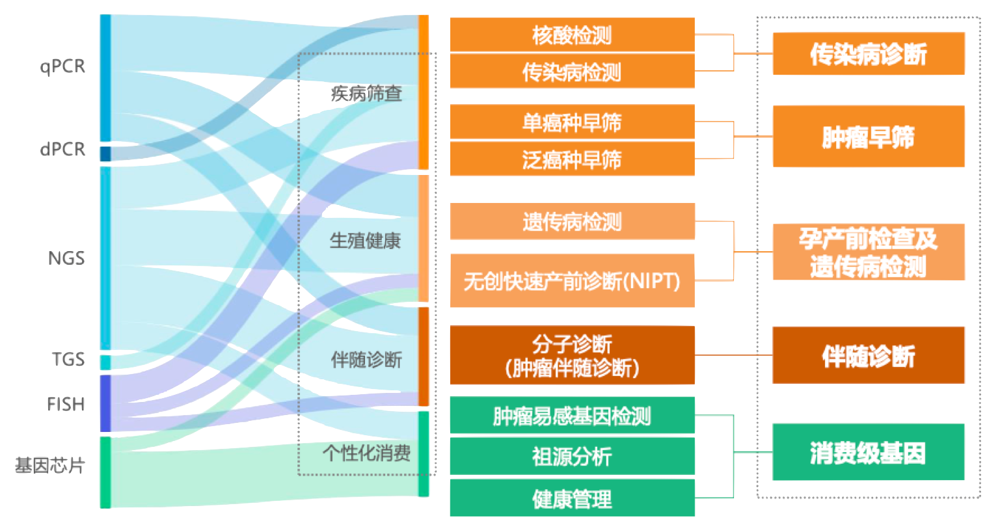
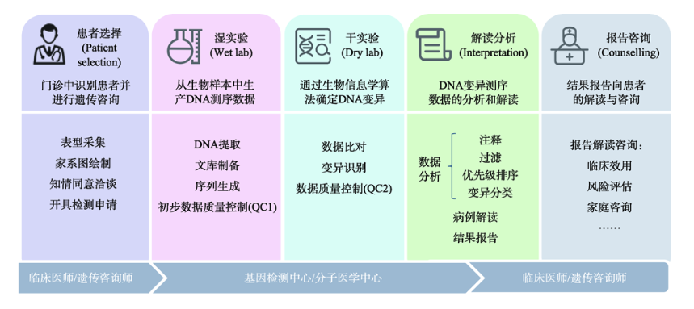

## 引言

上一篇《罕见病场景下，精巧的 Agent 设计还需要吗？》我们留了三个问题，其中最大的一个是：**专科医生该用什么 AI 决策辅助工具？**

回头看，过去这十几篇都在零敲碎打地讲 AI 在分子诊断中的某个具体环节，缺一条把它们串起来的线。所以这一篇我想用作整个系列的"目录"，把"我们到底在解决什么问题"、"已经走到哪儿了"、"还有哪些没聊过"整理一下，承上启下。

---

## 我们这个系列到底在做什么？

基因检测在临床中的应用面其实非常广：传染病、孕产前筛查、遗传病诊断、肿瘤早筛、伴随诊断……每一块都有自己的样本类型、技术路线和报告范式。

而我这个系列从一开始锁定的就是其中一小块：**基于 NGS 的遗传病分子诊断**。展开来说，就是对患者基因组 DNA 进行高通量测序，把所得序列与人类参考基因组比对，识别可能致病的变异，再结合患者表型和家族史，做出遗传病的分子诊断。

之所以重要，是因为遗传病症状常常不典型，患者可能辗转就医多年也没法确诊。基因检测做的是"找病根"，而不是"猜症状"。一旦找到致病变异，还可以指导用药（避开会被异常代谢的药物）、评估家族风险（确认其他成员是否携带相同变异），以及为后续的基因治疗打基础。

## 临床遗传学医生是谁？

我反复提到的"专科医生"，指的就是**临床遗传学医生（Clinical Geneticist）**——负责把基因检测结果、患者表型、家族史整合起来，做出遗传病分子诊断的那个人。但实际承担这份工作的并不只有遗传科医生：很多儿科、神经科、产科医生也在做，因为遗传病本身就是跨系统的。

这个学科在国内外的发展阶段差距还很大：

- **美国**：临床遗传学有独立的专科认证体系（American Board of Medical Genetics and Genomics, ABMGG），临床遗传学医生需要专门的遗传学住院医培训。除了医生之外还有成熟的 **Genetic Counselor（遗传咨询师）** 职业，专门负责向患者解读基因报告、评估家族风险，医生和咨询师分工明确。
- **国内**：临床遗传学还没有独立成科，多挂靠在儿科、产科或检验科下；遗传咨询师作为正式职业起步不超过 10 年。实际做遗传病诊断的，往往是有遗传学背景的儿科 / 产科医生，或者从检验科 / 基因组学背景跨界过来的医生。

这两条信息对"AI 工具该长成什么样"应该怎么设计很关键。使用者本身并不是一群同质的、按统一规范受训的"遗传科医生"。

## 临床基因组测序的五段路

我们不能真的给 AI 挂上一堆工具就放手让它自由发挥。也许最新的大模型已经具备完整的领域知识——可能只要一句"你是一位临床遗传学专家"就能跑起来；也许还需要我们通过 skill 或工作流的形式把流程显式写进去。但不管走哪条路，AI 都需要被**约束**按照临床遗传学医生的诊疗流程来分析，至少在硅基生命正式取代碳基生命之前。

那么这套流程长什么样呢？我参考的是 *卢宇蓝 et al. 2025* 在《遗传》上发表的《临床基因组测序解读与报告专家共识》。

共识把临床基因组测序拆成五个阶段：

| 阶段 | 主要工作 | 主要负责方 |
| --- | --- | --- |
| **检测前遗传咨询** | 识别适合的患者、采集表型、知情同意、完善检测申请信息 | 临床医生 / 遗传咨询师 |
| **湿实验** | DNA 提取、文库制备、上机测序、初步质控 | 实验团队 |
| **干实验** | 生物信息学算法识别变异、技术偏差校正、识别样本错误或污染 | 生信分析团队 |
| **解读分析** | 变异注释、过滤、优先级排序、致病性评估、病例解读、报告生成 | 实验室解读人员 / 临床医师 / 遗传咨询师 |
| **报告咨询** | 与患者沟通报告结果、讨论后续临床决策 | 临床医生 / 遗传咨询师 |

湿实验和干实验是评估测试性能（analytical validation）的关键环节，主要由实验团队负责，AI 介入相对有限。**这个系列的所有工作，几乎都集中在第四阶段——解读分析（共识里也称作"三级分析"）**。

## 解读分析里的六件事

为什么不追求"一个 agent 一站式搞定"？因为解读分析这一阶段本身就是由几个相对独立的子任务串起来的，每一步的输入输出、判断标准都不一样。把它们拆开各自击破，远比全部交给一个 mega-agent 更可控、也更可评估。

我把解读分析里的工作大致拆成六件事：

| 子任务 | 主要工作 |
| --- | --- |
| **临床表型分析** | 把患者的临床信息（病历叙述、症状描述）映射为 HPO 标准词条，作为后续表型–基因型匹配的输入。难点在于自然语言到标准词条的对齐 |
| **变异过滤** | 单个基因组的测序数据结果一般包含数百万条变异，逐一精细解读不现实，需要先按规则筛掉绝大多数，留下最可能致病的子集。关键是在灵敏度和"待核查变异数量"之间做平衡 |
| **变异优先级排序** | 通过算法综合表型相关性和变异致病性，按指定标准决定后续详细解读的顺序 |
| **变异致病性评级** | 按 ACMG/AMP 指南（*Richards et al. 2015*）评为 P / LP / VUS / LB / B |
| **变异分类** | 按 ACMG/AMP 指南将变异归类为可【明确 / 部分】解释患者表型的【致病 / 疑似致病】变异、与表型相关的临床意义未明变异、附带发现的致病 / 疑似致病变异等 |
| **报告撰写** | 整合变异详情、基因描述、疾病描述，撰写与病例表型相关的解读结论。报告要同时面向临床医生与患者，需在专业性与可读性之间取得平衡 |

下面就按这六件事一条一条盘，看我们覆盖了哪几件。

## 我们已经走到哪儿了

**临床表型分析**

《设计工具专属的评估方式》里我们尝试过一个 RAG pipeline——中文分词 → 英文翻译 → 基于英文词组检索 → LLM 分析，效果出乎意料地好。不过现在的大模型是不是已经能省掉这套预处理，得重新测一遍才知道。

**变异致病性评级**

- 《AI 当研究员，我当 PI（一）》和《AI 当研究员，我当 PI（二）》里我们用氛围研究的方式优化基于 ACMG 单条判据的提示词，大幅提升了单项判据的灵敏度，致病性 5 分类一致性 > 60%、3 分类 > 80%。参考其他同类工具，在没有文献和案例支持的前提下，纯规则评级的上限大概也就是这样了。
- 《燃烧 Token 不是程序员的特权，现在轮到遗传分析师了》里我们尝试用 AI + skill 复刻 ClinGen VCEP 专家级评级。受限于文献付费墙、关键证据深藏补充材料这类现实问题，整体仍不敌人类顶级专家。

**变异分类**

《构建一个可控的变异解读工作流》里我们用提示词驱动 AI 完成分类，但这一步只做了不严谨的抽样测试，**系统性的准确性和可靠性评估还没进行**。

**报告撰写**

AI 天然擅长生成文字。第一篇《模型选择》里我们评估过早期模型翻译和生成解读文本的质量。最新一代模型是不是仅靠自有知识就能写出可靠的"基因 / 疾病 / 变异"描述还没评估；如果需要外挂数据源，该接哪些、怎么接，也都是待答的问题。

## 还没聊过的几件

- **变异优先级排序**：综合表型相关性 + 致病性的排序算法，我们能有更好的方案么？
- **变异过滤策略**：现有过滤逻辑基本是人工预设规则的。能不能通过氛围研究让 AI 基于数据驱动地制定更优的过滤策略？
- **特殊变异类型**：拷贝数变异（CNV）、结构变异（SV）、线粒体变异、体细胞嵌合变异，这些类型 AI 该从哪儿切入？
- **重分析的自动化**：临床上有大量"当年阴性、几年后基于新知识应该重做"的病例。有什么方法能让 AI agent 在合适的时机主动启动重分析？

## 写在最后

除了这六件事，我也想留一些空间给那些**不够资格发表、但值得动手试一下**的假设和 what-if 想法。常规的研究范式是"我做了 X、得到了 Y"，那不妨偶尔反过来，**不做 X 会怎么样**。比如"不吃饭会不会死"，听起来像废话，但当对象换成"不给 AI X，它能走多远"时，上篇的小胖威利综合征 + CPS1 缺乏症的测试就属于这一类。

这种实验大概率不会进期刊，但常常能让我对"AI 现阶段到底在什么水平"有更直接的体感，也常常会反过来影响接下来要做的"正经"工作。

回到最初的那个问题：**专科医生该用什么 AI 决策辅助工具？**盘点本身没给出答案，但至少把要做的事理清楚了，剩下的就是一件一件去做了。

---

**参考资料：**

1. 亿欧智库. *2021 年中国基因检测行业研究报告——应用篇.*
2. 卢宇蓝, 李国壮, 王雅琼, 等. *临床基因组测序解读与报告专家共识 [J].* 遗传, 2025, 47(3): 314–328.
