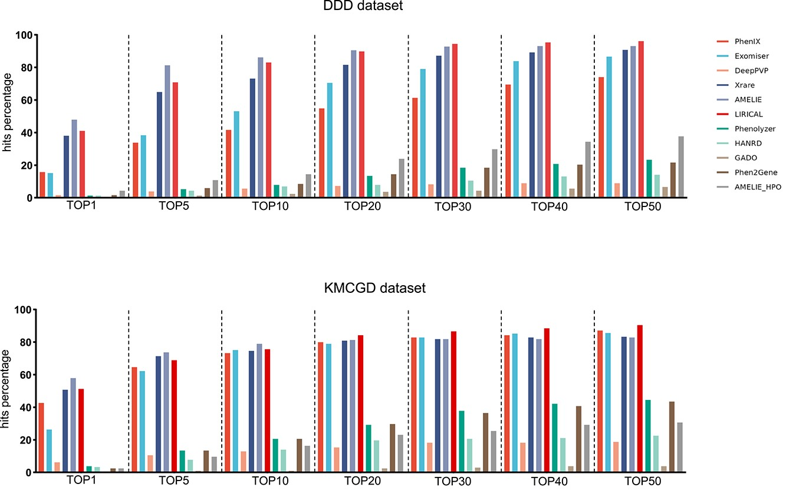
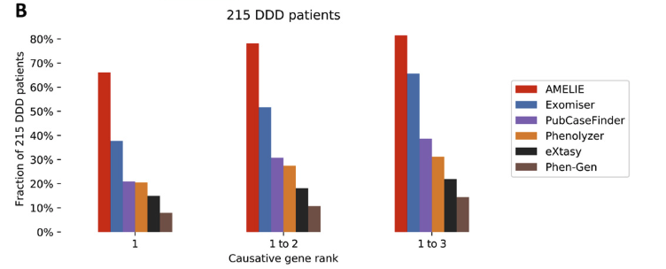
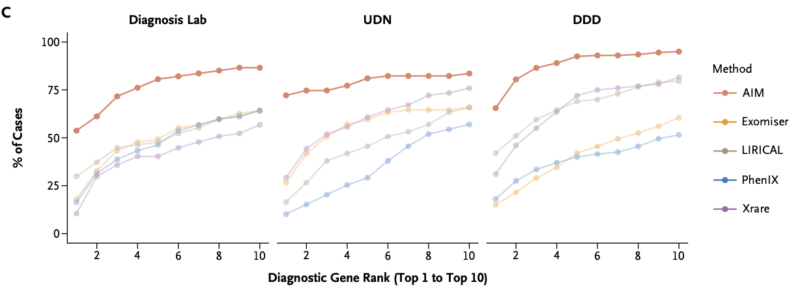
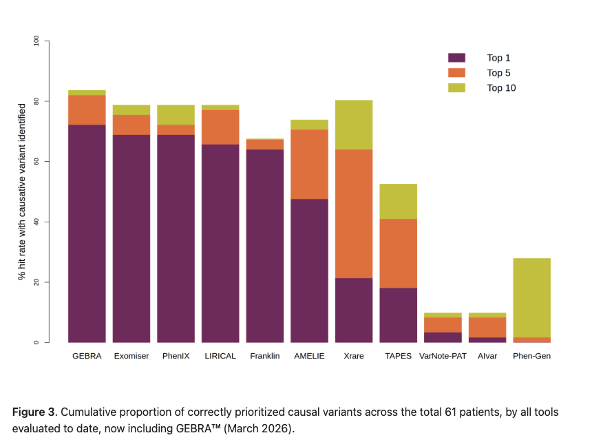
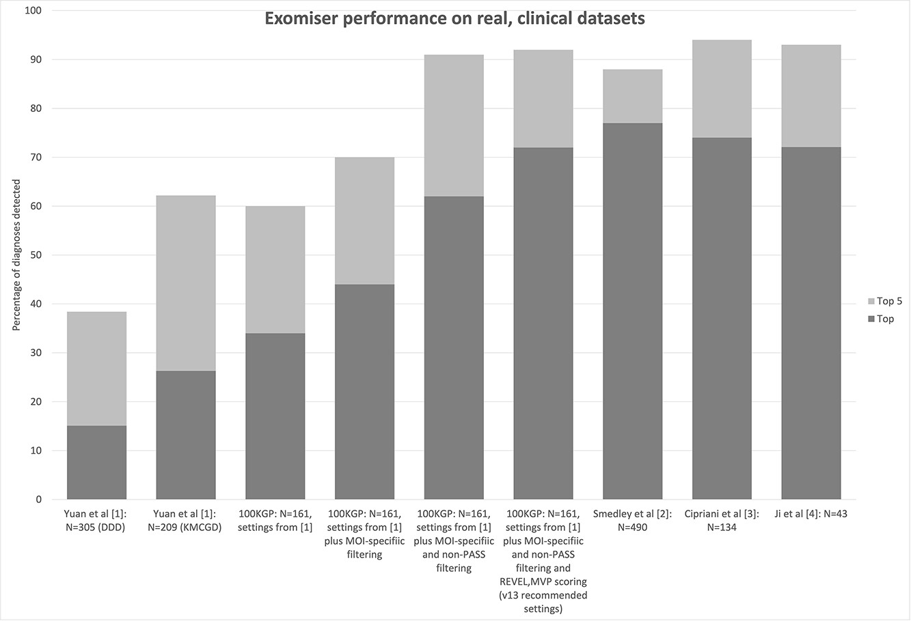

## 引言

上篇《阅读指南》里，我们把解读分析拆成了六件事，其中"变异优先级排序"留给了后续，这篇就来开始填坑。

变异优先级排序做的事情很直接：通过算法综合患者的表型相关性和候选变异的致病性，把最可能与疾病相关的变异（或基因）排到前面，供后续精细解读。听起来简单，但做起来有几个容易被忽视的问题。

## 到底是"基因排序"还是"变异排序"？

对临床遗传学医生来说，这两个概念没什么区别。但对设计算法的生物信息学研究者来说，这个选择关系到算法的根本架构。

先说临床端。目前遗传病基因检测主要面向单基因遗传病。也就是说一个基因上不管检测出多少变异：如果是常染色体显性（autosomal dominant, AD）疾病，有 1 个致病变异就能下阳性结论；如果是常染色体隐性（autosomal recessive, AR）疾病，需要 2 个位于不同等位基因上的杂合致病变异（即复合杂合），或者 1 个纯合致病变异。致病性评级以变异为单位，但最终报告以基因为单位。

再说算法端。所谓变异注释，就是在测序阶段识别出的原始变异位点基础上，补充检测阶段无法直接获得的信息：变异所在基因的功能与关联疾病，变异的编码区后果（错义、无义、移码、剪接位点变异等），在人群数据库（如 gnomAD）中的等位基因频率，各类计算致病性预测工具（REVEL、CADD、PolyPhen-2、SIFT 等）的评分，ClinVar 收录的分类结果，保守性评分，等等。对于设计排序算法的人来说，每一种注释就是一个特征。每个变异经过注释后会拥有一组独立的特征数据，可以被独立评估、独立打分，天然适合各种机器学习方法。

于是就出现了一个有趣的分化。偏临床机构背景的团队发表的算法（如 Exomiser、LIRICAL、AI-MARRVEL）虽然多用不那么先进的机器学习方法，但会认真对待复合杂合在排序中的权重，设计专门的 recessive 模式或额外加权模型。偏计算背景的团队（如 Xrare、AMELIE）更倾向于用"先进"的机器学习方法，但往往对复合杂合的处理不够充分。虽然两类工具的输出都可以是基因级别的排序（gene prioritization），但前者在 AR 疾病场景下的排序质量通常更高。

为什么这个区分重要？因为在真实的临床检测中，AR 基因上如果只检测到 1 个杂合致病变异，通常不能认为是阳性结果。如果排序算法只看单个变异而不考虑同一基因内的变异组合，就可能把某些 AR 基因的候选优先级估高，或者漏掉单独看不够"抢眼"但组合起来足以解释表型的复合杂合。

## 这些算法的天花板在哪儿？

这里只是一篇公众号文章，不打算做全面综述。我们只看能够综合表型和基因型进行排序的工具，以 Top 1、Top 5、Top 10 三个指标来衡量。

*Yuan et al. 2022* 在 DDD 数据集（305 例）和检测公司内部数据集（KMCGD，209 例）上评测了 11 款工具：

*Birgmeier et al. 2020* 在 215 例 DDD 真实单人案例上评估了 AMELIE 和其他 5 款工具：

AI-MARRVEL 在 58 例实验室内部数据、75 例 UDN 数据和 200 例 DDD 数据上进行了评测：

Genomics ITER 的公开 benchmark 仓库在 61 例全外显子测序确诊案例上持续测试各类工具，是目前更新最及时的独立对比来源：

综合这几组数据，最好的几款工具 Top 1 大致在 50%–72%，Top 5 在 75%–92%，Top 10 在 80%–96%。不同研究之间的数字差异主要来自数据集构成：单人家系排序难度大于 trio 核心家系，因此单人家系案例占比高的数据集，排序的性能指标自然会差一些。对算法如此，对人类专家也一样，也是临床专家共识推荐以核心家系送检的原因之一。

AD 基因的排序灵敏度显著高于 AR 基因，原因前面讨论过了。为了更好的解决 AR 基因的检测灵敏问题，Exomiser、LIRICAL、AI-MARRVEL 这些工具也都设计了专门的 recessive 模式来应对。但这种设计也会给软件的使用者带来困惑，毕竟在分析一个案例之前，谁又能知道案例是显性还是隐性基因导致的呢？

AMELIE、AI-MARRVEL、Xrare 三个机器学习算法各自做过特征重要性分析，得到的结论一致：**表型相关性是对排序贡献最大的特征**。这也符合临床实操，毕竟每个人携带的潜在致病变异很多，只有与患者表型匹配的致病变异才是真正的诊断答案。

## 数据比算法更重要

在所有 benchmark 里 Exomiser 是一个绕不开的存在。每个新方法发表时都要先把 Exomiser 拉出来打一顿，好像 Exomiser 很弱的样子。但如果你用过任何商用遗传检测分析软件，只要它没有自研排序算法，底层用的大概率就是 Exomiser。原因很简单：它一直在维护、持续在更新。而且不少后来者本身就是在 Exomiser 的部分结果上做二次开发，比如 DeepRare 的基因型分析模块就直接使用了 Exomiser 的输出。

一件有趣的事情是，*Yuan et al. 2022* 的评测中 Exomiser 表现不佳（DDD 数据集 Top 1 约 15%，Top 5 约 39%），Exomiser 团队对此非常不满，随后发表了反驳文章（*Jacobsen et al. 2022*）：

反驳中揭示了两条关键信息：

1. **排序前的过滤策略很重要。** 加入遗传模式相关的频率过滤（AD / 纯合隐性 0.1%，复合杂合 2%）后，Top 1 从 34% 提升到 44%；再加上 VCF 文件中 PASS 标记的质控过滤，进一步提升到 62%。这些都是 Exomiser 12.1.0 中已有的推荐默认设置。
2. **致病性预测数据源的选择很重要。** 将 PolyPhen-2、MutationTaster、SIFT 替换为更现代的 REVEL 和 MVP 后，Top 1 进一步提升到 72%。这些数据源在被测版本中已经可用，只是当时没有被设为默认选项，从 v13 开始已纳入推荐预设。

Jacobsen et al. 用同一个 Exomiser、同一套算法逻辑，在 100KGP 数据集上仅仅因为过滤策略和数据源配置的差异，Top 1 就从 34% 跳到了 72%。**在变异排序这件事上，数据比算法本身更重要。**

如果这样讲不够形象，那我们再看一个真实临床案例来说明"数据时效性"的影响：

> 患者表型：HP:0012202 血清胆汁酸浓度升高；HP:0004354 循环羧酸浓度异常；HP:0000952 黄疸
>
> 已知诊断：OMIM:619256 家族性高胆汁酸血症 2 型（NTCP 缺乏症）
>
> 阳性变异：NM_003049.4(*SLC10A1*):c.800C>T(p.Ser267Phe)

这个变异总人群频率 0.17%，但东亚人群频率高达 4.59%。ClinVar 中长期标注为 Conflicting classifications of pathogenicity，多年前基本被评为 benign。直到 2020 年 9 月才有文献报道该变异与 NTCP 缺陷相关，2021 年 3 月 OMIM 才收录 OMIM:619256-*SLC10A1* 关联，2021 年 6 月 HPO 才跟进收录这个疾病-表型-基因关联。

不管用什么算法，如果用 2021 年之前的工具和数据来排序这个案例，它几乎不可能排到前面：表型数据库里没有这个基因-疾病关联，变异数据库里也没有支持致病性的证据。数据的时效性对排序结果的影响，可能远大于算法的选择。

## 排不上去的变异到底输在哪儿？

确诊案例的致病变异没有被排进 Top 20，原因无非两条：表型-疾病相关性不足，或者变异致病性评估不足。说起来很简单，但我们用两个实例来看看，算法在什么情况下会输给人类临床遗传医生。

> 患者表型：HP:0000703 牙本质发育不全；HP:0010299 牙本质异常
>
> 已知诊断：OMIM:130900 釉质发育不全 III A 型
>
> 阳性变异：NM_198488.5(*FAM83H*):c.2000C>G(p.Ser667*)

*FAM83H* 关联的 OMIM:130900（Amelogenesis imperfecta type III）在 HPO 数据库中仅有 4 个 HP term，患者临床信息也有限，在任何排序算法中都难以获得高的表型相关性分数。同时，该变异是一个 stop_gained 变异，未被 ClinVar 收录。这里暴露了一个系统性问题。大多数排序算法依赖的计算致病性预测工具（REVEL、PolyPhen-2、SIFT 等）都是专门针对错义（missense）变异设计的，对无义变异无法给出预测分数。

> 患者表型：HP:0001263 全面发育迟缓；HP:0001249 智力障碍；HP:0001270 运动发育迟缓；HP:0000750 言语和语言发育迟缓；HP:0007018 注意缺陷多动障碍；HP:0012683 松果体囊肿；HP:0000952 黄疸
>
> 已知诊断：OMIM:618092 伴面部畸形、言语发育迟缓及 T 细胞异常的智力发育障碍
>
> 阳性变异：NM_138576.4(*BCL11B*):c.1784_1794delTGGGCAAGGTC(p.Leu595HisfsTer286)

这个 11bp 的 frameshift 变异同样未被 ClinVar 收录，没有基于生信预测的致病性结果。

两个案例的共同点：致病变异都不是错义变异。对于 stop_gained 和 frameshift 这类功能丧失（loss-of-function, LoF）变异，"已经破译人类遗传密码"的 AlphaMissense 无能为力，因为它只处理错义变异。那换上可以"读懂生命语言"的 Evo2 呢？

我们用 Evo2 40B 模型对 *BCL11B* 这个 11bp 缺失做个实测：提取以变异位点为中心的 8192bp 参考序列和变异序列，分别计算模型的自回归 log-likelihood，取差值作为评分。delta score 为 -0.0094，算是 deleterious，但不够强。对于一个 11bp 的缺失来说，如果区域高度保守，应该看到更大的差值。这个分数作为孤立证据远不足以支撑致病性判断。

相比之下，我们在《AI 当研究员，我当 PI》系列中开发的基于 ACMG 规则的评级工具可以直接给这个变异赋予 PVS1_Strong + PM2_Moderate。尽管不足以作为正式评级，但是对于作为排序中的变异致病性补充已经足够了。**当前场景中，基于规则的 ACMG 预评级可能比基于基因组语言模型致病性预测更实用。** Exomiser 从 v13.1.0 开始就补充了基于规则的 ACMG 评级，并在后续版本中持续完善，也指向同一个方向。

## 大模型能直接替代排序算法吗？

上面讨论的排序算法还有一个共同的局限：它们只对潜在阳性排序，不判定阴性。算法能告诉你"这些变异最可能致病"，但没有任何一个能反过来判定"这个案例没有找到致病变异，是一个阴性案例（暂时无法诊断或非遗传因素）"。当然这不是算法的设计初衷，我们不能吹毛求疵，但这个能力在临床上是被真实需要的，目前只能由人类临床遗传医生来承担。

回到我们一直在探索的问题：大模型的能力到了哪一步了？上篇《罕见病场景下，精巧的 Agent 设计还需要吗？》里我们发现大模型不借助任何工具就已经在表型-疾病匹配上表现出色，而且 1M token 上下文已是很多模型的标配。一个自然的问题是：能不能直接把经过过滤的、带完整变异注释的数据交给大模型，让它自己找阳性变异，跳过排序这一步？

我们用前文的 3 个阳性案例加上 2 个确认为阴性的案例来测试。每个案例提供 HPO 术语和经过基础过滤但包含完整变异注释的全部候选变异数据，交给 Claude Opus 4.7 分析。

| 案例 | 预期结论 | 大模型判断 | 是否正确 | 置信度 |
| --- | --- | --- | --- | --- |
| 发育迟缓 | *BCL11B*（阳性） | *BCL11B* | 正确 | HIGH |
| 牙齿异常 | *FAM83H*（阳性） | *FAM83H* | 正确 | > 95% |
| 胆汁酸升高 | *SLC10A1*（阳性） | *SLC10A1* | 正确 | HIGH |
| 阴性 1 | 阴性 | 未发现可信变异 | 正确 | LOW（20–30%） |
| 阴性 2 | 阴性 | *IKBKB*（过度解读） | 错误：假阳性 | MODERATE |

坦率地说，做这个实验之前，我的心理预设是大模型还无法替代排序算法，仍然需要先通过机器学习算法把候选范围缩到 Top 20 或 Top 50，然后再让 agent 做精细分析。结果：三个阳性案例全部正确诊断，包括前面讨论过的那两个对传统排序算法充满挑战的非错义变异案例。在一个阴性案例上也给出了"没有可信候选"的判断。

更值得一提的是大模型在两个阳性案例中展现出的推理深度。在 *BCL11B* 案例中，大模型没有局限于已有的 ACMG 预评级，而是综合了 *BCL11B* 对功能丧失变异的极端不耐受性（pLI 0.995, LOEUF 0.462）以及患者核心表型（智力障碍、言语发育迟缓、全面发育迟缓、行为异常）与已知 *BCL11B* 表型的高度吻合，自主将评级基于 PP4 提升至 Pathogenic。在 *FAM83H* 案例中，情况更有趣：*FAM83H* 基因名称在 2026 年 2 月 9 日刚刚变更为 *SACK1H*，基因名的不一致导致 ACMG 预评级工具没有匹配到完整的基因-疾病关系信息。这其实是所有基于预处理参考数据的工具共有的问题——一个变异名称一旦变更，各数据库的跟进更新完全不同步，差距甚至可以达到数年；即使有各种基因 ID 体系来缓解这个问题，完全依赖基因 ID 汇总各数据库的信息也做不到完全可靠。面对 ACMG 预评级缺失的情况，大模型自动启动了手动 ACMG 评估——提示词中完全没有这一条要求——赋予变异 Pathogenic（PVS1 + PM2 + PP4）。

五个案例当然说明不了什么统计意义上的问题，但这 3 个挑战性的案例都可以轻松搞定，我就更不担心那些显而易见的阳性案例了。

## 写在最后

变异排序算法也许还不至于被立刻淘汰，但它的"不可替代性"确实在缩小。在有好模型、有足够 token 预算的场景里，跳过排序直接让大模型分析完整注释数据，可能已经是更好的路径。

上篇我还写着"我们不能真的给 AI 挂上一堆工具就放手让它自由发挥"，现在看来我的这个立场也要动摇了。

另外一个现象值得注意：大模型在分析变异时倾向于"找到点什么"而不是宣布"没有发现"。第二个阴性案例中，大模型将一个 VUS 变异过度解读为可疑候选，正是这种倾向的体现。这可能与大模型经过 RLHF 训练后倾向于"给出答案"而非"承认没有"有关，也与临床遗传学中"不漏诊"的压力如出一辙——人类医生同样会落入对 VUS 变异过度解读的陷阱。假阳性倾向是绕不开的问题，让大模型直接面对完整的变异数据，它需要学会"敢说没有"——这恰恰是当前排序算法从未解决、但临床上真实需要的能力。那这个问题该怎么解决呢？我们下次讨论。

---

**参考资料：**

1. Yuan X. et al. *Evaluation of phenotype-driven gene prioritization methods for Mendelian diseases.* Briefings in Bioinformatics 23.2 (2022).
2. Jacobsen J. O. B. et al. *Evaluation of phenotype-driven gene prioritization methods for Mendelian diseases.* Briefings in Bioinformatics 23.5 (2022).
3. Birgmeier J. et al. *AMELIE speeds Mendelian diagnosis by matching patient phenotype and genotype to primary literature.* Science Translational Medicine 12.544 (2020).
4. Mao D. et al. *AI-MARRVEL — A Knowledge-Driven AI System for Diagnosing Mendelian Disorders.* NEJM AI 1.5 (2024).
5. *Repository for Benchmarking of causal germline variant prioritizers.* https://github.com/genomicsITER/benchmark-germline-variants-prioritizers
