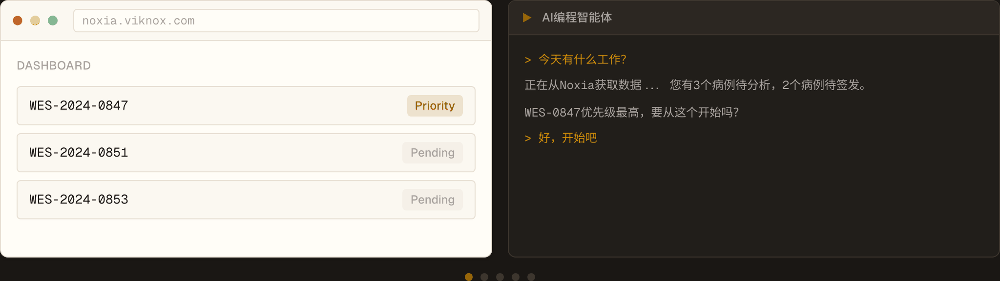
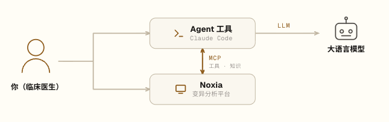

《精巧的 Agent 设计还需要吗》的结尾，我们有一个讨论：与其再造一个 Agent 系统，是不是该把领域里的工具、数据和知识库做成能被通用 Agent 工具调用的"装备"。

这个想法具体如何落到专科医生的临床基因组分析中呢？那需要先回到我对 AI 应用的几点粗浅认知，它们会决定最终方案该长成什么样子。

## 我对 AI 应用的几点认知

**第一，网页聊天形式的 AI 只发挥了一成功力。** 能结合本地文件、外部系统、工具和领域知识的 Agent 工具（即 agent harness，如 Claude Code），才能真正释放大模型的能力。这也是 Claude Code/Cowork、ChatGPT Codex、腾讯 WorkBuddy 正在做的事。它们不仅仅是代码助手，更会是智能办公新范式。

**第二，SaaS 没有死，只是构建逻辑从"面向人"转为"面向 AI"。** 协作中 Agent 需要工具来干活，人仍然需要可视化工作台来审阅和管理。界面层依然重要，但产品得从"界面交互"转型为"工具箱"，让 Agent 通过标准协议自主执行、返回结果。

**第三，在医疗场景下，完全自主的 Agent 行不通。** 大模型天生带有不确定性，叠加医疗里责任归属的伦理约束，每一步关键判断都得有专业医生在场：引导思考、与 Agent 协作、最终确认。

第三条几乎单独决定了系统的样子。它意味着系统不能是一个黑箱式的自动诊断引擎，而要同时是 Agent 的工具台、医生的控制台。于是一个理想的遗传分析系统，得分两层来看。

## 没有 Agent 时，它得是一个称职的分析系统

第一层，它本身就是一个完整的临床变异分析平台，覆盖从原始数据到基因报告的全流程：临床测序数据管理、变异评级、报告撰写与生成。

自带一套常规的 "AI" 辅助分析工具：表型 HPO 术语 NLP 提取、基于 ML 的变异优先级排序、基于规则的 ACMG 自动评级、CNV 可视化等等。

换句话说，就算一个 Agent 都不接，它本身就是一套能独立干活的分析系统。

## 接上 Agent，魔法就会发生，但系统同时也是安全闸

第二层，配合 Skill，Agent 可以跑完从案例创建、变异分析到报告生成的全流程：在阳性案例中以相当高的准确率识别致病变异，也能正确标记暂时锁不定致病基因的阴性案例。过程中你随时能和 Agent 讨论评级、追问证据、调整判断。

和传统"AI 帮你想、你负责动手"的应用不同，接上 Agent 后正好反过来：你负责目标，Agent 负责执行。

但魔法不等于放手。恰恰因为 Agent 能自己跑完全程，系统在几个关键节点上必须让它停下来——

- Agent 提出的变异分类，**仍需你手动批准**；
- 临床报告，**仍需你亲自签发**；
- 系统需要满足 CLIA、CAP、HIPAA、ISO 15189、FDA 21 CFR Part 11 等所要求的审批与审计流程。

所以这一层不只是可视化工作台，更是医学行为的安全闸：Agent 可以一路狂奔，但越不过医生这道门。

理想情况下，大概是这样：

## 于是有了 Noxia

这套系统，我们做出来了，叫 Noxia。它是 Agent-native 的遗传分析系统，本身却不做推理、不下判断。

HPO 术语提取、变异优先级排序这类"AI"的工具它都有，并且性能领先。但真正会推理、会和你讨论、会拿主意的那层智能，它一概不碰，全让给 Agent。重剑无锋，大巧不工：剑身是工具、数据、知识，锋是推理与判断，开刃这件事留给 Agent 去做。

Noxia 怎么和 Agent 配合呢？四个角色，一条流程。

| 角色 | 职责 |
|------|------|
| **你**（临床医生） | 用自然语言向 Agent 工具下达分析指令；在 Noxia 中审阅、批准变异评级、签发报告 |
| **Agent 工具**（如 Claude Code） | 在终端中运行，负责理解自然语言、编排工具调用、汇总结果 |
| **Noxia** | 通过 MCP 向 Agent 工具提供变异分析所需的工具与知识，双向同步结果；并提供可视化工作台供审阅与管理临床流程 |
| **大语言模型** | Agent 背后的推理引擎，负责语言理解与规划 |

一次分析大致这样：

1. 你在 Agent 工具中描述需求，告别**填表**，提供病例的临床表型与候选基因等背景；
2. Agent 结合表型与基因数据，借助 Noxia 的工具与知识对表型进行分析，对变异做注释、证据检索与分类，筛出候选致病变异；
3. 你随时能就候选变异和 Agent 展开讨论：追问证据、调整表型权重、比较鉴别诊断；
4. Agent 把结构化的证据、分类和结论同步到 Noxia 中，供你审阅、批准和管理；
5. 确认无误后，你在 Noxia 中签发临床报告。

## 两套 Skill，两种节奏

Agent 通过 Skill 学会怎么操作 Noxia。我们设计了两套基础技能，对应两种工作节奏。

**保守型：** 包含多个人工确认节点，支持你边想边讨论边分析，同时实时在 Noxia 里看到结果。

| Skill | 做什么 |
|-------|--------|
| noxia-case-management | 创建病例、上传 VCF、触发注释、设置 HPO 表型术语。每次分析从这里开始 |
| noxia-variant-analysis | 质控审查，结合表型扫描候选变异，ACMG 初筛，对值得深入的变异进行分析 |
| noxia-reporting | 对选定变异分类，标记入报告的发现，起草报告字段供审阅 |

**激进型：** 跳过所有人工核查点，一步到位。Agent 充当初级分析员，你可以完全脱离 Agent 工具，只在 Noxia 里审阅结果和审批报告；有疑问时再打开 Agent 工具，基于案例和它讨论。

| Skill | 做什么 |
|-------|--------|
| noxia-fast-forward | 一次无人值守地端到端跑完整条流程，适合一键分析并生成报告初稿 |

## Skill 只是起点

每个人、每个检验实验室都有自己的分析风格和理念，所以预设的 Skill 远谈不上完美，不可能适配所有人。

而且怎么设计 Skill，AI 领域也有很多争论。有人主张多个 Agent 各扮一角（例如表型分析员、变异评级员、案例分析师），组队协作；也有人认为人类这么分工只是因为能力有限，AI 不必照搬：所有问题都丢给一个 Agent，让它自己根据 Skill 和工具决定怎么取上下文、怎么完成任务。

我不知道哪种更对。但借助 Noxia，你可以按你认为正确的方式设计 Skill，调用 Agent，根据实际案例打磨属于自己的分析 AI。只需要简单地告诉你的 Agent 工具就行。

## 不分析案例时，它是你 Agent 工具的工具箱

如果你手上没有常规遗传案例要分析，只是做遗传咨询，Noxia 就是你 Agent 工具的工具箱：基因、疾病、变异信息随手可查，为表型分析提供向量搜索，还能帮你核验 Agent 给出的变异注释。

理论上，任何兼容 MCP 的 Agent 工具都能接入。你的克劳德，你的爱马仕，你的龙虾，都行。

## 你未必需要 Noxia

我们当然希望你来试试（后台私信或邮件 support@viknox.com 获取试用账号，更多资料见 https://www.viknox.com/zh/blog/ ）。

但 Noxia 和 AI 的结合方式算不上什么独门秘技，只是 AI 应用领域最基础的实践方法。如果你已经在用类似的遗传分析系统，去推动你的软件供应商、或你们的 IT 同事：在氛围编程如此成熟的今天，给现有系统加上 MCP server、加上 CLI、加上 Skill，真正试试 Agent 在临床遗传病分析里能做到什么程度。所有的 All in AI 里，没有比这个更容易落地的方案了。

## 写在最后

Noxia 的"无锋"不是缺陷，是选择——把推理留给 Agent，把最终拍板留给医生，自己安心做那把又钝又重的剑。AI4S（AI for Science）正火热，还没人喊出 AI4D（AI for Diagnosis）。Noxia 算是我们对它的一次尝试吧。
