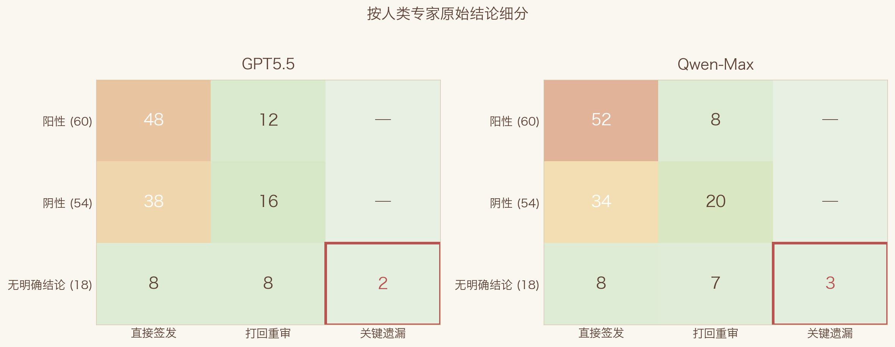
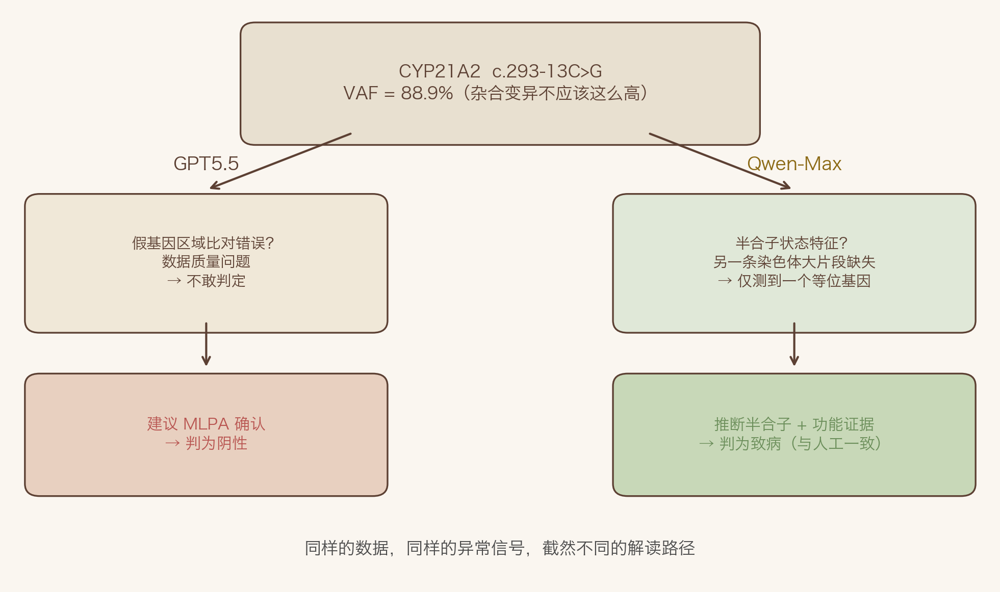

据说 AI 不会终结软件开发，只会重塑它的范式。程序员们虽然失业了，但是没被取代，只是从"写代码的人"变成了"审代码的人"，大家戏称自己为 yes engineer。那遗传分析师呢？AI 会不会取代遗传分析师，还是只会重塑遗传分析的流程？上一期我们介绍了 Noxia 和它背后的理念：把工具、数据和知识做成那把又重又钝的剑，推理和判断的锋刃留给 Agent。这一期，我们把这把剑拿到真实的临床案例里试试，看看它到底效果如何。

## 实验设计

以 132 例由人类遗传分析专家完成分析的真实案例作为基准。这些案例覆盖了遗传分析中最常见的三种结论：

> **阳性**（60 例）：检测到可以明确或部分解释患者表型的致病/疑似致病变异
>
> **阴性**（54 例）：检测范围内未检测到可以明确解释患者表型的致病/疑似致病变异
>
> **无明确结论**（18 例）：检测到与患者表型相关的临床意义未明变异（VUS）

全部使用 Noxia 的 noxia-fast-forward 技能，即 Agent 端到端地跑完从案例分析到报告生成的全流程，分析过程不进行任何人工干预。

在这次实验中，我们还同时验证了前几期讨论过的一个假设。大模型能力在快速提升，一些曾经行之有效的"老经验"可能已经过时。所以我们一次性做了两个减法：
- 第一，不设计复杂的提示词和检索流程——以前我们用"中文分词→英文翻译→基于英文词组检索→LLM 分析"的 RAG 方法，效果不错，但那是为上一代大模型量身定做的。这次我们只提供 HPO 向量检索工具，让 AI 自己决定怎么用。
- 第二，不提供变异优先级排序算法的结果——以前我们依赖排序算法帮人类缩小搜索范围，但现在模型的长上下文能力已经足够强，可能可以直接从大量变异中筛选候选。他们 AI 圈的人管这叫大海捞针（Needle-in-a-Haystack）。

## 怎么评？

这次评估关心的是"人类不做第一手分析，仅审阅 AI 的结果，能不能安全地完成工作"。这和传统的模型评估视角不同。

传统评估把算法当一个独立的判断者，用 F1 值、灵敏度、特异度去衡量它和标准答案的吻合度。但我们设想的工作模式是 Agent 充当初级分析员出具初稿，人类遗传分析师作为审阅者做最终决策和签发。在这个模式下，AI 的一些"错误"其实不重要，比如 AI 把一个阳性案例谨慎地标记为无明确结论，只要它找到了正确的变异，审阅的医生一眼就能改过来。真正危险的是 AI 根本没有呈现关键变异，而医生在审阅模式下也不会自己从头筛变异，这种遗漏才是不可接受的。

基于这个逻辑，我们把评估结果分成三个层级：

- **直接签发**：AI 的结论和人类专家一致——阳性对阳性且变异一致，阴性对阴性，无明确结论对无明确结论且关注的变异一致。审阅者只需确认签字。

- **打回重审**：AI 的结论和人类专家有分歧，但关键信息都在。比如人类判阳性、AI 判无明确结论，但 AI 找到了正确的变异，只是在分类上更保守；或者人类判阴性、AI 多报了一个 VUS，需要人类排除。这类情况下，审阅者需要花时间重新审视 AI 的判断、排除差异，但所有必要的证据都已经摆在桌上。

- **关键遗漏**：AI 不仅结论错误，而且遗漏了人类专家关注的关键变异——审阅者根本看不到那条变异，所以也不会对此提出质疑。在"Agent 分析、人类审阅"的工作模式下，这是最难通过审阅发现的风险之一。

需要说明的是，本研究以人类专家的分析结果作为参考标准（reference standard），而非绝对真值（ground truth）。ACMG 变异分类本身存在实验室间差异，不同实验室对 PM2、PP3、BS1、基因-疾病有效性和表型匹配的使用标准并不完全一致。因此，AI 与人类一致不等于 AI 正确，AI 与人类不一致也不等于 AI 错误。对于存在分歧的案例，仍需独立专家复核才能确认。此外，本次评估仅考量致病变异的检出（是否找到了关键变异），暂不讨论 AI 与人类在变异分类（ACMG 评级）上的一致性问题。

## 第一轮：一线大模型

我们先用 OpenAI 的 GPT5.5 打头阵，它基本上代表了目前最强的一线大模型之一。132 例全部跑完，结果如下：

| | 直接签发 | 打回重审 | 关键遗漏 | 合计 |
|------|------|------|------|------|
| 阳性 | 48 | 12 | 0 | 60 |
| 阴性 | 38 | 16 | 0 | 54 |
| 无明确结论 | 8 | 8 | 2 | 18 |
| **合计** | **94 (71.2%)** | **36 (27.3%)** | **2 (1.5%)** | **132** |

71% 的案例可以直接签发，审阅者只需确认 AI 的判断没问题就行。27% 的案例需要审阅者介入，重新审视 AI 和人类专家的分歧，但所需的信息都在，不需要从头分析。

最值得关注的是"关键遗漏"那一列：仅 2 例，全部集中在"无明确结论"——本次评估中，阳性和阴性案例未观察到关键遗漏。被遗漏的都是人类专家标记为 VUS 的变异，而且这些 VUS 当前证据有限，其临床可解释性存在较大不确定性，稍后我们会展开讨论。

进一步拆开"打回重审"的 36 例，绝大多数是 AI 比人类更保守：10 例人类判阳性、AI 判无明确结论但变异一致（AI 找到了变异，只是不敢下定论）；14 例人类判阴性、AI 多报了一个 VUS（AI 更谨慎，不敢放行）。偶尔也有 AI 更激进的情况：2 例人类判阴性、AI 判阳性——其中是否存在 AI 提出了合理的候选解释而人类遗漏的情况？这个我们同样后面展开讲。

## 第二轮：国产大模型

有一种普遍的说法：国产大模型虽然和美国一线闭源模型还有数月到两年不等的差距，但已经跨过了"能用"的门槛，加上开源和低价的优势，在硅谷也被广泛接受并用于日常工作。所以我们拿 GPT5.5 做标杆，看看国产大模型的水平如何。

这次先用通义千问 Qwen-Max。选它的主要原因是最近有羊毛可以薅。千问在国产大模型里算不上第一梯队的稳定选手，如果它都能过关，那 Kimi、GLM、DeepSeek 这些口碑更好的模型大概率也没什么问题。

| | 直接签发 | 打回重审 | 关键遗漏 | 合计 |
|------|------|------|------|------|
| 阳性 | 52 | 8 | 0 | 60 |
| 阴性 | 34 | 20 | 0 | 54 |
| 无明确结论 | 8 | 7 | 3 | 18 |
| **合计** | **94 (71.2%)** | **35 (26.5%)** | **3 (2.3%)** | **132** |

同样 94 例直接签发，"关键遗漏"多了 1 例。和 GPT5.5 一样，所有"关键遗漏"都集中在"无明确结论"案例中，阳性和阴性案例同样未观察到关键遗漏。这个结果相当出乎意料。一个"非一线"的国产模型，在遗传分析这种高度专业的任务上，居然和目前最强的模型之一打了个平手。

## 正面对决

94 对 94，看起来两个模型能力完全一样。但这其实是一个巧合。仔细对比发现，两个 94 例集合中只有 83 例完全重合，各有 11 例只在一方的"直接签发"里出现。也就是说，两个模型在同一批案例上犯了不同的错，恰好数量上抵消了。

但这 22 例分歧案例也揭示了两个模型截然不同的"性格"。

在阳性案例上，千问明显更果断：有 6 例人类判阳性的案例，GPT5.5 谨慎地标记为无明确结论或阴性，而千问直接正确地判定为阳性。GPT5.5 只在 2 例上比千问更接近人类的判断。千问的果断甚至挽救了一个 GPT5.5 彻底判错的案例——一位先天性肾上腺皮质增生症患者（CYP21A2 基因），GPT5.5 分析了这个变异但认为证据不够而判为阴性，千问则正确地识别出来了。

但这种"大胆"是有代价的。在阴性案例上，GPT5.5 明显更干净：有 8 例人类判阴性的案例，千问多报了一个 VUS，而 GPT5.5 正确地放行了。千问只在 4 例阴性案例上比 GPT5.5 更准确。换句话说，千问的"大胆"在阳性案例上是优势——敢下结论；在阴性案例上却是劣势——本该放行的非对报一些。

## 案例特写

这里挑三个有代表性的故事。

### AI 提出了人工未报告的候选解释

患者男，出生后运动和语言发育均比同龄人慢 1-3 个月，入学后数学能力极差，韦氏智力量表测试显示边缘智力水平。人类专家的结论是阴性——没有找到能解释这些症状的致病变异。

两个 AI 都不同意。它们不约而同地锁定了 BRSK2 基因上的一个移码缺失变异，判定为疑似致病，指向一种常染色体显性遗传的复杂神经发育障碍（MONDO:0100038）。这个判断在遗传学上站得住：BRSK2 的 pLI 评分为 1.0（极度不耐受功能缺失），ClinGen 对该基因与神经发育障碍的关联给出了"明确"的有效性评级，变异本身在人群数据库中完全缺失。

那人类专家为什么没有报告它？很可能因为 BRSK2 相关的神经发育障碍至今没有被 OMIM 收录——它还没有正式的"OMIM 疾病编号"。在传统的分析流程中，没有 OMIM 条目的基因-疾病关联容易被排除在常规筛查范围之外。而 AI 在这方面具备互补优势：它能更好地综合基因约束度评分、ClinGen 评级、变异机制和表型匹配来评估候选基因，不完全依赖于 OMIM 是否已收录。当然，这一候选解释是否成立，仍然需要临床医生结合患者的具体情况来判断。

### 保守的代价

患者新生儿，出生后出现低钠血症和高钾血症，临床已经在用氢化可的松和氟氢可的松治疗。 CYP21A2 检测提示异常——高度怀疑先天性肾上腺皮质增生症。人类专家的结论是阳性，致病基因就是 CYP21A2。这应该是一个很简单的案例。

GPT5.5 找到了 CYP21A2 变异（c.293-13C>G），也识别出它和肾上腺皮质增生症的关联。它甚至注意到了这个位点的特殊性——在报告里明确标注了"CYP21A2/假基因区域"，并写道"假基因的基因转换导致该位点对短读长外显子组测序具有技术挑战性"。它也看到了那个异常的等位基因频率：88.9%，对于一个杂合变异来说太高了。但 GPT5.5 把这个异常当成了数据质量问题——可能是假基因区域的比对错误，而不是生物学信号。加上没有找到第二个等位基因、人群频率偏高、数据库中存在纯合携带者，GPT5.5 的结论是：证据不够，判为阴性，建议做 CYP21A2 专项检测（MLPA）来确认。

千问也看到了完全一样的数据，却对 88.9% 提出了另一种可能的解读：这不是比对错误，而是半合子状态的特征——另一条染色体上可能存在一个大片段缺失（CYP21A2 区域因为有假基因，是大片段缺失的高发区，约占致病等位基因的 20-25%），外显子组测序检测不到这种缺失，导致几乎只测到了一个等位基因。千问据此推断该变异可能处于半合子状态，结合功能研究证据，给出了致病的分类，与人类专家的结论一致。当然，这一推断尚需 MLPA 或其他方法确认 CNV 的存在——千问提出了一个合理的假说，但并非确证。

同样的数据，同样的异常信号。GPT5.5 看到了假基因干扰，选择了谨慎回避："数据有问题，我不敢判。"千问也看到了假基因干扰，却选择了："数据看起来有问题，恰恰可能因为另一条染色体上有个大缺失。"两种态度都有道理——在这个案例里，千问的推断恰好与最终人工结论一致。这也印证了我们前面看到的模式：千问在阳性案例上更果断，GPT5.5 在证据边界上更保守。保守有保守的价值——宁可漏判也不误判，但保守也有代价——有些患者可能因此需要额外的确认检测才能获得诊断。

### 关键遗漏到底漏了什么？

从表格中可以看到，两个模型的"关键遗漏"全部集中在"无明确结论"案例中。本次评估中，阳性和阴性案例均未出现关键遗漏。那 AI 到底漏了什么？

以两个模型唯一共享的漏判案例为例：一名患儿表现为慢性肠病，人类专家报告了 NLRC4 基因上的一个 VUS。两个 AI 都判为阴性。但仔细看这个 VUS 的证据：ACMG 评级仅有 PM2 一条支持证据，还被 BP4 抵消；REVEL 预测分值 0.034，强烈偏向良性；ClinVar 无记录；表型匹配也只是部分吻合——NLRC4 相关疾病的典型特征是全身性自身炎症（反复发热、皮疹、脾大等），而该患儿的表现是肠梗阻和回结肠狭窄。这个 VUS 当前的证据有限，其临床可解释性存在较大不确定性。人类专家选择报告它，可能基于基因-疾病机制的潜在相关性、后续重分类的可能性、或家系验证的价值——这些是经验丰富的分析师在边界案例中常见的专业判断。

其余遗漏的情况类似，比如 GPT5.5 漏掉了 PIEZO2 的一个 VUS，千问还额外漏掉了 GFAP 的 VUS——这些变异都是人类专家在"无明确结论"案例中报告的候选，当前证据处于报与不报的边界。不同实验室对 VUS 的报告策略本身就存在差异：有的倾向于多报候选 VUS 供临床参考和后续随访，有的则聚焦于证据最充分的发现。AI 的报告策略可以通过调整 Skill 来适配不同机构的偏好。

## 所以，AI 会不会取代遗传分析师？

132 例，两个模型，数据都在这里了。71% 直接可用，仅有 2-3 例关键遗漏且全部集中在"无明确结论"案例中——遗漏的是当前证据有限的 VUS，而非确诊级别的致病变异。本次评估中，阳性和阴性案例均未观察到关键遗漏。一个国产大模型和 GPT5.5 打了个平手，在阳性案例上甚至更果断。

这 132 个案例或许说明，遗传分析的工作，在 AI 的协作下，可以逐渐从"寻找候选变异"转向"验证候选变异"。AI 可能可以接管前者，而后者依然需要遗传分析师的经验、责任和最终判断。

所以问题也许不是"AI 会不会取代遗传分析师"，而是"未来的遗传分析师，该如何和 AI 协作"。
