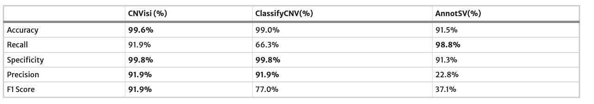

## 引言

在临床基因检测中，CNV 是与 SNV/indel 同样重要，但更充满挑战的一种变异。它在诊断产出中的权重不低，尤其是对发育迟缓、智力障碍、自闭症谱系和多发先天畸形。例如染色体微阵列（CMA）自 *Miller et al. 2010* 的 ISCA 共识起就是对 CNV 的一线检测方法。随着实验室转向外显子和基因组，CNV 不再依赖单独的芯片，可以直接从测序读数中检出，补上 CNV 分析能进一步提高基因检测诊断率也早已成为行业共识。

相比于 SNV/indel 的检测，短读长测序技术在对 CNV 的检出上准确性本身就更差一些，很多时候假阳性和假阴性的控制难以兼顾。而 CNV 的评级更是难上加难：大量 CNV 是独特、非复发的。表型-区域关联也往往缺失、有限或彼此矛盾，判读很难收敛到一致结论。ACMG 与 ClinGen 在 2020 年给出一套半定量打分框架（*Riggs et al. 2020*），用意正是压缩实验室之间的分歧。但即便有了统一评分表，分歧依然存在。

这套框架的验证材料里就带着一个直接的证据。工作组在委员会之外另招募了 11 位临床细胞遗传学专家，共评估了 114 个 CNV，多数由两位评审各自独立打分。取其中附表 S2.2 那批常染色体、且有两份完整独立打分的 103 个 CNV，把两份结果逐条比对：完整五分类（P / LP / VUS / LB / B）的一致率只有 64.1%（66/103）；即便放宽到"致病侧 / 不确定 / 良性侧"三档，也只有 71.8%（74/103）。还有两个 CNV，一位评审判致病侧、另一位判良性侧，方向完全相反。

也就是说，CNV 评级本身就是一件专家之间都难以一致的事。那么 CNV 评级的辅助工具，它的上限会到哪里呢？

## 现有工具的两条路线

和 SNV 一样，CNV 的算法辅助评级也分两条路线，实现思路完全不同。

| 路线 | 代表工具 | 怎么给结论 |
|---|---|---|
| 规则型（ACMG/ClinGen 打分） | ClassifyCNV、AnnotSV、AutoCNV、Horizon | 按 *Riggs et al. 2020* 评分表逐条计分，汇总成五分类，每一分可追溯 |
| 机器学习致病性预测 | CNVoyant、dbCNV、ISV-CNV | 把各种注释当成特征交给机器学习模型，走训练集/测试集/验证集的流程，输出致病概率 |

规则型工具都在实现同一套评分表，彼此的差别只在参考数据和逐条实现的细节。机器学习类方法则选择不套用指南评分，而是让模型自己从已知变异和注释数据中学致病性。

其中不需要安装、可以直接输坐标查询、也不需要注册的有几个：CNV-ClinViewer（评级核心是 ClassifyCNV）、AutoCNV、GeneBe，以及 AnnotSV。对于随手的一次性核对，这几个就够用了。

既然我们在 Noxia 中已经实现了 SNV 的 ACMG 辅助评级，和 CNV 的检测和注释，自然要往前一步，把 CNV 辅助评级也接上。考虑到用户是遗传分析师，不是生信工程师，所以我们依然选择走规则型这条路：评分表透明，每一分都能回溯到 ACMG/ClinGen 的证据类别，比一个只给概率的黑箱更适合进临床流程。AI 已经大幅拉低了工具开发的时间成本，与其复用上面这些 5-6 年前的算法，不如让 AI 从零重做一套，就叫它 VibeCNVClassifier 好了。和我们在《没有大模型，中文表型分析还能怎么做？》里做 VibeHPO 时的原则一样：要确保它不是 AI slop，需要全程用数据约束 AI 的开发，而不是信 AI 由缰。

## 评价体系

CNV 注释的维度和打分规则都比 SNV 要少得多，对 AI 那就更是小菜一碟了。具体的细则这里就不展开了，直接看结果。一套评级工具的可信度，全在评估设计上。我们在三个相互独立的队列上测量最终性能，各自的"标准答案"来源不同，考察的能力也不同。

其实和 SNV 的规则引擎一样，约定了两个口径。**Exact** 指预测的五分类与标准答案完全一致；**Collapsed** 指把 P 与 LP、B 与 LB 各自合并，只要求方向（致病 / 不确定 / 良性）一致。对一个加性打分方法来说，LP↔P、LB↔B 的边界本来就很窄，Exact 可能是一个过于严苛的指标了。另外单独增加一个安全性指标：**把 P/LP 真值判到良性侧**，因为这是临床上最危险的错误方向。

| 队列 | N | Exact | Collapsed | P/LP 误判良性 |
|---|---|---|---|---|
| Riggs S2.2（专家判读） | 106 | 65.7% / 68.3% | 70.5% / 73.1% | 0 |
| ClinVar CNV 规模队列 | 71,378 | 56.0% | 64.1% | 35/28,007 |
| 报告病例（含遗传方式 + HPO） | 622 | 56.8% | 65.1% | 0/423 |

第一个队列是 *Riggs et al. 2020* 附表 S2.2 里 106 个经专家重新判读的常染色体 CNV，标准答案是两份独立的专家 ACMG 打分。前面提到，这两份独立打分之间的 Exact 一致率是 64.1%。我们的工具对上其中任一份分别是 65.7% 和 68.3%，达到了专家彼此之间的一致性水平。错的方向也几乎全是保守方向：在缺少临床证据时，把本该致病或良性的变异评为 VUS，这个队列里没有一个致病真值被判成良性。

第二个队列升级一下，用"大数据"。我们把 dbVar nstd102 里 71,378 个 GRCh38 CNV 全部拿来运行一遍，只输入坐标。这批数据也是 ClassifyCNV 做规模基准时用的 ClinVar-CNV 来源，里面不只有高置信变异，还混着大量低置信和 VUS/良性记录。结果是 Exact 56.0%、Collapsed 64.1%，和小队列量级相当。这个队列真正的价值在于它足够大，既有一个真实的良性/疑似良性分母（9,222 条），也有足够多的 P/LP 变异，能观察到那些在几百条的小队列里根本碰不到的罕见错误。这里的致病误判良性是 35/28,007，绝对数很小，工具整体依然强烈偏保守，绝大多数漏判的 P/LP 都落到 VUS 而非良性。但我们也要注意到 P/LP 误判良性不再是 0。

第三个队列是真实的报告病例，带有先证者中观察到的 HPO 和报告的遗传方式。由于 CNV 的断点在测序时无法精确定位，同一个复发变异会以略有差异的坐标反复出现在不相关的病例里，为了尽量避免同一变异在评估中被重复计数，我们基于一定的 CNV 重叠阈值把上千个 CNV 合并成 622 个相对不重复的独立变异。只基于坐标进行 CNV 评级时 Exact 是 47.4%；加入遗传方式和先证者 HPO 后升到 56.8%。这个队列上依然是 0/423 的致病误判良性。下一步我们看看引入临床信息是否会改变这些评级，这样可以某种程度上验证我们对 *Riggs et al. 2020* 中评分表的第 4、5 节的实现。

## 临床信息是如何改变评级的？

ACMG/ClinGen 的 CNV 评分表里，遗传方式和先证者表型属于病例证据（评分表的第 4、5 节）。同样一段缺失，只看坐标能算清基因组含量，但它是 de novo 还是遗传自健康父母、先证者的表型是否与该区域的疾病相符，只有拿到临床信息才能计分。我们在 622 个报告变异上做了个前后对照：一次只利用坐标，一次把遗传方式和病例中观察到的 HPO 一并加入。

结果是，加入临床证据改变了 89 个变异的判定，Exact 一致率从 47.4% 升到 56.8%（多出 58 个正确），而 Collapsed 一致率保持在 65.1% 不变。这两个数字放在一起，恰好说明了临床信息在这里的作用方向：它把处在 0.90 附近、卡在 Likely pathogenic 的变异，用 de novo 加相符表型推过 0.99 的致病阈值，升为 Pathogenic。因为这些移动都发生在 P↔LP 这一档内部，所以 Collapsed 不变，只有更严苛的 Exact 才捕捉得到这份置信度的提升。

举一个具体的例子。一个落在 *ARID1B* 上的缺失（与 Coffin-Siris 综合征相关），只看坐标时停在 Likely pathogenic；补上先证者相符的表型证据后，评分越过 0.99，升为 Pathogenic。*DMD*、*FGFR1* 等位点的 de novo 缺失也是同一条路径：de novo 本身是一份强证据，先证者表型再补一份支持证据，把一个边界上的 LP 升级成 P。

临床信息在这个队列里只把评级推向更高的置信度，没有出现相反方向的滑动：没有一个致病真值因为加了临床证据而被推向良性，安全性指标始终是 0/423。当然，临床 HPO 集是围绕诊断分析整理的，所以这份增益是充分表型信息下偏乐观的上限估计；真实盲态下的先证者表型能贡献多少，大概率是要打一个折扣的。但方向是明确的——CNV 评级里最难的一部分判断，是需要依赖坐标之外的临床上下文，这也是大多数 CNV 辅助评级工具的局限性。一方面是工具开发者有没有充分考虑这部分信息的分值，另一方面是使用者是否提供了充足的临床上下文。

## 和 ClassifyCNV 正面 PK：准确度持平，安全性存在分歧

我们选了 ClassifyCNV（*Gurbich & Ilinsky 2020*），它和我们实现的是同一套 2020 ACMG/ClinGen 评分表、同样的五分类阈值。所以两者的差异只来自参考数据和逐条实现。为公平起见，两个工具都只输入坐标，不提供临床证据（ClassifyCNV 本就没有病例证据的入口）。

| 队列（只输入坐标） | Exact（VibeCNVClassifier / ClassifyCNV） | Collapsed（VibeCNVClassifier / ClassifyCNV） | 逐条一致 | P/LP 误判良性（VibeCNVClassifier / ClassifyCNV） |
|---|---|---|---|---|
| Riggs S2.2（专家，106） | 65.1% / 65.1% | 70.8% / 67.9% | 95.3% | 0 / 0 |
| ClinVar CNV 规模队列（71,378） | 56.0% / 56.8% | 64.1% / 65.5% | 91.4% | 35 / 107 |
| 报告病例（622） | 47.4% / 47.4% | 65.1% / 65.0% | 86.5% | 0 / 10 |

> 注：此处专家队列 Exact 为 65.1%，与前文表格里的 65.7% / 68.3% 略有出入——两者命中数相同，只是分母口径不同。前文分别对 evaluator1 / evaluator2 计分，会各自剔除个别无法可比的打分（分母 105 / 104）；这里为与 ClassifyCNV 逐条对齐，统一以整个 106 队列为分母（65.1% = 69/106）。差异不到一个百分点。

准确度上两者几乎无法区分：专家队列 Exact 完全相同，报告病例也完全相同，nstd102 上 ClassifyCNV 反而略高不到一个点；91%–95% 的逐条一致同样说明两者都忠实实现了同一套评分表。这个一致性甚至让我调用一个独立 AI 去检查一下 VibeCNVClassifier 是不是抄袭了 ClassifyCNV。

P/LP 误判良性这条安全性上两者还是存在差异的。在 7 万级的 ClinVar CNV 规模队列上，ClassifyCNV 把 107 个致病/疑似致病变异判到了良性侧，VibeCNVClassifier 是 35 个，约为其三分之一；在真实报告病例里，它判错 10 个，VibeCNVClassifier 则一个没有。

进一步观察，是因为 ClassifyCNV 的良性判定更激进——ClinVar CNV 规模队列上它把 29% 的真良性判为良性，我们只判定了 16%。多召回的良性正是它在 ClinVar CNV 规模队列上准确度略高的来源，但同一个更低的良性阈值，也让它更容易把落在常见区域里的致病变异误标成良性。两件事是一体两面。它拿安全性换良性灵敏度，而我们则更保守一些。这就是工具开发者需要取舍的时候了，毕竟对于任何算法来说，性能上不能"既要、又要、还要、更要"。

ClassifyCNV 的误判集中在一个可预期的系统性类别。以报告病例里那 10 个为例，全部是**隐性致病基因的杂合缺失**：

| 基因 | 疾病（遗传方式） |
|---|---|
| *SMN1* / *SMN2* / *NAIP* | 脊髓性肌萎缩症（AR） |
| *CYP21A2* | 先天性肾上腺皮质增生症（AR） |
| *CYP11B1* / *CYP11B2* | 醛固酮合成酶缺陷 / CAH（AR） |
| *CLCNKB* | Bartter 综合征（AR） |
| *AIRE* | APECED（AR） |

这些区域（*SMN1/SMN2*、RCCX/HLA 的 *CYP21A2* 模块、*CLCNKB* 位点）在 gnomAD-SV 里都以常见结构变异反复出现。ClassifyCNV 用单向 80% 覆盖加平均频率打分，于是一个"落在常见区域内部"的携带者缺失就被判成了良性。我们的实现在和人群高频 SV（gnomAD-SV）匹配时要求双向重叠 ≥0.50 且类型匹配，相当于多加了一道机制闸门：当缺失覆盖的每个致病基因都是隐性、且该位点没有显性机制时，就把良性频率信号中和为 0——隐性基因的一个常见杂合缺失是预期中的携带者等位基因，而不是良性证据。变异于是落回 VUS，而不是被错标成良性。报告实验室把它们判为致病，可能是因为看到了症状先证者和第二个等位基因；两个只看坐标的评级工具都没有这层信息，无法评为致病，也是情有可原。

## 意外发现逆天算法

写本文的时候重新回顾相关文献，又意外发现了一个通过 NLP 补充临床信息，同时基于规则的 CNV 解读工具 CNVisi（*Chen et al. 2025*）。它的性能真的做到了"既要、又要、还要、更要"：在 3384 个 CNV 上 Accuracy 99.6%、Specificity 99.8%，Recall / Precision / F1 都是 91.9%。同时满足极低假阳性和极低假阴性，这简直是我们难以企及的性能指标，其算法本身不是机器学习方法，所以理论上应该也不存在"过拟合"的说法。

中文说事出反常必有妖，英文叫 too good to be true。把这篇文章交给 AI 审查一下，看看能有什么发现：

> - 99.6% 这个数字来自二分类简化（P/LP 对其余）。论文自己也报告了完整五分类的一致率：85.2%。但基于的样本集存在严重不平衡——3384 个 CNV 里专家判阳性的只有 86 个，约 2.5%。一个把所有 CNV 都判阴性的空模型，Accuracy 也有 97.5%。在这个基线上，99.6% 并不是很大的提升，更该看的是每类的 Recall、Precision 和 MCC。
> - 参考标准的独立性存疑。论文流程是先由 CNVisi 自动解释，再由专家 review/revise 形成最终报告，随后拿 CNVisi 的结果和专家的最终分类比。专家判断是否 blinded、是否独立于 CNVisi 的输出，文中没有明确，无法排除 incorporation bias。
> - 这是一项单中心回顾性内部验证。训练用的历史报告、知识库、专家判读，和测试数据来自同一家医院、同一套检测体系、同一支专家团队。模型学到的可能不只是 CNV 的生物学规律，还有本院特有的判读习惯和报告语言模式。

**注：以上属于 AI 的个机观点，不代表本公众号立场。**

## 写在最后

某种程度上可以说我们重复造了轮子，性能上相对于 2020 年的 ClassifyCNV 并没有显著提升。但也并不是毫无收获，毕竟我们的目标是为 Agent 打造工具。现在腾讯 workbuddy 的营销做得很凶，阿里的 Qoder 试下来也不错，大家是时候拾起来开始用正经 AI 了。如果你已经在用智能体工具，也可以把 https://cnvclassifier.viknox.com/about 的说明直接复制给你的硅基伙伴，开启你的 Agent CNV 评级之旅。至于人类用户，我们也顺手加了个 UI 壳：https://cnvclassifier.viknox.com/classify ，供古法评级用户使用。

---

**参考资料：**

1. Miller DT. et al. *Consensus statement: chromosomal microarray is a first-tier clinical diagnostic test for individuals with developmental disabilities or congenital anomalies.* Am J Hum Genet 86(5):749–764 (2010).
2. Riggs ER. et al. *Technical standards for the interpretation and reporting of constitutional copy-number variants: a joint consensus recommendation of the American College of Medical Genetics and Genomics (ACMG) and the Clinical Genome Resource (ClinGen).* Genet Med 22(2):245–257 (2020).
3. Gurbich TA., Ilinsky VV. *ClassifyCNV: a tool for clinical annotation of copy-number variants.* Sci Rep 10:20375 (2020).
4. Chen S. et al. *Application and clinical utility assessment of natural language processing-based software for copy-number variants interpretation.* J Transl Med 23(1):1052 (2025).
