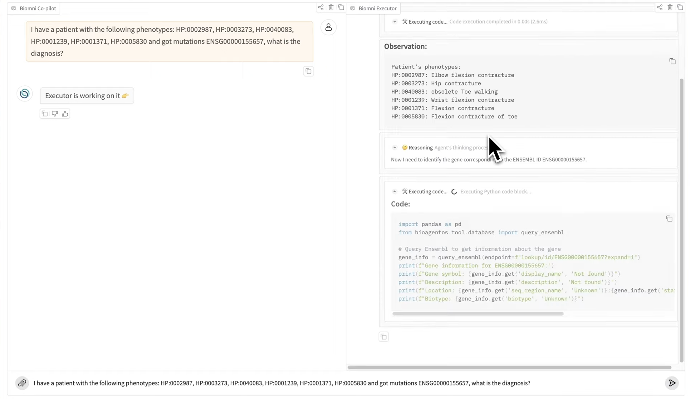
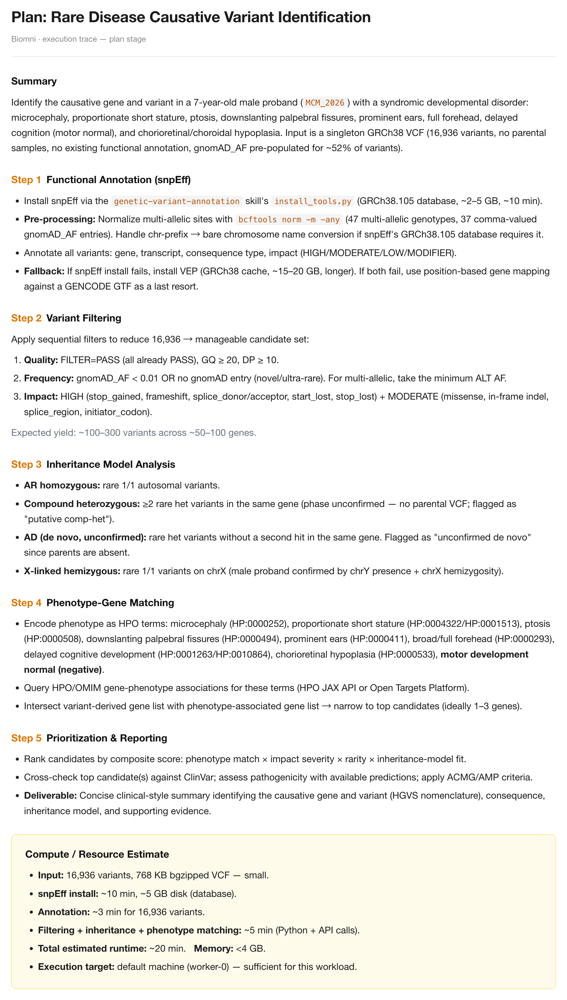
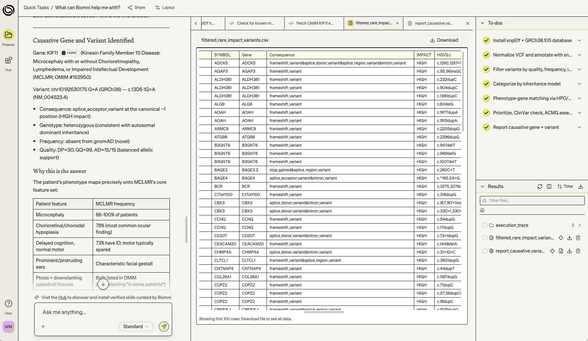
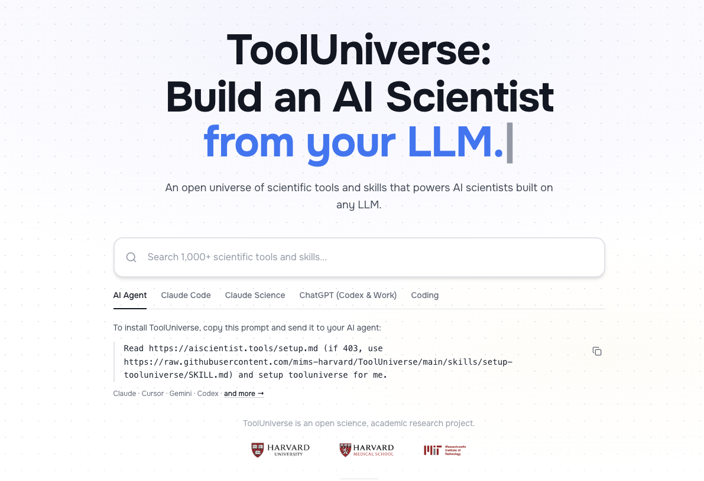

## 引言

去年 Biomni 的预印本出来、到处都在吹的时候，我内心其实是有点嗤之以鼻的。

Demo 里的效果平平无奇。以它宣称的罕见病诊断能力为例，我看到的交互是：用户丢进去几个 HPO 编号和一个 Ensembl 基因 ID，问"诊断是什么"，agent 通过写代码去查数据库，走表型 → HPO → 数据库匹配疾病的路线。当时的感觉是科学版的 Manus，离"做科学"还有距离。更重要的是，AI4S 的场景里我预期会遇到的 2 个困难没有得到解答。

## 疑问一：科研工具集的边界画在哪里

给所有领域都把工具备齐，我觉得恐怕不容易。

Biomni 的做法是扫描大量文献，找出大家都在用的、形成共识的软件和数据库，把这批工具集成进来。这个思路很聪明，覆盖面确实能做得很宽。我的疑虑在于，科研工作的推进往往是落在共识之外的。

细分方向的科研人员，日常会用到一些相当冷门的软件。这类软件常有个共同特征：算法思路很厉害，论文发得也不错，但开发质量堪忧，文档缺失，依赖冲突，装一次要折腾半天。共识扫描大概率扫不到它们，因为用的人本来就少；可少数人用不等于不重要，很多时候正是这些工具决定了一个方向的突破做不做得下去。这类边界上的需求，支持还是不支持呢？如果支持，可以想象其背后的技术难度是非常高的。

另一头是个性化的组合。就算我完全相信 AI 能从上千个工具里精确定位到我这个领域该用的那几个，token 浪费我也不在乎，可我做遗传诊断，蛋白折叠、分子对接、材料模拟这些东西摆在工具列表里，对我确实没什么用。工具集越大，AI 的选择空间越大，出错的花样也越多。而我真正想要的那种组合——我们实验室自己写的脚本、内部的变异频率库、和临床对接的表型录入规范——是任何通用工具集都不会包含的。

## 疑问二：计算成本和 token 成本不是一回事

生命科学的很多计算，吃的是算力和存储，跟大模型的 API 调用差着量级。

很多大模型套壳平台能给每个用户轻松开沙盒，很大程度上是因为它的工具调用绝大多数落在浏览、检索、信息整理和轻量办公自动化，对 CPU 和内存的需求相对比较低。一个沙盒跑完就回收，成本可控。

生命科学这边就不太一样了。原始数据处理动辄几十 GB 到 TB，跑几小时到几天很常见。就算跳过原始数据，只从处理完的数据矩阵开始，一个极小规模的单组学队列——1000 个样本的 GWAS、1 万个细胞的单细胞表达矩阵——数据量也在 GB 以上，随便做点降维或关联分析就要吃掉几个 GB 内存。这种沙盒的云端成本恐怕不低，远高于 token 的价格。

而且大多数研究不是一次性买卖。一批数据会被间隔性地反复使用、重分析、补样本、换参数再跑一遍。这意味着平台不能算完就把沙盒清掉，它得在 AI 的记忆之上，再叠一整套文件与数据的存取调度：数据放在哪、什么时候从冷存储捞回来、上一次分析的中间结果留不留、两个月后我回来接着做的时候环境还在不在。这套东西的工程量和成本，感觉都不比 harness 本身小。

至于他们能不能做出足够好的 harness 水平（当时还没有 harness 的说法），我毫不怀疑，斯坦福的水平摆在那里。

## 让子弹飞一会儿

现在 Biomni 的文章正式发表在 Science 上，团队成立了 Phylo 公司走上商业化道路，定位也从"通用生物医学 AI 智能体"（A General-Purpose Biomedical AI Agent）换成了"由人工智能智能体开展的自主生物医学研究"（Autonomous biomedical research with an artificial intelligence agent）。

从"通用"到"自主"，从"智能体"到"研究"，这个措辞的变化本身还蛮值得琢磨的。是时候实际体验一下了。

测试任务沿用我们之前测 Noxia 时设计的那一套：模拟单人 VCF 数据加真实临床描述，考验端到端的诊断能力。

> 患儿男，7 岁。匀称性身材矮小、小头畸形、面容异常（前额略饱满、眼睑下垂并下斜、招风耳），运动发育大致正常但认知发育滞后；眼底检查提示脉络膜与视网膜发育不良。
>
> 预期变异：家系全外显子组测序显示患儿携带 *KIF11*（NM_004523.3:c.1306-1G>A）变异。依据 ACMG 指南判定为致病变异（PVS1 + PS2_Moderate + PM2）。诊断为小头畸形伴或不伴视网膜病变、淋巴水肿或智力障碍综合征（MCLMR，OMIM 152950）。

## 它自己规划了计算资源

结果是，它的规划比我预想的扎实。

计算资源这一条，它在 Plan 阶段就把账算了出来：

> **Compute / Resource Estimate**
> - snpEff install: ~10 min, ~5 GB disk (database)
> - Annotation: ~3 min for 16,936 variants
> - Filtering + inheritance + phenotype matching: ~5 min
> - Total estimated runtime: ~20 min
> - Memory: <4 GB
> - Execution target: default machine (worker-0) — sufficient for this workload

它甚至写了备用方案：如果 snpEff 装不上就转 VEP（缓存 15–20 GB，更慢），两个都失败就退到基于 GENCODE GTF 的位置映射。

我没有拿一个 Fastq 给它跑真正极端的端到端分析，所以不敢说这个疑虑被完全解决了。但这次能看到的是，它确实开了一个足够跑变异注释的沙盒，装上了 snpEff，下载了 5 GB 以上的参考数据，完成了一次虽然轻量、但比一般 API 调用重得多的数据分析。资源预估这件事，它是当成规划的一部分认真做的。

## 它了解行业技术路径

我相信 Biomni 没办法针对千变万化的研究方向都写好专门的提示词和推理链，那样的工作量不现实。但针对这个任务，它给出的流程完全符合行业的技术路径：先做功能注释，再按质量、频率、影响程度三级过滤，把上万个变异压缩到百量级；然后按遗传模式分类——AR 纯合、复合杂合、AD 疑似新发、X 连锁半合子都单独列出，并且明确标注"无父母样本，相位和新发状态均未确认"。接下来才是 HPO 表型编码、表型-基因关联查询、候选基因取交集。

表型分析部分，我没看出 Biomni 像我们一样把 HPO 做成向量数据库、用 RAG 来提升准确性，执行轨迹里也没有出现专门的表型分析工具，感觉很可能是靠大模型自身的知识在做。如果拿严格的精确度、特异度体系去评，这种做法的准确性可能是不够的。不过在端到端分析的情景下，它只需要框定一个足够小、又能确保包含真答案的基因集合供后续步骤处理，容错空间比独立的表型分析任务大不少。从结果来看，足够用了。

有个细节也可以看出它做得很好。它把患儿表型逐条编码成 HPO 术语的时候，把"运动发育大致正常"编成了一条**阴性**表型。愿意把否定信息也当证据用，说明它对这套流程的理解没有停留在关键词匹配的层面。

变异优先级排序也没有调用 Exomiser 这类成熟工具，它自己定义了一个复合评分：rank candidates by composite score: phenotype match × impact severity × rarity × inheritance-model fit。四个维度选得没问题，是这个领域公认的四要素。可这个乘法怎么加权、每一项怎么归一化，我在分析轨迹里没找到。另外如果我就是想用 Exomiser 呢？我懒得实验了，就当一个开放问题留给大家吧。

反正别管黑猫白猫，最后它抓到了正确的候选变异。

报告也写得比我预期的规整：基因 *KIF11*，变异 chr10:92630175 G>A（GRCh38），c.1306-1G>A，注明是经典 −1 位的 splice_acceptor_variant，HIGH impact；杂合，符合常染色体显性；gnomAD 中不存在；质量数据 DP=30、GQ=99、AD=15/15，等位平衡。后面还附了一张患儿表型和 MCLMR 已知频率的对照表——小头畸形 86–100%、脉络膜视网膜发育不良 78%、认知落后但运动正常 73%——把"为什么是这个答案"讲清楚了。

至于成本，现在还是薅羊毛阶段。收费的 Pro plan 起步每月 100 美元，应该已经把计算成本充分考虑进去了。再说也不是所有人天天跑原始数据分析，它针对的用户群主要还是"预处理后的数据到文章结果"这一段，那个区间的计算资源，平台应该还是可以轻松保证的。

## 不过，问题是我不太愿意放弃的控制感

基于我的个人使用习惯：

即使把隐私和数据安全的问题全部放在一边，我还是喜欢数据和文档待在我触手可及的本地电脑或服务器上，不太想每次都打开网页去第三方平台取。这里面有实际的考虑：如果我要给一个进行中的项目补一批 GB 级别的数据，我可以想象那个上传下载不会轻松；等我三个月后回头做补充分析，那批数据还在不在、以什么形式在，我心里也没底。

更根本的可能还是控制感。尽管我早就沦为 yes 工程师和 yes 科学家了，天天在点同意、继续，但作为人类还是舍不得彻底交出方向盘。用 Claude Code、Codex、WorkBuddy 的时候，我觉得方向多少还是我在把握。我知道它在改哪个文件，可以随时打断，可以让它退回上一步重来。Biomni 功能上也支持，但使用体验上我彻底沦为"观察"科学家：提交任务，看进度条，读报告，总感觉哪里打断都不合适。当然这只是基于单次体验。

大概这也是为什么它现在的定位被称为"自主生物医学研究"。它可能最适合帮助科学家探索那些自己已有一定积累、但还没有完全掌握的领域：比如生物学背景的人进一步进入生物信息学，或者从事 IND-Enabling 工作的人开始探索 Drug Discovery。这种时候你并不需要控制细节，你需要的是有个比你更熟这个领域的角色用实际数据把路走一遍。只是在我自己的主场里，我想要的东西正相反。

还有一层是边界。Biomni 再强大，我们也只能待在它支持的范畴里。它可以支持我把分析结果分享出去。可本地的通用 agent 工具能给我的自由度要大得多，比如本地的智能体工具可以很方便地通过飞书接入我团队的管理体系，通过 Obsidian 接入我的个人知识库。当然 Biomni 也有连接器可以连接各种第三方平台和工具，但网页端的灵活性总是会比本地型工具差一点点。

## 所以，我的选择是 ToolUniverse

狭义地讲，ToolUniverse 是哈佛生物医学信息学系牵头开发的一套生态，用来把任意大模型变成 AI scientist 系统。它标准化了大模型识别和调用工具的方式，集成了 1000 多个机器学习模型、数据集、API 和科学软件包，覆盖数据分析、知识检索和实验设计。

广义地讲，它代表的是一类做法：把可用的工具攒成集合，包括但不限于 skills、agent 设计、数据库。K-Dense 的 scientific-agent-skills、Google DeepMind 的 Science Skills 都是这个方向。

论技术含量，ToolUniverse 肯定没有 Biomni 高。它没法替你管沙盒和数据，但它足够灵活，也更容易迭代。我可以轻松地结合别人造的轮子和我自己造的轮子，不用等谁来支持。

这些开源工具集是很好的起点，但重点在于科学家在用 AI 做科研的过程中，慢慢生长出自己的一套 Tool Universe。你的工具集应该反映你的研究方向，记住你踩过的坑。

当然这点判断有两个前提。一是通用智能体的 harness 能力足够强，配上专门的工具后足以支撑科研工作；二是 AI 仍然需要人类的抉择才能推进科学的边界。

哪天学界证明了科学专用 harness 方案能比通用 harness 方案拿到明显更好的科研结果，我马上跪下认错，然后加入。或者能证明 AI 压根不需要人类的把控就可以进行 autonomous research，那我只能马上转行去做服务人的工作了。

拭目以待！

---

## 注解

**harness 与 agent**

harness 是包裹在大模型外层的工程系统，承担几项职责：按流程反复调用模型；解析模型输出中的工具调用意图并实际执行；将执行结果重新组织后回传给模型；维护跨轮次的上下文与记忆。它的作用是把一个只能生成文本的模型，接入到可以读写文件、调用接口、操作环境的实际任务流程中。agent 指的是"大模型 + harness + 工具"整体运行后构成的系统，能够围绕一个目标自主完成多步骤任务。大模型是核心推理组件，harness 是使其可用的执行框架，agent 是二者结合后对外呈现的完整能力单元。

**沙盒**

沙盒就是 AI agent 临时开的隔离的小型计算环境，让它可以安全地运行代码、操作文件、访问网页和使用工具，任务完成后销毁回收。
