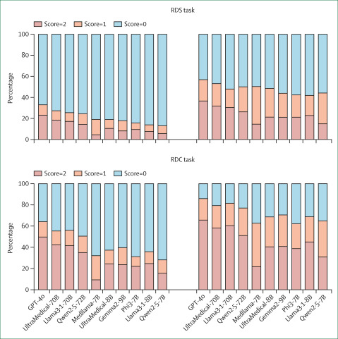
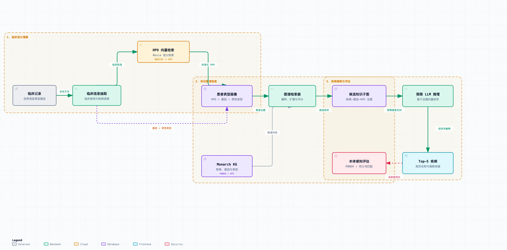

## 引言

最近读到清华医学院的一篇文章：*Chen et al. 2026*, RareArena: a comprehensive benchmark dataset unveiling the potential of large language models in rare disease diagnosis（The Lancet Digital Health, 2026）。

这篇文章的核心工作是发布一个罕见病诊断基准数据集。作者用一条自动化采集流程，从 PubMed Central 的病例报告里整理出目前规模最大的罕见病诊断基准，并拆成两个任务：确诊检查之前的罕见病识别（rare disease screening，RDS，49,760 例 / 4,597 种病）和检测信息完整后的确诊（rare disease confirmation，RDC，22,901 例 / 3,522 种病）。他们用十个大小不一的大模型跑了一遍，表现最好的 GPT-4o 在 RDC 任务上 top-1 recall 64.2%、top-5 recall 85.9%；而且在遗传性疾病上比非遗传性疾病更准。

大模型能从表型推断疾病、且准确率不低，这件事我们之前已经讨论过多次，结果和 DeepRare 的结论基本也是一致的。所以这篇文章的重点是发布数据集，而不是去探索“AI 解罕见病诊断”这件事的上限。于是我有了一个想法：如果在大模型直接推理之外再叠一层别的方案，这个诊断率还能不能进一步提升？

第一个进入我脑子的候选方案就是 GraphRAG。想尝试 GraphRAG 其实很久了，一直没找到合适的切入口。企业做营销、研究者发文章，为了场面好看会多堆一些花哨的方案；但我追求简单，从解决问题的角度看，一个技术如果证明不了它有用，没必要为了加而加。RareArena 的数据集和他的 RDC 任务，正好是一个优秀的检验场景。

问题很具体：**GraphRAG 到底能不能提高大模型对罕见病的诊断率，能提高多少？**

## GraphRAG 是什么？

GraphRAG（Graph-based Retrieval Augmented Generation）= 知识图谱 + 检索增强（RAG）+ 大语言模型。

GraphRAG 在数据存在大量互相关联的知识（企业资料、金融、法律、科研、供应链、医疗）的场景下非常有价值。如果只是查文档、问 FAQ，普通 RAG 可能是更简单、更经济的方案。因此罕见病领域天然适合这个思路。基因、疾病、表型、药物、治疗方案之间本就存在大量结构化关系，这正是知识图谱擅长表达的东西。理论上，把这些关系接进检索环节，应该能补上大模型直接推理的一部分短板。理论上成立，能不能兑现要看数据。

## 先确定评价体系

受限于研究经费（token 额度），我不打算重跑 RareArena 的全部数据，重点放在 RDC 任务上。RDC 相比于 RDS 多了检测信息，得到正确疾病诊断的可能性更大。如果 GraphRAG 对 RDC 任务都没有效果，那就不用浪费精力在 RDS 任务上了。

评估口径我们也尽量对齐 RareArena 文章：输入 RDC 基准里的临床描述、年龄、性别和检测结果，不提供预期诊断或任何标签信息；模型输出五个排序后的候选诊断；再用字符串匹配加大模型语义判断，看预期诊断有没有落在前五里。RareArena 提供了一个采样数据子集——对每个 Orphanet 疾病类型及每个亚型，从完整 RDC 数据集中随机抽取至多三个案例，确保覆盖所有记录在案的罕见病。为控制评估成本，我们沿用这一子集。

命中判定沿用原文的三档打分：

```
2 分 = 同义 / 等价匹配
    模型预测与标准诊断为同义、等价、缩写、拼写变体、同一疾病的临床等价亚型。
1 分 = 上位匹配
    模型预测是标准诊断的上位类别，识别到了正确疾病家族但不够具体。
0 分 = 未命中
    前五个预测中没有等价或上位匹配。

Top-1 score = 2   ：首位诊断完全等价命中
Top-1 score >= 1  ：首位诊断至少达到上位匹配
Top-5 score = 2   ：前五诊断中存在完全等价命中
Top-5 score >= 1  ：前五诊断中存在等价或上位匹配
```

为了简化理解，我们后续主要以 Top-5 score >= 1 为标准定义模型或算法给出了正确诊断，即预期诊断出现在模型给出疾病列表的前五名中。

这是 gpt-5.4-mini 对 4,376 个 RDC 基准案例直接推理的结果：

| 指标 | 数量 | 比例 |
|---|---:|---:|
| Top-1 score = 2（同义 / 等价） | 2,506 | 57.3% |
| Top-1 score >= 1（同义或上位） | 2,931 | 67.0% |
| Top-5 score = 2（同义 / 等价） | 3,203 | 73.2% |
| Top-5 score >= 1（同义或上位） | 3,719 | 85.0% |

Top-5 score >= 1 的 85.0%，和原文 GPT-4o 报的 85.9% 几乎贴在一起。基线可靠，可以进入下一步。


*RareArena 原文各模型 RDC 表现，供对照*


## 罕见病诊断的 GraphRAG 方案

GraphRAG 方案的核心难点是构建知识图谱，接入大模型反而是最简单的一步。这一步得感谢 Monarch Initiative（[monarchinitiative.org](https://monarchinitiative.org/)），他们已经把“基因—疾病—表型”这张图谱建好并开放出来，让我可以直接把分析流程搭在上面。整条流程分五步：

**一、从临床文本抽取结构化信息。** 先由大模型从病例里提取阳性表型、实验室异常和影像学异常，同时明确标出被排除的阴性表型。阴性表型很重要，后面会用它来构造矛盾、排除候选。

**二、向量检索标准化为 HPO。** 自然语言表型和 HPO 术语之间往往没有直接的字符串对应。“不能独立抬头”“出生后头围增长缓慢”这类临床表达，需要映射成标准 HPO。这里用的是之前搭好的 HPO 向量库，把每条临床表型对到最相关的 HPO 术语上，和常规遗传分析里的表型分析是一回事。

**三、从 Monarch 图谱构建患者相关子图。** 拿到患者 HPO 之后，在 Monarch 图谱里检索相关疾病，综合考虑几件事：患者 HPO 与疾病 HPO 的精确匹配；HPO 父子层级中的近似匹配；阳性表型的特异性和信息量；阴性表型带来的矛盾；病历里显式提到的基因—疾病关联；以及 MONDO 疾病层级、标准名和同义词。检索出来的不是一张疾病列表，而是一个局部子图：候选疾病、支持表型、矛盾表型、关联基因、本体关系都在里面。

**四、大模型在有限空间里做鉴别诊断。** 大模型只对检索出的候选疾病做鉴别和重排，输出五个排序结果。相比完全开放式生成，这样能压掉一部分没有依据的疾病幻觉，把推理限制在可追溯的图谱关系里，也更容易区分表型相似的罕见病亚型，还能顺带输出标准 MONDO ID 便于后续评估。代价也明确：它把大模型限制在一个有限的搜索空间里，训练时学到的那些隐含知识有可能就发挥不出来了。

**五、本体感知的评估。** 疾病名经常同时存在标准名、缩写、旧称和临床别名，所以评估不能只比名字。判定时优先比对 MONDO ID，再识别同义词、等价诊断和合理的上位疾病。


*基因—疾病—表型子图驱动的 GraphRAG 诊断流程*


## GraphRAG 到底能挽救多少？

我们的问题问的是“能不能提高”，那大模型自己就能诊断出来的案例我们先放一边。看直接推理失败的那部分，也就是基线里 Top-5 score = 0 的 657 个案例。GraphRAG 方案单独作用在这 657 例上，结果如下：

| 657 个基线失败案例上的校正指标 | 数量 | 比例 |
|---|---:|---:|
| Top-1 score = 2 | 97 | 14.8% |
| Top-1 score >= 1 | 125 | 19.0% |
| Top-5 score = 2 | 147 | 22.4% |
| Top-5 score >= 1 | 199 | 30.3% |

在大模型直接推理失败的 657 个案例里，GraphRAG 把其中 199 个（30.3%）重新拉回到前五命中。

这里有一个有趣的观察需要展开分析一下。在这 657 个案例里，只有 184 个（27.8%）的子图真正检索到了本体可识别的目标疾病；而大模型最终给出了 199 个正确答案。检索没有命中，正确答案从何而来？把这几个数逐项分开：

- 子图中检索到目标的：184 例（50 个候选内的召回）。
- 这 184 例中，目标仍出现在大模型 top-5 且被本体识别的：151 例（82.1%），说明检索命中后重排阶段基本保住了它。
- 大模型 top-5 中本体可识别的总数：158 例，其中 151 例来自检索命中，7 例靠补充的本体上下文推断得到。
- 论文口径下的校正 top-5：199 例，比 158 多出的部分来自评委按同义 / 上位判定的等价匹配，本体检索并未直接识别。

还有一点我们也不能忽略：提示词里虽然要求“只能从候选列表中选择”，但这条约束没有在程序层面强制校验。整个队列中，大模型共产生 104 个越界预测（分布在 94 个案例），而 199 个命中里有 17 个正是这类越界预测。目前看来我们之前的假设“它把大模型限制在一个有限的搜索空间里，训练时学到的那些隐含知识有可能就发挥不出来了”要存疑了。

## 排查一：是不是输入本身有问题？

AI 用久了，我已经养成一个条件反射：结果不对，不是 AI 的问题，是我自己提供的上下文有问题。这个场景下，就要先怀疑 RareArena 提供的临床描述本身是否可靠了。

我们对失败案例的原始输入逐条做了充分性审阅（覆盖 487 个原始零分案例）：

| 输入状态 | 案例数 | 比例 |
|---|---:|---:|
| 足以评估 | 275 | 56.5% |
| 输入不足或基准数据有缺陷 | 212 | 43.5% |

具体看输入不足或基准数据有缺陷的原因。这 212 个输入不足的案例，一共带 241 个问题标签（29 个案例同时命中多类）：

| 类别 | 案例数 | 含义 |
|---|---:|---|
| 基准标签或本体不一致 | 110 | 诊断、Orphanet 映射、MONDO 目标、解剖、基因或源记录之间存在冲突 |
| 一般性输入不足 | 96 | 关键的临床 / 影像 / 病理 / 生化 / 分子证据缺失 |
| 有变异命名但缺基因符号 | 11 | 有变异 / 外显子 / 转录本 / 蛋白记号，但无法关联到明确基因 |
| 未披露基因检测结果 | 10 | 检测在做或已做，但没披露结果 |
| 阴性 / 无关检测后遗漏致病结果 | 9 | 只给了排除性、低分辨率或不相关的结果 |
| 跨案例抽取污染 | 5 | 抽取批次里另一个案例的发现串了过来 |

举两个具体的例子。

第一个是来自 `PMC:5787054` 的一个病例。病历内容其实相当完整：婴儿期喂养困难、肌张力障碍等等；也给了变异结果 `c.919G>T`，但漏掉了基因名 *TSEN54*。这应该是 RareArena 生成基准数据集时的一个遗漏。因为病例报告只在标题里提了基因名，然后全文基本只讨论变异，不再提基因名。来自这类病例报告的病例，基准数据集的检测信息中都会缺少基因名称信息。

第二个是来自 `PMC:3613624` 的一个病例，预期诊断 Lowe 综合征。原文的报告是提出在 Lowe 综合征的患者中发现 DMSA 影像伪影，其余肾脏影像基本正常的临床现象，因此 Lowe 综合征会涉及的其他表型，例如先天性白内障、发育障碍等也就完全没提，也没有分子诊断结果。因此虽然 Lowe 综合征在 Monarch 里有丰富的表型注释，但由于表型描述的严重信息不足，模型直接推理和 GraphRAG 同时失败也完全在情理之中了。

也就是说，这 212 个输入不足的案例基本属于不可解。RareArena 的数据有一些瑕疵，这完全可以理解：这么大体量的数据整理，不可能靠人逐篇审阅，而真实世界的病例报告本身也不可能完美。

## 排查二：是不是知识图谱本身有短板？

第二个怀疑对象是图谱。我们这套方案的一个前提，是用 HPO 表型去构建子图；如果“基因—疾病—表型”图谱本身在某些疾病上就缺表型呢？毕竟我们是拿来主义，并没有对这张图谱做全面检查。

把视角收窄到 275 个足以评估的案例里那 255 个仍然失败的案例——这些案例输入充分、本可评估，却仍然没做对，下称输入充分的失败案例。查一下这些疾病在图谱里到底有多少条直接的表型关系：

| 队列 | 零表型关系 | ≤5 条表型关系 |
|---|---:|---:|
| 255 个失败案例 | 107（42.0%） | 126（49.4%） |

近一半的疾病，在图谱里只有极其有限的直接表型关联。

仅看总数不够，还要看具体是哪类疾病在图谱中缺表型。把 255 个输入充分的失败案例和 199 个 GraphRAG 挽救案例做对比（用比值比 OR 加双侧 Fisher 精确检验；因为类别有重叠且是观察后再分层，p 值只当探索信号，不当确证性检验）：

| 疾病特征 | 输入充分的失败案例 | GraphRAG 挽救案例 | 比值比 OR | 探索性 p 值 |
|---|---:|---:|---:|---:|
| 遗传性疾病 | 84/255（32.9%） | 126/199（63.3%） | 0.28 | 1.50e-10 |
| 综合征型疾病 | 33/255（12.9%） | 51/199（25.6%） | 0.43 | 0.0006 |
| 发育 / 形态发生障碍 | 43/255（16.9%） | 54/199（27.1%） | 0.54 | 0.0109 |
| 主要为外源机制 | 20/255（7.8%） | 3/199（1.5%） | 5.56 | 0.0020 |

可以看到，遗传性、成综合征的疾病更容易被 GraphRAG 挽救回来；器官系统的分类反而不是最强的区分维度。

原因在于，当前这条表型检索路径最适合那种由一组稳定、体质性临床特征定义的疾病；而肿瘤等获得性疾病在多个方面与这一模型相悖：

1. 高度特异的肿瘤亚型经常作为 MONDO 节点存在，却没有直接的 HPO 注释，缺少可用的表型画像。
2. 有用的知识编码在别的关系类型里。肿瘤靠解剖、组织学、细胞谱系、分子改变、免疫组化标志物、癌基因关联来刻画，这些都不在“MONDO→HPO”这条直连检索的覆盖范围内。
3. 注释可能只挂在更宽的父类上。一个泛化的肿瘤家族有临床注释，它下面那个具体的罕见亚型却什么都没有；直连边检索不会自动继承父类注释。
4. 病例证据常常以病理为中心。组织形态、染色模式、分子标志、解剖起源，并不总能干净地归一化成常规患者 HPO 术语。
5. 体细胞证据不等于孟德尔证据。一个肿瘤标志物或体细胞改变，不等价于一个致病的胚系基因，所以现有的基因辅助检索路径未必帮得上忙。
6. 感染性疾病是类似的错配。它们在图谱里的身份，更多取决于致病微生物、暴露史、解剖部位或实验室确认，而不是一份有辨识度的 HPO 画像。

罕见肿瘤是当前图谱检索方案确定的薄弱区：大约三分之二的输入充分的肿瘤失败案例没有或几乎没有直接 HPO 覆盖，几乎无一能进入候选召回。更深一层的分界，在于“被良好整理的遗传综合征”与“由病理、感染、暴露、解剖或获得性机制来定义身份的疾病”之间。

## 结论：大概能提升 4.5 个百分点

做一个偏乐观的假设：把大模型直接推理和 GraphRAG 挽救拼成一条方案，并且粗略地假设引入挽救不会伤到直接推理原本的准确率。那么在这批数据上，把 199 个挽救回填到原始 4,376 案例的基线里，会得到一个事后估计：

| 指标 | 基线 | 基线 + GraphRAG 挽救 | 变化 |
|---|---:|---:|---:|
| Top-1 score = 2 | 57.3% | 59.5% | +2.2 个百分点 |
| Top-1 score >= 1 | 67.0% | 69.8% | +2.8 个百分点 |
| Top-5 score = 2 | 73.2% | 76.6% | +3.4 个百分点 |
| Top-5 score >= 1 | 85.0% | 89.5% | +4.5 个百分点 |

我们的乞丐版 GraphRAG 方法大约能提高 4.5 个百分点。如果再把那些输入不足的案例和罕见肿瘤案例剔除，大模型直接推理结合 GraphRAG 在罕见病的诊断率应该能超过 90%。

更严谨的数字，得用真正的组合流程、跑清洗过的全量数据才能算出来，那就留给经费更充足的研究者去做吧。这里能确定的结论有两条：
- GraphRAG 对遗传性、成综合征的罕见病确实有效；
- 对肿瘤、感染这类身份不靠表型定义的病，瓶颈已经从大模型推理转移到了知识图谱的检索侧，仅调整提示词不足以解决，需要更换检索路径。

## 致谢

没有赛博义父不停地送重置额度，这篇研究不可能完成。

没有“token 用完了还没到周重置”和“token 没用完可能被重置”的双重恐惧，我大概也不会这么努力地蹬。
