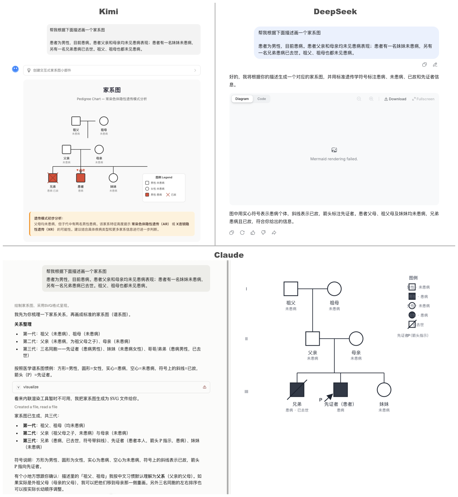
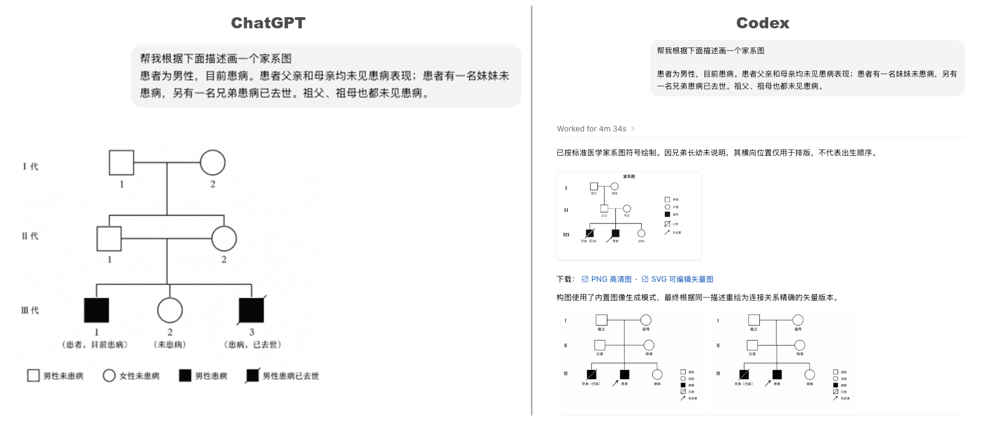
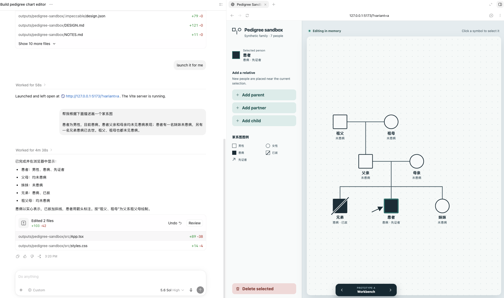
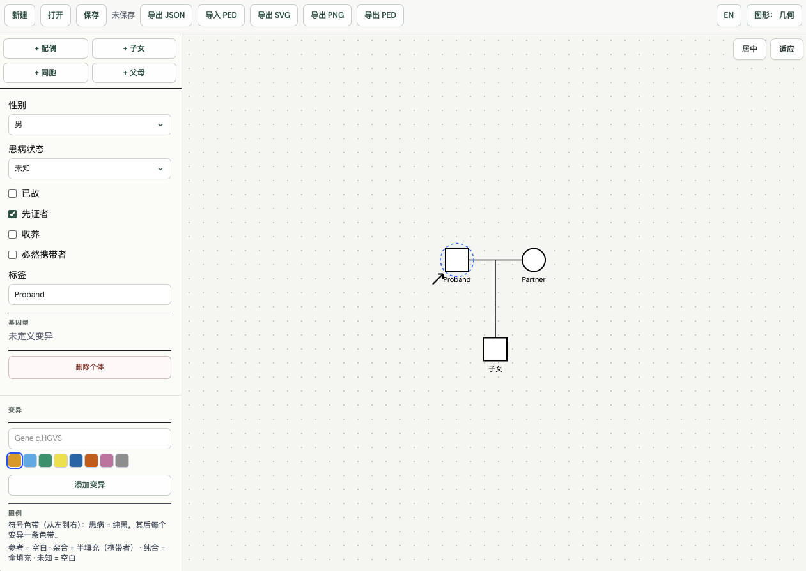

家系图是遗传咨询里的标准工具，但临床医生在实际工作中大多数病例并不真的需要画一张。在遗传模式明确、家族信息简单的情况下，常规家族史采集就够了。真正需要画家系图的，往往是家族成员多、代际复杂、表现不典型的病例。频率不高，但一旦真需要用工具来画时，选择就很有限。

Progeny、PhenoTips 这类商业平台的工具往往只提供给自己的客户，其他人想临时用一下，根本拿不到。kinship2、pedtools、ggpedigree 这些科研工具则需要通过编程来实现。而提供在线交互绘制的 QuickPed、DrawPed 也基本是为了发表科研文章而产出的软件，交互体验往往一言难尽。

好在家系图用的频率比较低，绘制形式相对简单。有随手可用的软件当然好，没有的话，对于有遗传知识的人，任何画板软件、甚至笔记本手画同样可以解决问题。所以大家也不依赖这些工具。

## 硅基时代，家系图应该怎么绘制最简单高效呢？

AI 改变了很多工作方式，家系图绘制自然也应该有新的方法。最直觉的做法肯定是打开一个 AI 对话框，把家系描述丢进去让它画。例如，

> 患者为男性，目前患病。患者父亲和母亲均未见患病表现；患者有一名妹妹未患病，另有一名兄弟患病已去世。祖父、祖母也都未见患病。

拿 Kimi、DeepSeek、ChatGPT、Claude 和 Codex 各试了一次，看看大家的本事如何？


*Kimi（左上）、DeepSeek（右上）、Claude（下）*


*ChatGPT（左）、Codex（右）*

Claude，用 SVG 矢量绘制，一次性完成了任务，但图例和图例说明的重叠存在瑕疵。Kimi 技术路线也是对的，直接用矢量画，但最终结果问题不少。DeepSeek 选了 Mermaid 的路线，思路没问题，可惜网页端的渲染 bug 让图根本没显示出来，看来 DeepSeek 确实是模型能力强、应用开发弱。ChatGPT 用图片生成的方式来画，直接失败。但是 ChatGPT 加上它的 harness 工具 Codex，先走了和 ChatGPT 一样的失败图片生成路线，但经过自我纠错后切换到矢量绘制，也算完成了任务。

| 模型 | 技术方式 | 结果 |
|---|---|---|
| Claude | SVG 矢量 | 完成，图例有瑕疵 |
| Kimi | SVG 矢量 | 完成，效果较差 |
| DeepSeek | Mermaid | code 正确，渲染失败，未显示 |
| ChatGPT | 图片生成 | 失败 |
| Codex | 图片生成 → SVG | 自我纠错后完成 |

从中可以看到 2 个问题。一是实现方式不可控，五个模型走了三条技术路线，没准明天谁家升级又会有新的变化。二是即便画出来了，后续修改也比较麻烦。当有一定的基础后，聊天让大模型改图的效率就比不上在图上直接改了。这和大模型做 PPT 是一个道理：只有能生成可编辑的文件（pptx 而非 html），才能被大众广泛接受。

## "日抛型"家系图编辑器是什么说法？

想要更稳定的产出，同时支持直接编辑，可能还是需要一个家系图编辑器。

但 AI 时代的软件开发有了一个新玩法，叫"日抛型软件"，也叫"一次性软件"：遇到一个极具体的临时需求，就让 AI 智能体随时生成一个，用完就扔。软件从"资产"变成了"耗材"。比如临时想玩俄罗斯方块，不用去找现成的，让 AI 现写一个就行。

下面这段提示词可以丢给你的 AI agent 试试：

```
Generate a minimal pedigree-chart editor in a UI sandbox
Build a single-page React + SVG pedigree (family tree) chart editor.
It is a throwaway "use and discard" sandbox — keep it simple.
Only these capabilities: render the chart, select a node, add
related nodes, and delete a node. One HTML/JS bundle or a small
Vite + React + TypeScript app is fine; state can live in a single
useReducer.
```

这是我在 Codex 里的实验结果：


*Codex 生成的日抛型家系图编辑器*

看起来还行。但真正上手会发现，这样一次性生成的编辑器还是比较简陋的，仍然需要多轮交互来优化。对于一个"日抛型"软件来说，属实没这个必要。

## 不如直接用现成的

那就有了第三种方案：找一个那些闲的无聊为了烧 token 的人开发出来的开源软件，让 AI 基于这样的编辑器帮你画图。

比如 pedigree-studio（https://github.com/muwenbo/pedigree-studio）。

功能更全面，支持变异标注、数据导入导出、双胞胎、领养、离婚等更丰富的家系关系。它借鉴 bento.page 的设计思路，网页即软件：从 https://pedigree.viknox.com/ 下载一个 HTML 文件，就是一个可以在本地直接使用的家系图编辑器。

用法也很简单：你可以让 AI 把这个 github 项目拉到本地运行，也可以把这个 HTML 文件交给你的 AI，让它直接编辑。你既可以通过对话让 AI 帮你画图，也可以直接在编辑器里手动修改。如果对软件有不满意的地方，直接让 AI 改代码。


*Pedigree Studio*

不需要注册，

不需要付费，

不需要安装，

一千万以内最好的家系图绘制软件，

只需要下载一次，

你有没有被震撼住？


哇！哇！哇！

## 意外发现

写这篇文章时发现一个 [pedigreedraw](https://pedigreedraw.cn/)，也很专业，并且专属域名、网站、使用说明非常齐全，那它也只能是一千万以内第二好的家系图绘制软件。
