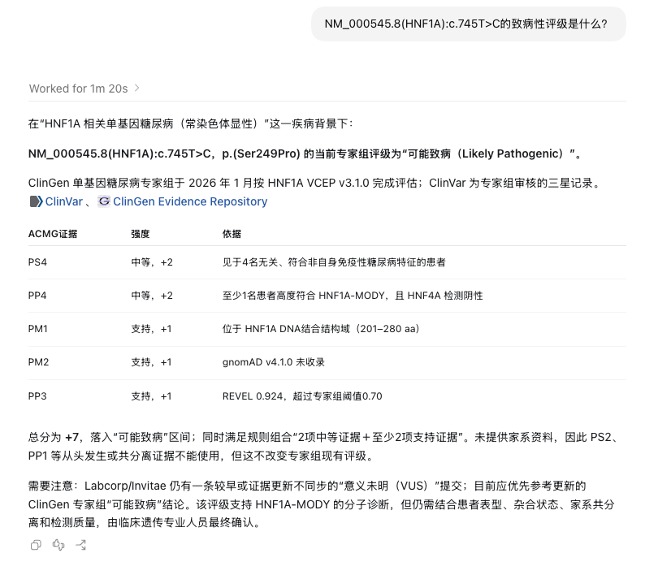
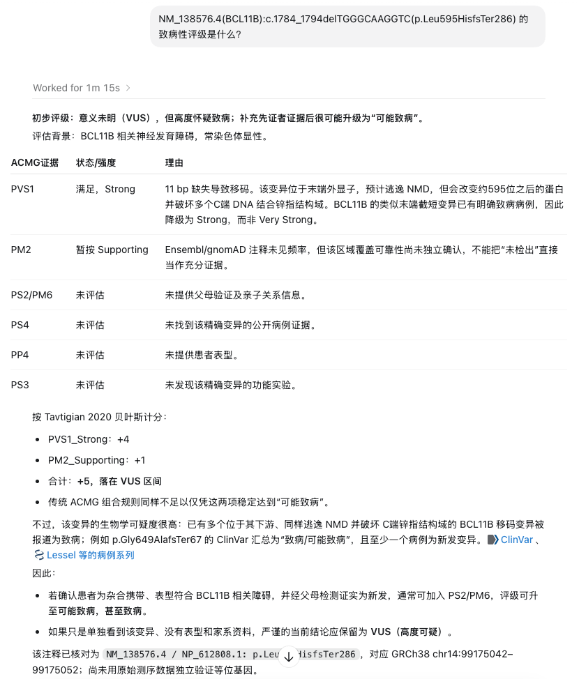
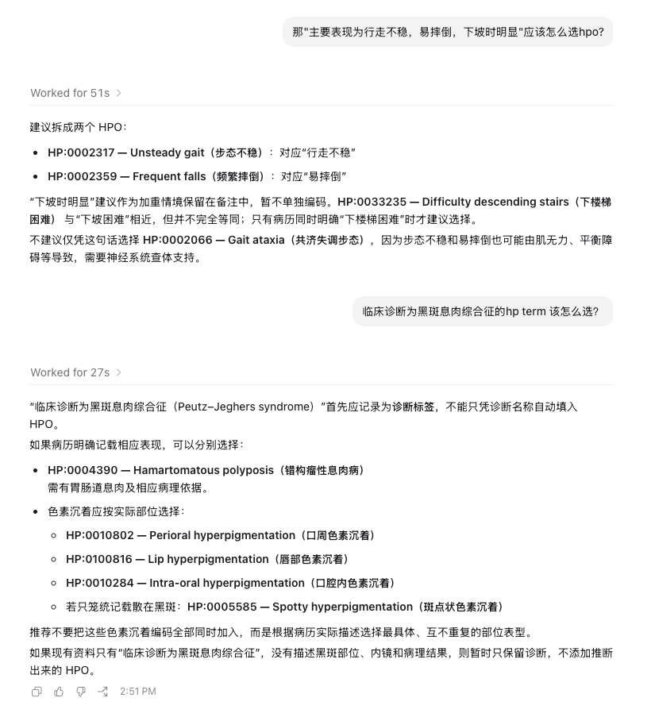
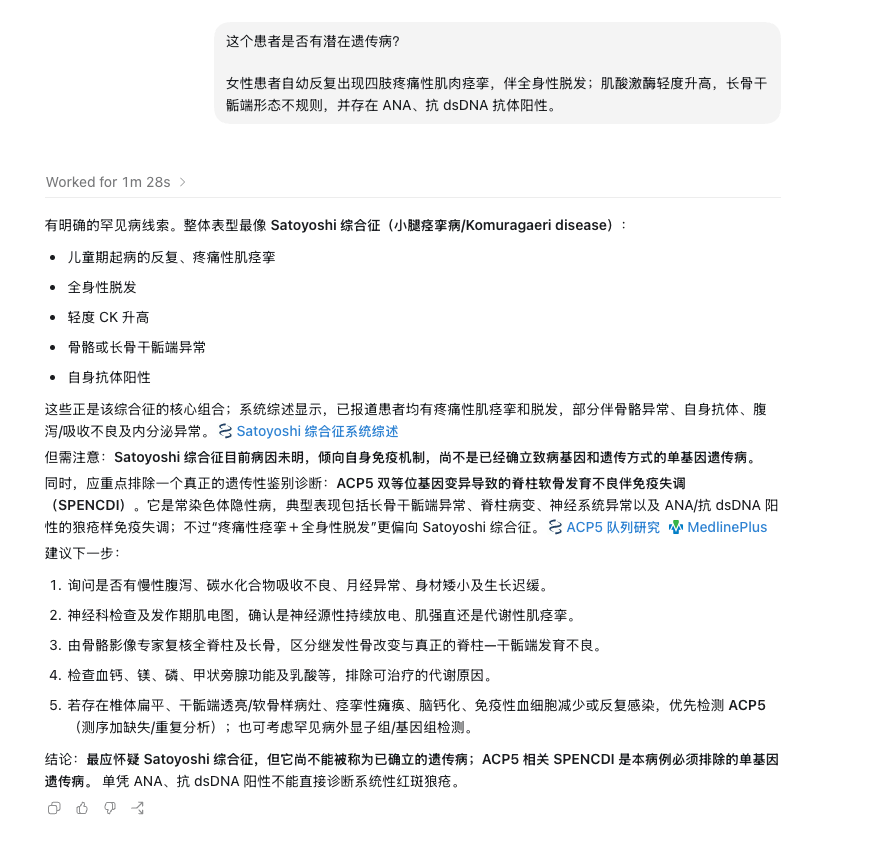
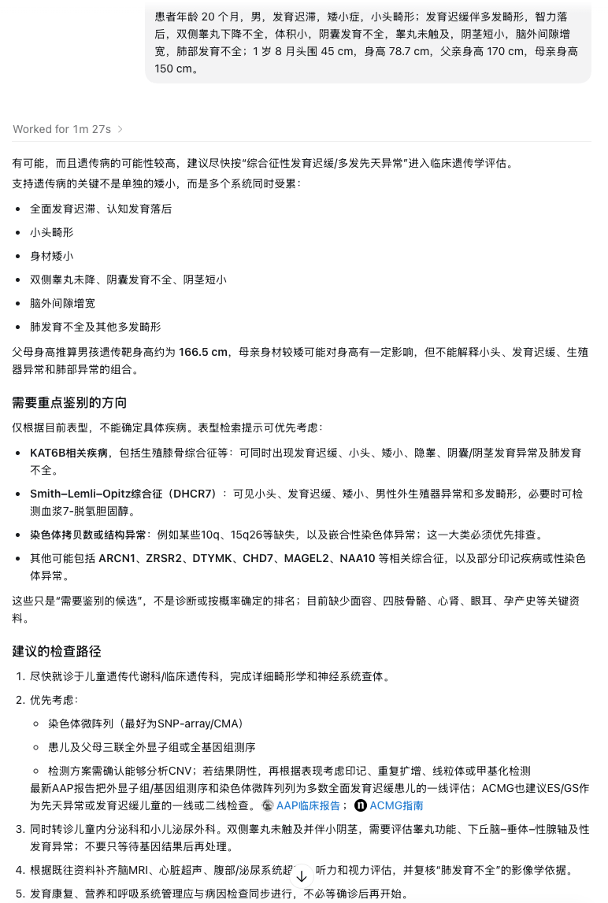
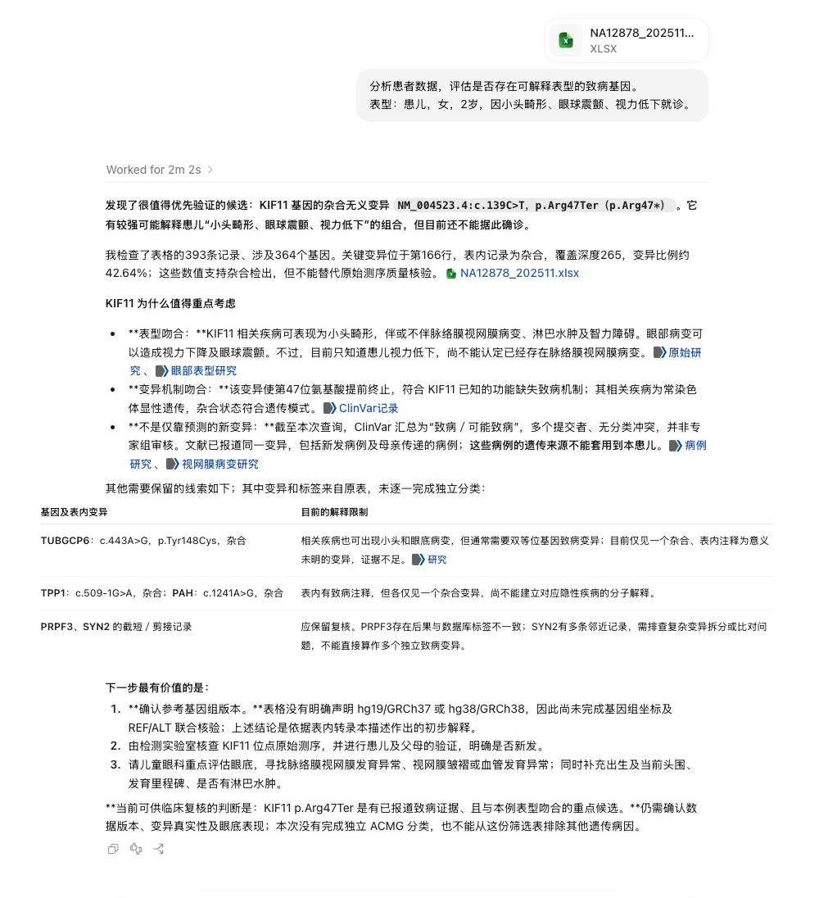
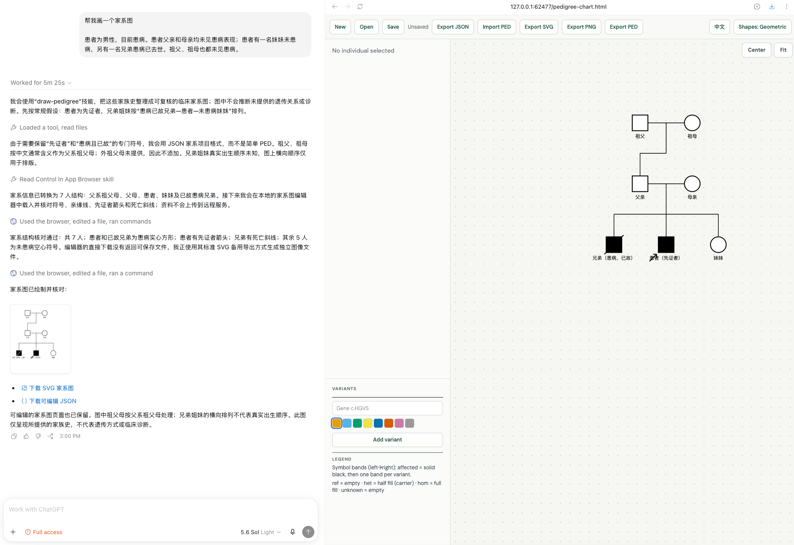
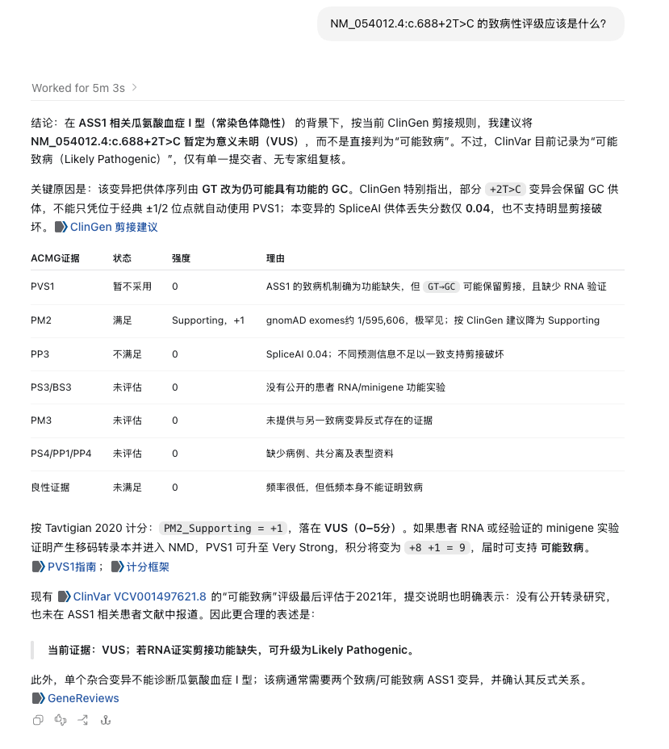
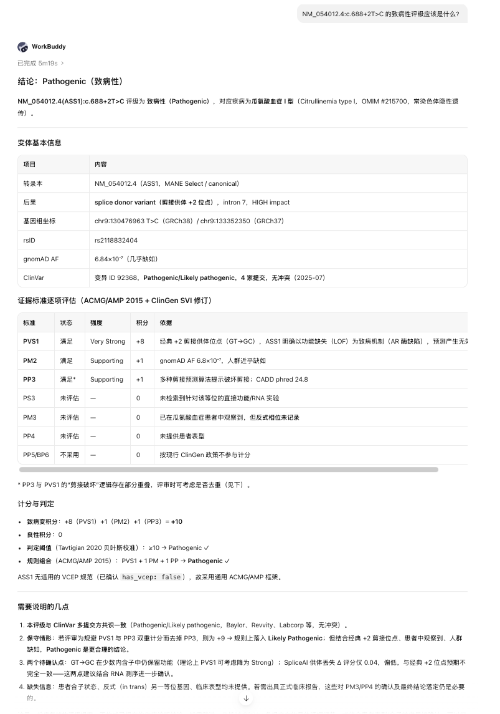
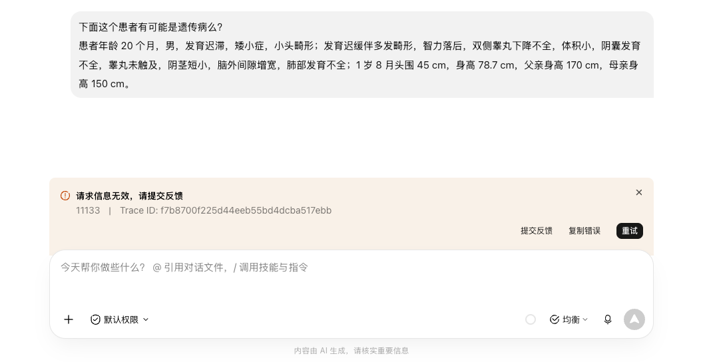

过去，我们在公众号里陆续做过变异评级、表型分析、候选疾病推理、测序数据筛选、家系图绘制和 CNV 评级。现在，我把这些成果整理成了一个可以直接安装的遗传咨询技能包。

只要你的 Agent 支持安装技能或插件，就可以把这些能力装进去使用，不需要为了每一项分析分别注册、登录不同的网站。

## 这个技能包能做什么

### 1. 辅助完成序列变异评级

这项能力来自《燃烧 Token 不是程序员的特权，现在轮到遗传分析师了》中构建的变异评级技能，并更新到了目前最新的 ClinGen 相关规则。

如果变异已经被 ClinGen、ClinVar 等数据库收录，技能会先检索已有记录和相关证据，而不是重新发明一遍结论。

如果面对的是尚无现成结论的变异，它会按照 ACMG/AMP 框架及适用的 ClinGen 规范，逐条整理证据，并用贝叶斯框架辅助形成一份可供专业人员复核的评级建议。



*已被 ClinGen 收录的变异，检索并核对已有评级*



*全新变异，逐条判据打分*

### 2. 从中文表型描述中提取 HPO 术语

在《没有大模型，中文表型分析还能怎么做？》中，我们尝试用传统自然语言处理技术（NLP）处理中文临床表型，但复杂描述、上下文关系和隐含信息超出了自然语言处理技术的能力。

现在，可以把中文病史直接交给技能包。它会梳理阳性表现、明确阴性表现和不确定信息，再提出相应的 HPO 术语及映射理由，供使用者确认。



*从中文表型描述提取并映射 HPO 术语*

### 3. 根据表型寻找候选疾病

这项能力来自《大模型答不出的罕见病，GraphRAG 可以吗？》中构建的知识图谱推理方法。

在表型组合辨识度较高的案例中，它成功找到了 Satoyoshi 综合征；但在信息较少、区分度不足的案例中，它没有把预期小胖威利综合征（Prader-Willi syndrome）列入正确候选。

小胖威利综合征（Prader-Willi syndrome）也是我们在《罕见病场景下，精巧的 Agent 设计还需要吗？》中讨论到的案例。

根据表型寻找候选疾病这件事情，有时大模型直接推理表现更好，有时基于可追溯数据源的检索更可靠，但两种方法都不能保证稳定命中。

原因可能来自表型信息不足、知识库覆盖有限，也可能是通过表型推理疾病这件事本身的局限性。



*表型组合辨识度高的案例：正确推出 Satoyoshi 综合征*



*区分度不足的案例：漏掉了小胖威利综合征*

### 4. 从测序数据中筛选候选变异

在《构建一个可控的变异解读工作流》中，我们尝试把临床表型和测序结果放进同一条有步骤限定的分析工作流。

现在，技能包可以协助 Agent 读取变异注释表，结合表型、遗传模式、变异频率、功能后果和已有证据，筛出值得进一步核查的候选变异。

这项功能主要适合希望独立复核检测结果，或者想重新检查变异注释表的临床医生和遗传分析人员。



*结合表型与测序数据，筛出可解释临床表型的候选变异*

### 5. 绘制家系图

技能包还整合了《我替 AI 开源了一千万以内最好的“日抛型”家系图编辑器》中的家系图能力。

把家庭成员、亲缘关系、患病状态和检测结果告诉 Agent，它就可以生成结构化家系数据和家系图初稿，不必再手动摆放每一个符号。



*一次生成的家系图*

### 6. 辅助完成 CNV 评级

最后，还有《我又重新造了 CNV 致病性评级的轮子》中构建的 CNV 评级工具。

它可以按照相应的 ACMG/ClinGen 框架整理区间、基因、剂量敏感性、病例及遗传证据，并生成一份带有评分依据的辅助评级建议。这项功能就不放实例图了。

## 怎么使用

把下面这段话粘贴给支持技能或插件的 Agent 即可：

```text
请从 https://github.com/muwenbo/genetic-counseling-skills 为当前 Agent 安装并配置 Rare Disease Genetic Counseling 技能。请使用本应用支持的安装方式。完成后请告诉我这些技能是否已可用、需要哪些权限或网络访问，以及是否需要重启应用或开始新会话。
```

## 使用之前，有几件事需要知道

### 1. 大模型有“抽卡”的一面

模型能力、Harness 能力和上下文长度都会影响结果。同一个任务换一个模型，输出质量可能明显不同；即便使用同一个模型，在不同时间重复运行，具体措辞和候选排序也可能发生变化。

本文中的示例运行在 ChatGPT 5.6 Sol (Light) 上，只代表这些案例在当时环境中的表现。如果笨模型不好用，那就试试更聪明些的模型。

可以看到不同 Agent 结合同一技能包得出不同的结论，各位专家看看谁更聪明些。无论谁的最终结论正确，我相信他们都把数据收集这件事做得很充分。



*ChatGPT 5.6 Sol (Light) 对 NM_054012.4(ASS1):c.688+2T>C 的评级*



*WorkBuddy 均衡模式对 NM_054012.4(ASS1):c.688+2T>C 的评级*

### 2. 检索到文献，不等于读到了全文

Agent 通常能够联网搜索，也可以查询文献，但这个技能包不会默认要求对文献应读尽读。如果想要深度查找和阅读文献，可能需要你额外要求 Agent，或者加装其他 AI for Science 类技能。

即使如此，我仍然对所有宣称能够“自主读文献”的 AI Agent、技能和工具保持警惕。我担心的是它能不能拿到论文，理解论文的能力倒在其次。

公开数据显示，仍有相当比例的学术成果没有被识别为开放获取：

| 统计范围与时间 | 开放获取比例 | 未被识别为开放获取的比例 | 数据来源 |
|---|---:|---:|---|
| 2024 年发表的期刊文章，2025 年 5 月统计 | 47% | 53% | [OpenAlex 衍生数据集](https://zenodo.org/records/15423474) |
| 2023 年发表的期刊文章，2025 年 5 月统计 | 59% | 41% | [OpenAlex 衍生数据集](https://zenodo.org/records/15423474) |
| OpenAlex 收录的历年学术成果，含期刊文章以外类型；2026 年 8 月文档数据 | 约 37% | 约 63% | [OpenAlex 官方说明](https://help.openalex.org/data/works/open-access/) |

这些数字的统计范围并不完全相同，也不能直接代表某个 Agent 的全文获取率。但至少说明一件事：找到论文标题和摘要，不能自动证明工具已经阅读了全文。而我们早已发现，变异评级的证据病例，常常藏在文章里不起眼的地方。

一个可信的 AI 文献分析过程，应当明确交代哪些结论来自全文、哪些只来自摘要、全文通过什么渠道获得，以及哪些文献未能获取。没有这些信息，“我已经阅读了相关文献”是需要打一个大大的问号的。

### 3. 模型或 Agent 的审查机制让大家都安全

医学案例中常常会有敏感词，遇到了，就只能认罪认罚。



*WorkBuddy 拒绝服务的案例*

### 4. 最终结论仍然需要由人来落实

最重要的一点：这个技能包提供的是临床决策支持，不是自主诊断。它产生的表型映射、疾病候选、变异筛选、评级结果和报告文字，都只是可供复核的分析建议。

## 写在最后

这个技能包的发布，也意味着我们之前开发的对话智能体 Vicuña 不再需要继续扩展同一批功能。

这不是什么遗憾。硅基时代就是这样：AI 的应用范式不断变化，我们不仅要更新工具，有时还要亲手淘汰自己刚刚做好的工具。

Vicuña 系统仍会继续维护。已经习惯使用它的朋友不用担心，也欢迎新朋友来薅羊毛。

只是现在开始，这些遗传咨询的技术能力不再锁在 Vicuña 里，而是跟着你走进你正在使用的 Agent 伙伴。
