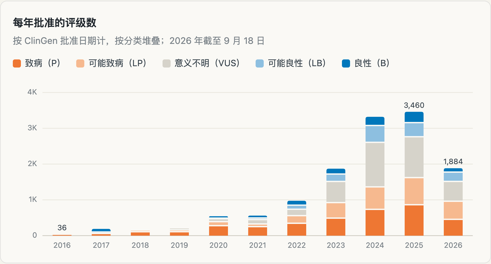
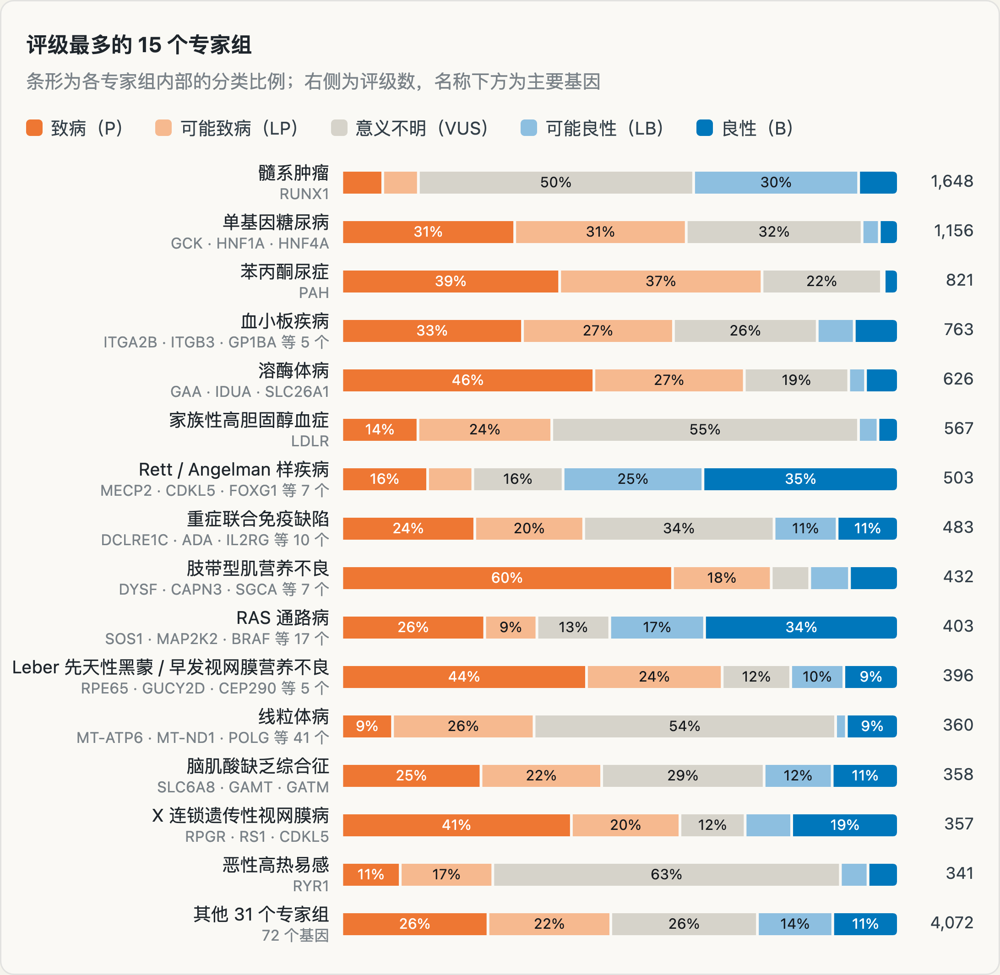
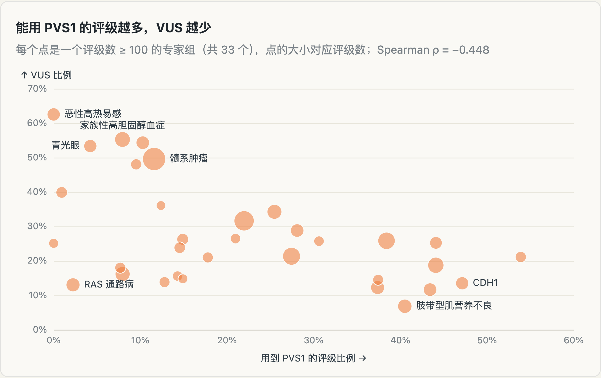
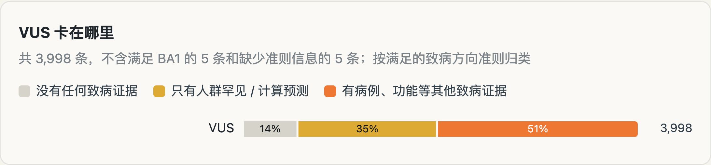
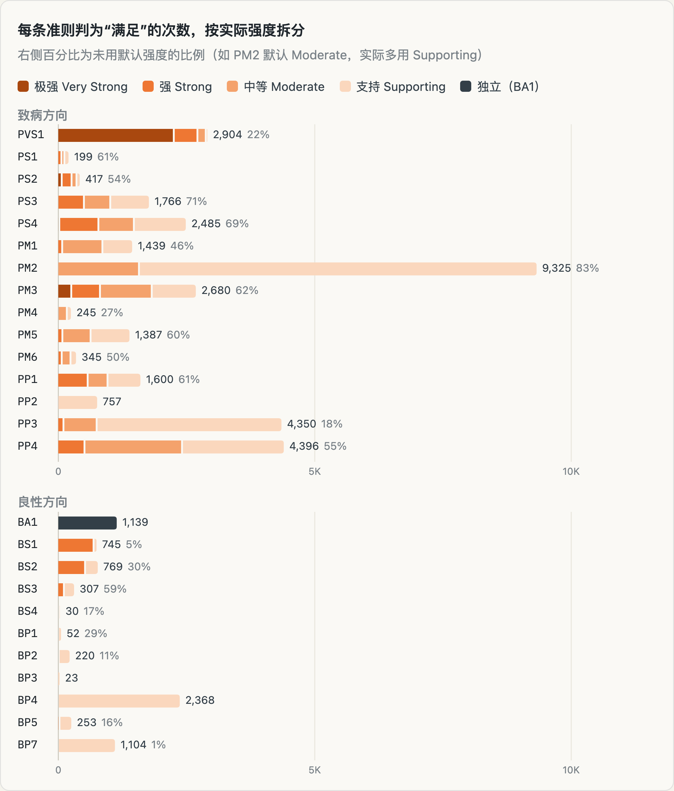
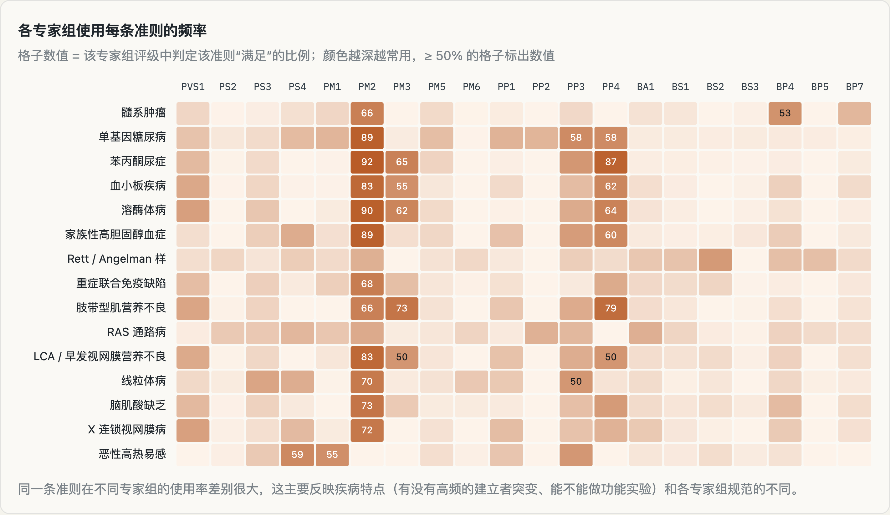
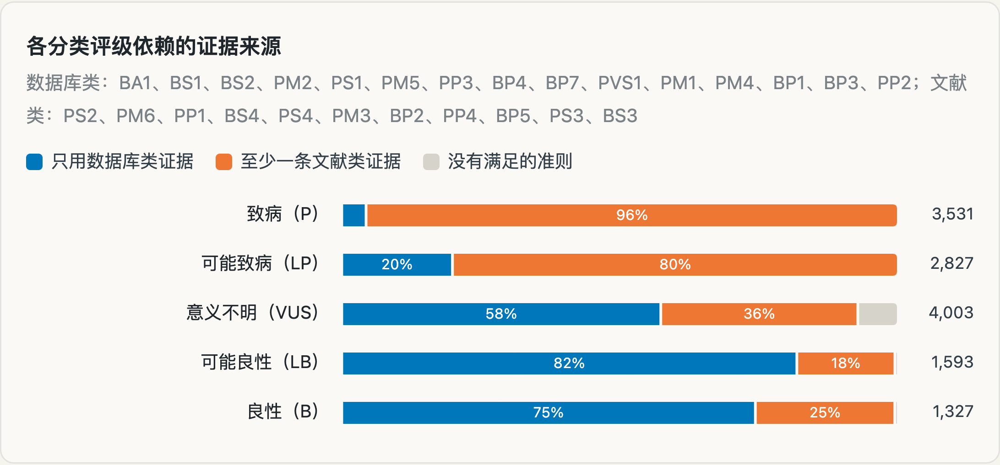
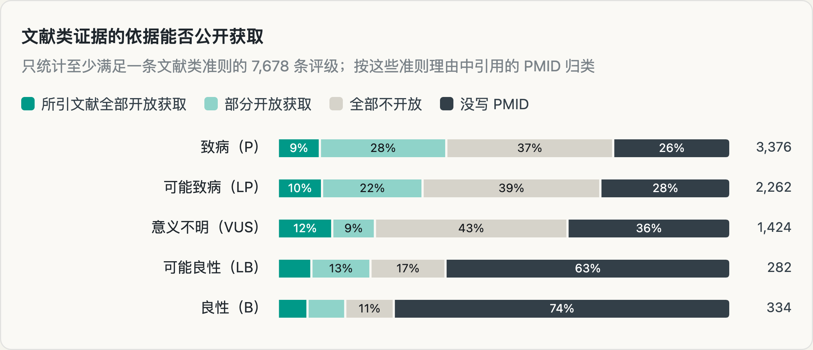
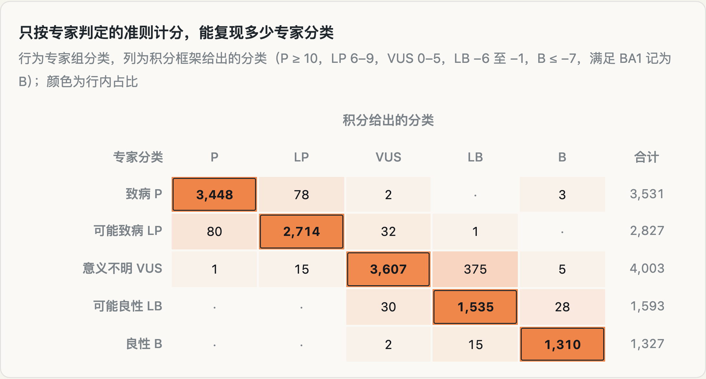

我们曾经在《燃烧 Token 不是程序员的特权，现在轮到遗传分析师了》里做过支持 ClinGen VCEP 规范的 AI 评级技能，后来也整合进了遗传咨询技能包。当时用一个变异试了试这个技能的能力和局限，但作为一个工具，这远远不够。一个好的 AI 应用，尤其是医学这种严肃场合的 AI 应用，需要一套验证体系。基座大模型、harness 工具，甚至技能里措辞的改变，都可能改变 AI 的行为结果。

所以我们还是需要一个可靠的基准来做大规模验证。ClinGen Evidence Repository（ERepo）是目前唯一公开、每条评级都带逐条准则判定的专家评级集合：哪些准则满足、用了多强的证据、依据是什么，每一条都写得很清楚。所以理论上讲，它不仅能检验 AI 的最终结论，还能检验每一条证据判得对不对。

但这是真的么？今天我们来一一拆解，看看里面有什么，专家是怎么判的，哪些部分 AI 有机会做对，而哪些部分 AI 根本拿不到依据。

## 省流版

- **ERepo 是一个可以逐条对答案的基准。** 12.6 万条准则判定全部公开，只按专家判定的准则和强度计分，就能复现 95.0% 的专家分类。
- **最努力的是髓系肿瘤专家组，VUS 多少主要看致病机制。** 它只评 *RUNX1* 一个基因，就占了全部记录的 12%。专家组能用 PVS1 的比例越高，VUS 越少（ρ = −0.448）。
- **一半 VUS 是缺证据，证据冲突的只占两成。** 49% 的 VUS 没有任何致病证据，或者只有人群频率和计算预测。
- **专家组真的在调整证据强度。** 48% 的“满足”判定没有用 ACMG 默认强度，用通用规则的 AI 会在这些地方和专家分歧。
- **40% 的评级只靠数据库就能判，但致病结论几乎都离不开文献。** 5,326 条评级只用到数据库类证据，致病评级中 96% 至少有一条文献类证据。
- **很多依据 AI 根本拿不到。** 有文献类证据的评级中，32% 一个 PMID 都没写，多为内部病例；所引文献全部开放获取的只有 10%。

## 这个基准里有什么

ERepo 收录的是各 VCEP 按自己的疾病规范完成并发布的变异评级。每条记录对应一个变异和一种疾病，列出最终分类，以及专家组对每条 ACMG/AMP 准则的判定（Met 或 Not Met）、实际采用的强度和文字理由。

这次共抓到 13,293 条评级，去掉 7 条已撤回的，分析其余 13,286 条，涉及 13,147 个变异、175 个基因、125 种疾病和 46 个专家组。同一变异在不同疾病或专家组下可以各有一条评级，所以记录数比变异数略多。逐条准则判定共 126,339 条，其中“满足” 41,305 条，明确“不满足” 85,034 条。准则理由里还提到了 7,425 篇不同文献。

别的公开数据集（比如 ClinVar）大多只有最终结论。ERepo 同时给出输入证据和输出结论，可以在准则层面打分：AI 判对了哪几条、判错了哪几条。其中 8.5 万条专家明确排除的准则也能用上，专门检查 AI 会不会过度判定。

评级在 2023 年后才大量出现，近三年占了全部的 65%。

## 哪个专家组最努力？

工作量很不均匀。髓系肿瘤专家组只评 *RUNX1* 一个基因，就交出了全部记录的八分之一（1,648 条），其次是单基因糖尿病（1,156 条）和苯丙酮尿症（821 条）。

各专家组的结论构成差别也很大，而决定 VUS 多少的主要是疾病的致病机制。能大量使用 PVS1（零效变异）的功能丧失型疾病，VUS 少；以错义或功能获得为主的疾病，VUS 多。

所以评测成绩必须按专家组分层报告。只看总准确率，髓系肿瘤一组就会左右结果；AI 在功能丧失型基因上的好成绩，也不能外推到错义主导的基因。

## 哪些变异最难下结论？

VUS 是最大的一类，共 4,008 条，占 30%。把 VUS 按满足的致病证据拆开看，553 条（14%）没有任何致病证据，1,417 条（35%）只有人群罕见（PM2）和/或计算预测（PP3）。约一半 VUS 卡在证据太少，专家并没有拿不准。致病和良性证据同时出现的只有 814 条（20%），其中不少只是 PM2_Supporting 加 BP4 这样的弱证据。

VUS 不该被当作答错的“中间档”。只涉及人群频率和计算预测的那一半，AI 完全可以做到和专家一致；另一半涉及病例和功能证据，AI 能不能判对，取决于它能不能找到同样的依据。

## 专家组怎么用准则？

48% 的“满足”判定没有用 ACMG 默认强度，而且调整方向很有规律：PM2 有 83% 降为 Supporting，PS3 有 71%、PS4 有 68% 按证据量降级，PP4 有 55% 升为 Moderate 或 Strong，连 PVS1 也有 22% 没用 Very Strong。这些调整在各专家组的规范里都有明确规定，正是通用 ACMG 规则里没有的部分。

同一条准则在不同专家组的使用率也差别很大，主要反映疾病特点（有没有高频的建立者突变、能不能做功能实验）和各组规范的不同。用通用 ACMG 默认强度的 AI，在近一半的“满足”判定上会和专家不一致。评测必须以对应专家组的规范为准，这也是评级技能把 VCEP 规范作为核心上下文的原因。

## 判一个致病变异，靠的是什么？

准则分成数据库类（人群频率、计算预测、变异类型和位置、已知致病位点）和文献类（新发、家系、病例、反式、表型、功能实验）。

良性结论主要靠数据库，可能良性中 82%、良性中 75% 只用到数据库类证据。致病结论则几乎都要文献，致病评级中只靠数据库类证据的仅 155 条（4%），多数是 PVS1 加 PM2 再配同位点证据。

最常见的准则组合也印证了这一点。致病评级最常见的是 PVS1 + PM2_Supporting + PP4（163 条），在 PVS1 + PM2_Supporting 之上，通常还要一条病例或表型证据（PP4、PM3、PS4）。可能致病评级里最常见的组合，则只有 PVS1 + PM2_Supporting 两条（354 条，12.5%）。

这样就可以把基准分成两个赛道。数据库赛道是只靠数据库类证据的 5,326 条评级（40%），考的是注释和规则执行，AI 理应接近满分。文献赛道是其余的评级，几乎所有致病结论都在这里，考的是找文献、读文献。

## AI 拿得到专家的依据吗？

文献是 AI 评级最难啃的骨头：检索不稳定，全文常在付费墙后，关键信息藏在补充材料里。这批数据可以让我们充分了解影响有多大。

至少满足一条文献类准则的评级有 7,678 条，其中 2,437 条（32%）在这些准则的理由里一个 PMID 都没写，依据多是专家组成员实验室的内部病例；文献类“满足”判定中有 17% 明确写了 internal、unpublished 等字样。引用了 PMID 的评级中，所引文献全部开放获取的只有 752 条，一篇开放获取都没有的有 2,836 条。

被引的 7,425 篇文献，中位发表年份是 2013 年。被引最多的是 RASopathy 专家组自己的共识方法文章（PMID 29493581），194 条评级在理由中提到了它。

所以文献赛道还要再细分。依据是未发表内部病例的评级，AI 无论如何拿不到，应单独标记，不计入“答错”；依据在付费墙后的，评测时要说明 AI 有没有拿到全文。否则测出来的是文献获取能力，不是评级能力。

## 怎么用它评测 AI

用 ClinGen SVI 推荐的贝叶斯积分（Supporting 1 分、Moderate 2 分、Strong 4 分、Very Strong 8 分，致病为正、良性为负），只把专家判定为“满足”的准则加总，就能复现 12,614 / 13,281（95.0%）的专家分类。在这个基准上，最终分类基本由逐条准则决定，AI 只要把每条准则判对，分类自然就对。

对不上的 667 条中，524 条专家结论比积分更偏致病，其中 375 条是积分为负、专家仍保留为 VUS 的记录；143 条更偏良性。最多的是髓系肿瘤 132 条（占该组 8%）、线粒体病 58 条（16%）、Rett / Angelman 样疾病 37 条（7%）、家族性高胆固醇血症 34 条（6%）和单基因糖尿病 30 条（3%）。这些正是专家组专用规则起作用的地方，可以单独拿来检验 AI 是否真正掌握了 VCEP 规范。

评测可以这样设计：

1. 按准则打分，不只看最终分类。逐条比较 AI 与专家的 Met / Not Met 和强度，8.5 万条“不满足”同样计分。
2. 分三个赛道报告：数据库赛道（40%）；文献赛道，区分可公开获取、付费、无 PMID 三种依据；VCEP 规则赛道，也就是积分对不上的 667 条。
3. 按专家组分层，至少把功能丧失为主和错义为主的专家组分开报告。
4. 屏蔽答案。ClinGen 评级会同步到 ClinVar，带联网搜索的 AI 可能直接查到专家结论。评测时要禁止访问 ClinVar 和 ERepo 上的对应记录，并检查 AI 引用的来源。

## 这些数字说明不了什么

这里只描述专家组已发布的结论，不对任何具体变异做临床解读。另外几点：

- ERepo 只覆盖已有 VCEP 的疾病和基因，少数专家组又贡献了大部分记录，这里的比例不能外推到全部临床变异。
- 专家结论是参照，不是绝对真值。专家组会随新证据更新评级，AI 与专家不一致时，应回到具体证据看谁的依据更充分。
- 各专家组的记录方式不同。有的列出全部 26 条准则（含 Not Met），有的只列满足或讨论过的准则，所以“不满足”次数不适合在专家组之间比较。
- 积分只作参照，各专家组的分类以自己的规范为准。积分对不上的评级体现的是专用规则，不是错误。
- PMID 从准则理由的自由文本中提取，引用了不等于这篇文献支持该准则，也可能是审阅后认为证据不足的文献。只出现在总体摘要中的文献没有计入，“内部病例”按 internal、unpublished 等字样识别，会有遗漏。
- 数据是 2026-10-11 的快照。7 条已撤回的评级不计入分析，另有 5 条记录因 ClinGen 接口报错，缺少逐条准则信息。

*数据来自 ClinGen Evidence Repository（erepo.genome.network），2026-10-11 抓取；文献年份与开放获取状态来自 Europe PMC。*
