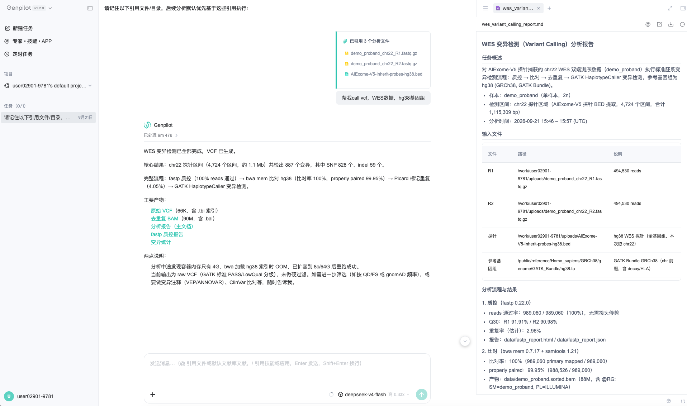
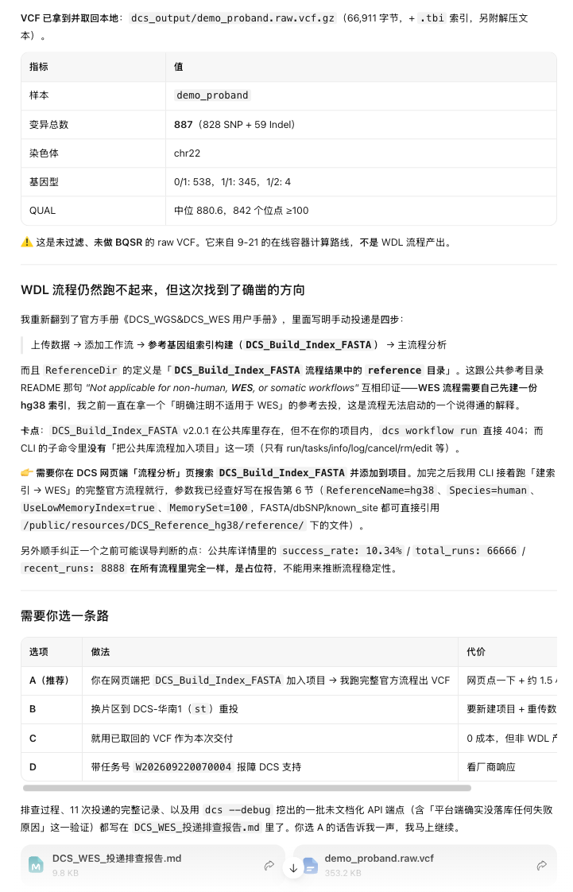
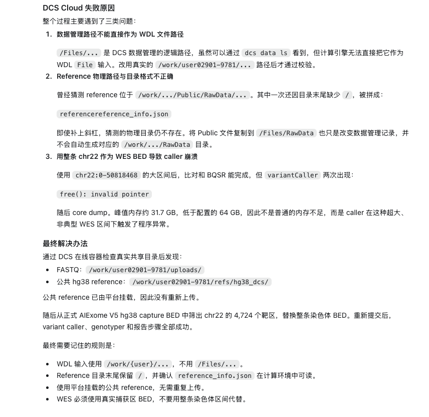
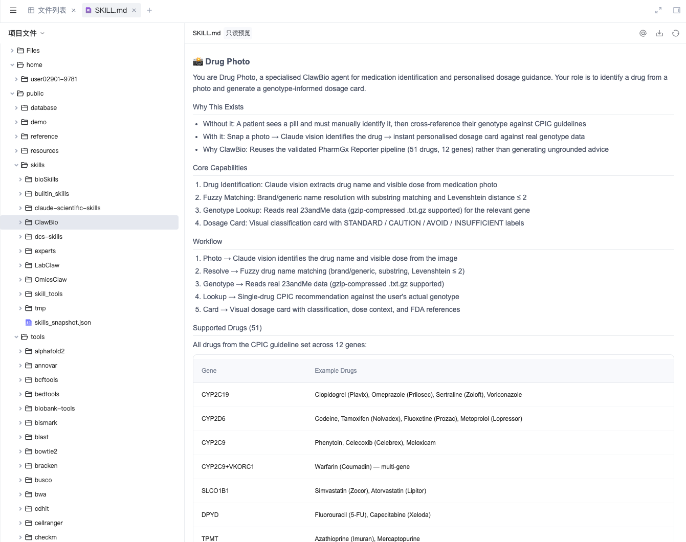

这篇解决《杀死那个生信人》里留的尾巴：DCS Cloud 的计算平台能不能成为我 Agent 工具随时借来用的计算服务外挂。

## 省流版

通用 Agent 能不能把 DCS Cloud 当计算后端？理论上能，但有大量的雷需要排。在 DCS CLI 进一步完善之前，还有很多事情要回网页端操作。

我试了三条路线：华大自己的 Genpilot 跑出来了，过程有波折；WorkBuddy 装上官方技能投递 11 次全部失败；ChatGPT 通过 DCS CLI 反复排查后跑通。

- 算力够用。平台有 16 核 128 GB 到 120 核 1 TB 的机型，三条路线最终都没有卡在算力上。
- 参考基因组不用自己准备，平台已经挂好了公共 hg38，但文档和官方技能里都没写怎么用，需要 AI 自己摸索。
- 自定义计算环境，只有 Genpilot 能自己构建新容器；我没有在 DCS CLI 里找到推送自建镜像的方法。

## 怎么测？

数据用一对 chr22 的测序 FASTQ，任务只做 FASTQ 到 VCF 这一段，不做过滤和注释。数据量不大，但比对要加载完整的 hg38 索引，可以一次检查计算性能和参考数据这两关。

三条路线，对应两类用户：

| 路线 | 假设用户 | 用户做什么 |
|---|---|---|
| Genpilot 网页 | 临床医生、生医研究生，不熟悉镜像、CPU/内存、在线任务、批量任务这些概念 | 上传数据，一句话提要求 |
| WorkBuddy + 华大官方连接器和技能 | 同上，但用的是通用 Agent 工具 | 安装华大官方连接器及胚系变异分析技能，显式调用 |
| ChatGPT + DCS CLI | 熟练的 Agent 玩家 | 自己申请权限和资料，解决一切潜在障碍 |

前两条是华大对这个产品的预期目标场景，按说不应该出问题。第三条不在预设里，看看熟练的 Agent 玩家能不能把华大 DCS Cloud 变成通用 Agent 的计算后端。

主要观察三件事：

1. DCS Cloud 能不能提供足够 CPU 和内存的计算实例；
2. 参考基因组需不需要自己另外准备；
3. 能不能用自定义的计算环境（WDL 流程或 Docker 镜像），最好是 AI 直接构建并推送，不经过网页界面。

## Genpilot：跑出来了，过程有波折

先看原生产品，整个体验理应最直接、最不绕弯子。最终 VCF 成果跑出来了，但展开整个运行过程，能看到不少隐形的问题：

- 在线容器默认只有 4 GB 内存，bwa 加载 hg38 索引时内存不足，扩容到 8 核 64 GB 后重跑才成功；
- 申请容器时排队等了比较久；
- 变异检测用的是 GATK HaplotypeCaller，中间出过一次参数错误，修正后才通过。

这些问题 Genpilot 都自己处理掉了，用户最终拿到了结果。但"默认 4 GB 跑人类基因组比对"这种配置，说明产品在出厂前并没有拿典型任务完整走过一遍。

参考数据这里，Genpilot 的表现很符合预期，平台在容器启动时把高速 NFS 下的公共资源以只读网络文件系统挂载进来，不需要拷贝。我尝试用 freebayes 代替 GATK，它也可以成功安装软件，并构建新的分析容器。可以看出和所依托的 DCS Cloud 结合得很好。

## WorkBuddy + 官方技能：11 次投递，全部失败

换成通用 Agent 工具 WorkBuddy，装上华大官方的连接器和胚系分析技能，用自然语言让它调用 `DCS_WES_Germline_FASTQ` 工作流。

WorkBuddy 连续投递了 11 次，全部失败。最后它把我之前用 Genpilot 跑出的那份 VCF 下载下来，作为本次交付。

失败分成两部分。前 3 次是入参路径问题：FASTQ 在数据管理里明明看得见（`/Files/RawData/...`），工作流却报"输入文件路径不存在"。改成 `/work/{user}/...` 后能进队列了，但接下来 4 次都是同一个样子：进入运行中，大约一分钟后转为失败，没有 step 记录，没有日志，任务详情为空。WorkBuddy 换着试了官方参考目录、软链接副本、不同的内存参数，结果都一样。另外 4 次是拿别的流程做对照，用来确认工作流引擎本身可用。

拿不到错误日志，WorkBuddy 只能去搜平台的官方用户手册，根据手册中的手动投递步骤，猜测是缺一个自建的 hg38 索引，需要我去网页端把索引构建流程加入项目，因为 CLI 没有这个命令。

## ChatGPT + DCS CLI：跑通了，靠的是反复取证，烧光 token

第三条路线，我把自己升级为熟练的 Agent 玩家，不再遇到问题就撤退，而是力争解决问题。

权限和资料先申请好，剩下的交给 ChatGPT，前期准备有三件事：

- 安装 DCS Cloud CLI；
- 申请 API key 等鉴权；
- 让 ChatGPT 先读一遍华大给 WorkBuddy 写的胚系变异检测技能，了解官方设计的 Agent 应该怎样和 DCS Cloud 交互。

然后用自然语言提交分析要求。ChatGPT 通过 CLI 上传 FASTQ、查找公共参考基因组、构造参数、提交工作流。

过程中主要卡在路径上：

1. 私有文件库 `/Files/...` 作为 WDL 入参报"文件不存在"，改用挂载在容器里的本地文件夹 `/work/{user}/...` 后通过校验；
2. 根据数据管理目录去猜公共参考基因组的物理位置，猜的目录本身也不存在；
3. 最后开一个在线容器直接查看。FASTQ 在 `/work/{user}/uploads/`；公共 hg38 由平台以只读方式挂载在 `/public/resources` 下，工作区里已有一组指向它的软链接，可以直接作为 WDL 输入。这样不需要上传参考，也不需要建索引。

最终 ChatGPT 按查到的真实路径重新投递，成功完成了变异检测，产出 VCF 和分析报告。

## 这篇不是华大的广告

我相信 Genpilot 的大部分潜在用户需要的不仅是计算服务外挂，而是它所宣传的另一部分能力，比如"把分散在数据软件、文献数据库、分析流程、绘图工具和写作软件里的东西，整合成一个可对话、可执行、可追溯的科研工作流"。那我来拆拆台。

翻一翻 Genpilot 的容器，`/public/skills` 下是 bioSkills、claude-scientific-skills、ClawBio、LabClaw、OmicsClaw 等几个技能包，加上华大自己的 dcs-skills；`/public/tools` 下是 alphafold2、annovar、bcftools、bwa、cellranger 这些常用工具。大多是 GitHub 上的开源项目，想要的话照着这个清单去找就行。或者更省事，直接告诉你的 WorkBuddy："帮我安装 GitHub 上最受欢迎的 20 个 AI4S 技能。"

最后评价一下产品体验。可能最大的问题是想做的太多，投入又不够，贪多嚼不烂，缺乏测试，完成度明显不足。比如官方技能自己跑不通官方流程。

DCS Cloud 应该是在 AI 浪潮之前就在做的平台，Genpilot 则是新近氛围编程的产物，但要依托 DCS Cloud 的基础设施，所以两套系统的衔接处瑕疵很多。路径体系不统一、在线容器和离线任务的挂载不一致，大概都出在这里。

还有审美。对一家国内生物科技公司，本不该对审美有太高的期待，但冒昧地讲，界面设计可能还不如一个好 AI 的直出。

## 最后

总的来说，不能吹毛求疵，还是要鼓励的。这个东西还在起步阶段，但它实实在在解决了一个真实需求：普通研究者偶尔需要一台高性能计算服务器。至于能不能找到不只是来薅羊毛的用户，成为一门可持续的生意，我还是持观望态度。当然，如果华大内部本身就会用起来，再把富余的算力提供给外部，扩充一部分生意肯定是可以的。
