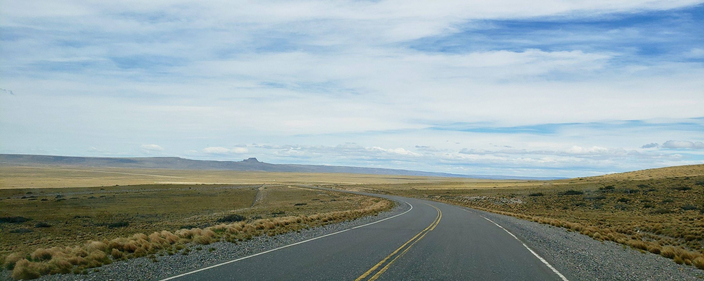

<figure class="banner">
  
  <figcaption><a href="/human/2020/08/23/pan-american-patagonia.html">Ruta 40, Patagonia · 2018</a></figcaption>
</figure>

## About me

I'm a bioinformatician who enjoys turning complex biological data into something humans can actually understand. My work focuses on applying technology to medical genetics—rare disease diagnostics, cancer treatment insights, and all things precision medicine.

## When I'm not decoding genomes

You'll probably find me:

- exploring a new place just because a photo looked nice,
- snowboarding down a mountain at questionable speeds, or
- editing travel videos for YouTube

## What I write

I write here, usually split between two moods:

- [Professional mode](/blog/#professional): technical insights and the occasional industry observation
- [Human mode](/blog/#human): travel stories and small lessons picked up along the way

[Read the blog →](/blog/)

---

**Get in touch:** muwenbo.prc@gmail.com

[LinkedIn](https://linkedin.com/in/wenbo-mu) · [YouTube](https://www.youtube.com/@LuckyNomadX) · [GitHub](https://github.com/muwenbo)
